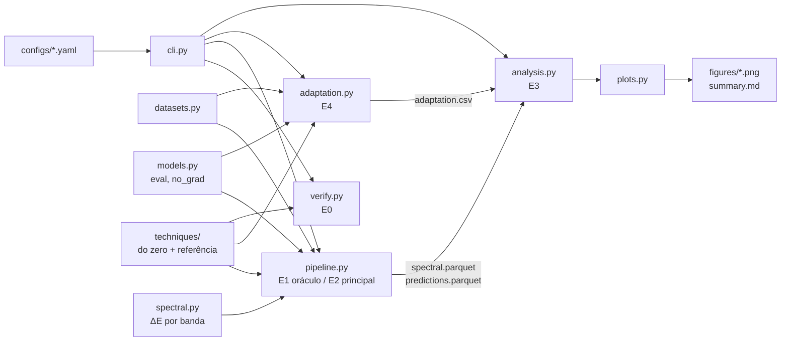
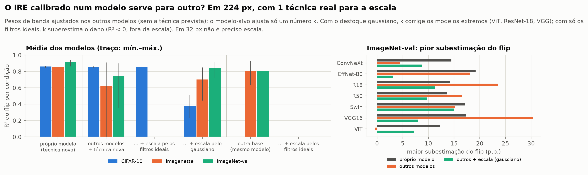

# Modelagem detalhada — Quando melhorar piora

> Visão geral e principais resultados: [README.md](README.md) · resultados completos: [results.md](results.md) · site: [beatrizalmeidaf.github.io/pdi](https://beatrizalmeidaf.github.io/pdi/).

Aplicação experimental que acompanha a revisão sistemática em [revisao_literatura/main.tex](revisao_literatura/main.tex).
Ela mede, para cada técnica clássica de pré-processamento e cada nível de intensidade, **quanta energia espectral foi removida ou adicionada em cada banda de frequência** e **quanto a decisão de classificadores pré-treinados muda**, e testa se a primeira prevê a segunda.

> **Pergunta de pesquisa.** Técnicas clássicas de pré-processamento aplicadas para melhorar a qualidade perceptual (denoising, suavização, equalização de histograma, aguçamento, super-resolução) degradam sistematicamente a acurácia de classificadores CNN pré-treinados? Essa degradação se explica pela remoção seletiva de componentes de alta frequência que o classificador usa como sinal discriminativo, e é possível prever a magnitude do dano a partir da energia espectral removida em cada banda?

---

## Sumário

1. [Hipóteses](#1-hipóteses)
2. [Análise das duas propostas do `prompt.txt`](#2-análise-das-duas-propostas-do-prompttxt)
3. [Das lacunas às decisões de desenho](#3-das-lacunas-às-decisões-de-desenho)
4. [Variáveis](#4-variáveis)
5. [Quantificador espectral](#5-quantificador-espectral)
6. [Datasets e classificadores](#6-datasets-e-classificadores)
7. [Experimentos E0–E5](#7-experimentos-e0e5)
8. [Análise estatística](#8-análise-estatística)
   - [8.1 Limiares de dose e janela operacional](#81-limiares-de-dose-e-janela-operacional)
   - [8.2 Índice de Risco Espectral (IRE)](#82-índice-de-risco-espectral-ire--fórmula-proposta)
   - [8.3 Validação perceptual: BRISQUE e pessoas](#83-validação-perceptual-brisque-e-estudo-com-pessoas)
9. [Arquitetura do código](#9-arquitetura-do-código)
10. [Como rodar](#10-como-rodar)
11. [Saídas](#11-saídas)
12. [Custo computacional](#12-custo-computacional)
13. [Ameaças à validade](#13-ameaças-à-validade)
14. [Status e o que falta](#14-status-e-o-que-falta)
   - [14.3 Rodada final](#143-rodada-final-imagenet-val-12-modelos-3-sementes)

---

## 1. Hipóteses

As quatro questões da revisão (QP1–QP4) viram hipóteses testáveis. Cada uma tem um experimento e um critério de decisão.

| # | Hipótese | QP / lacuna | Experimento | Critério |
|---|---|---|---|---|
| **H1** | Técnicas que **removem** energia (suavização, Wiener, JPEG de baixa qualidade, bicúbica) degradam a acurácia de forma monotônica com a dose. As que **redistribuem** (CLAHE, equalização) têm efeito pequeno ou positivo. As que **adicionam** alta frequência (aguçamento, SR aprendida) também degradam em doses altas, porque empurram a entrada para fora da distribuição de treino. | QP1, lacuna 1 | E2 | Sinal e monotonicidade de Δacc por nível; McNemar pareado com correção de Holm |
| **H2** | O **ΔE medido por banda** prevê Δacc melhor do que o parâmetro nominal (σ, k, clip…) e do que métricas de pixel (PSNR/SSIM), **inclusive para técnicas que o modelo nunca viu**. | QP3, lacuna 2 | E3 | R² *leave-one-technique-out* (LOTO): `spec_*` > `dose_rank`, `psnr`, `ssim` |
| **H3** | A banda crítica **não é universal**: depende do dataset (32 px × 224 px) e da arquitetura (CNN × ViT). Um perfil de sensibilidade medido com filtros ideais transfere apenas **parcialmente** para as técnicas reais. | QP3, lacuna 4 | E1 + E3 | Perfis S(banda) diferentes entre datasets/arquiteturas; R² de transferência oráculo → técnicas < R² LOTO |
| **H4** | Para técnicas **invertíveis** ou redistributivas (CLAHE, aguçamento), a maior parte da queda é **domain shift** (recuperável com adaptação). Para técnicas **destrutivas** (mediana, JPEG Q10, blur forte), sobra **perda de informação**. | QP2, lacuna 3 | E4 | Fração recuperável R ≈ 1 × R ≈ 0 |
| **H5** | A **coerência de fase** por banda (estrutura preservada) acrescenta poder explicativo à magnitude da energia. | QP2, lacuna 4 | E3 | `spec_bands+coh` > `spec_bands` no LOTO e na AUC por imagem |
| **H6** | Cada técnica tem um **limiar de dose** (BMD) abaixo do qual o classificador não perde acurácia. Para as técnicas redistributivas existe uma **janela operacional**: a dose que já cumpre o objetivo visual fica abaixo do limiar. Para as destrutivas, a janela é vazia. | QP1, QP4 | E2 (varredura densa) | BMD com IC por bootstrap; janela = [dose perceptual, BMDL] |
| **H7** | O **IRE** (fórmula proposta, §8.2), calibrado uma vez por modelo, prevê o limiar de técnicas que ele não viu. | QP3, lacunas 2 e 4 | E3 | Limiar previsto (LOTO) dentro do IC do observado; R² do flip por condição |

---

## 2. Análise das duas propostas do `prompt.txt`

O prompt traz duas propostas. A primeira é enxuta: só as técnicas com lacuna de evidência, ΔE por banda e inferência estrita. A segunda é mais ampla: a ementa toda, 4–5 níveis, vários datasets, regressão e fine-tuning. Confrontei as duas com a revisão. Ficou o que a literatura sustenta e entrou o que faltava para responder à pergunta.

| Ponto | Proposta 1 | Proposta 2 | Decisão | Por quê (revisão) |
|---|---|---|---|---|
| Técnicas | Só CLAHE, *unsharp*, SR (bicúbica × rede) | Ementa inteira (gauss, mediana, bilateral, USM, laplaciano, HE, CLAHE, Wiener, JPEG, SR) | **Grupo primário** = HE, CLAHE, USM, laplaciano, SR bicúbica/ESPCN/FSRCNN. **Grupo de controle** = gauss, mediana, bilateral, Wiener, JPEG | A Tab. de cobertura mostra 0 estudos para aguçamento e SR e 1 para equalização: são o alvo (lacuna 1). Abandonar blur por completo, porém, enfraquece o estudo. (a) O controle **replica números conhecidos** (Vasiljevic [b4], Wu [b28], Hendrycks [b6]) e valida o pipeline. (b) A regressão precisa de ΔE **negativo e positivo** em todas as bandas: suavização remove, aguçamento adiciona. Sem o controle, o preditor só veria metade do eixo. |
| Dose | Medir ΔE em vez do parâmetro | 4–5 níveis por técnica | **5 níveis** (3 para SR) **e** ΔE medido; o parâmetro nominal entra só como *baseline* a ser vencido | Lacuna 2: a literatura mede a dose pelo parâmetro (raio, σ). Os níveis geram a variação; o ΔE é o eixo comum que permite juntar técnicas diferentes numa mesma curva. |
| Bandas | Baixa/média/alta | Baixa/média/alta | **16 anéis finos + 3 bandas agregadas**, em ciclos/pixel, com janela de Hann | Maiya [b22] e Tsuzuku & Sato [b19] mostram que a banda crítica pode ser baixa ou média e muda com o dataset (lacuna 4). Três bandas fixas escondem isso. A janela evita a falsa alta frequência criada pela borda da DFT. |
| Fase | — | — | **Nova:** coerência espectral por banda | Shao et al. [b24]: filtros tradicionais não produzem o deslocamento espectral limpo que se atribui a eles. A magnitude sozinha pode não bastar (H5). |
| Calibração | — | — | **Novo E1:** oráculo com filtros ideais (remove/dobra **uma** banda) | Mede a sensibilidade S(banda) de cada modelo diretamente, à la Jo & Bengio [b14] e Yin et al. [b18]. Permite o teste mais forte de "prever o dano": ajustar só no oráculo e prever as técnicas reais. |
| Protocolo | Estritamente `model.eval()`, zero fine-tuning | Repetir com re-treino/fine-tuning | **Principal = inferência congelada** (responde à pergunta). **E4 complementar** = BN-adapt, sondas lineares e fine-tuning opcional | Só a inferência congelada **não separa** domain shift de perda de informação: mede a soma dos dois. Ortiz-Jiménez [b23] mostram que a assimetria treino/teste domina o efeito (93 % → 27 % só no teste, −3 p.p. com treino simétrico). Para atacar a lacuna 3 é preciso comparar com um modelo que **pode se adaptar**. As sondas fazem isso sem tocar no extrator, então o "zero fine-tuning" do protocolo principal é preservado. |
| Métrica de decisão | *Decision flip* | Queda de acurácia | **Ambas** + KL(p_orig‖p_proc) + Δp(classe correta) por imagem | O *flip* capta mudanças que a acurácia agregada esconde (acertos e erros que se compensam). As medidas contínuas dão poder estatístico por imagem. |
| Datasets | ImageNet | CIFAR-10/100 + Tiny-ImageNet ou subconjunto do ImageNet; ImageNet-C opcional | **CIFAR-10** (32 px) + **Imagenette** (224 px, 10 classes do ImageNet) + `imagenet_val` local opcional | Tiny-ImageNet não tem pesos pré-treinados padrão (exigiria treinar, o que contraria o protocolo). O Imagenette usa índices do ImageNet-1k, então os pesos oficiais funcionam sem adaptar a cabeça. ImageNet-C mede corrupções, não aprimoramento; fica como E5 opcional (QP4). |
| Modelos | ResNet-50, VGG-16, EfficientNet | ResNet-18, ResNet-50, ViT pequeno | ImageNet: **ResNet-18, ResNet-50, VGG-16-BN, EfficientNet-B0, ViT-B/16** (+ ConvNeXt-T, Swin-T disponíveis). CIFAR: **ResNet-20, ResNet-56, VGG-16-BN, MobileNetV2** | Une as duas listas. A comparação CNN × Transformer testa o viés espectral arquitetural (Tsuzuku & Sato [b19]: a sensibilidade de Fourier vem da convolução). |
| Implementação | — | "Do zero, cobrindo a ementa" | Todas as técnicas **do zero em NumPy**, validadas contra OpenCV/PIL/SciPy (E0). *Backend* `reference` para execuções grandes | Atende à ementa. A validação garante que o resultado não é artefato da implementação. A única exceção é a rede de SR, que usa pesos públicos via `cv2.dnn_superres`. |

---

## 3. Das lacunas às decisões de desenho

| Lacuna (revisão, §II.G) | O que a literatura faz | O que este estudo faz | Onde no código |
|---|---|---|---|
| **1. Escopo de técnica**: equalização, aguçamento e SR quase sem evidência | Concentra-se em blur, ruído e denoising | Grupo primário com 7 técnicas sem evidência + grupo de controle que replica a literatura | [techniques/](src/pdi_spectral/techniques/) |
| **2. Variável independente**: dose medida pelo parâmetro | σ, raio, qualidade JPEG | ΔE medido por banda e por imagem; o parâmetro é *baseline* | [spectral.py](src/pdi_spectral/spectral.py), [analysis.py](src/pdi_spectral/analysis.py) (`dose_rank` × `spec_*`) |
| **3. Confundimento** entre perda de informação e domain shift | Inferência congelada **ou** re-treino, raramente os dois no mesmo estudo | Mesmas condições sob 5 níveis de adaptação; fração recuperável R | [adaptation.py](src/pdi_spectral/adaptation.py) |
| **4. Fragilidade da hipótese espectral**: banda crítica depende do dataset; magnitude ≠ estrutura | 3 bandas fixas ou uma métrica escalar (Yin [b18]) | Anéis finos, dois datasets de resoluções diferentes, CNN × ViT, coerência de fase, oráculo calibrado e teste de transferência | [oracle.py](src/pdi_spectral/techniques/oracle.py), E1, E3 |

---

## 4. Variáveis

### 4.1 Independentes: técnica × nível

Todas operam em RGB uint8 na **resolução exata de entrada do modelo**. A equalização e o CLAHE operam no canal Y (YCbCr) para preservar a cor.

| Técnica | Grupo | Família (ementa) | Parâmetro de dose | Níveis | Efeito espectral esperado |
|---|---|---|---|---|---|
| `hist_eq` | primário | equalização | α (mistura com a equalizada) | 0.2, 0.4, 0.6, 0.8, 1.0 | redistribui (ganho global + mudança de forma) |
| `clahe` | primário | equalização | *clip limit* (grade 2×2 em 32 px, 8×8 em 224 px) | 1, 2, 3, 4, 6 | redistribui, realça média frequência local |
| `unsharp` | primário | aguçamento | *amount* (σ = 1) | 0.5, 1, 1.5, 2, 3 | adiciona média/alta |
| `laplacian` | primário | aguçamento | c em x − c∇²x | 0.25, 0.5, 0.75, 1, 1.5 | adiciona alta |
| `sr_bicubic` | primário | super-resolução | fator s (reduz por s e reconstrói) | 2, 3, 4 | remove alta (anti-aliasing) |
| `sr_espcn` | primário | super-resolução | fator s | 2, 3, 4 | remove e **sintetiza** alta |
| `sr_fsrcnn` | primário | super-resolução | fator s | 2, 3, 4 | idem |
| `gaussian` | controle | suavização | σ | 0.5, 1, 1.5, 2, 3 | remove alta (passa-baixa suave) |
| `median` | controle | suavização | k | 3, 5, 7, 9, 11 | remove alta, não linear (preserva bordas) |
| `bilateral` | controle | suavização | (σ_s, σ_r) | (1,.05) … (5,.3) | remove textura, preserva bordas |
| `wiener` | controle | restauração | janela k (ruído estimado) | 3, 5, 7, 9, 11 | remove alta adaptativamente |
| `jpeg` | controle | compressão | qualidade Q | 90, 70, 50, 30, 10 | remove alta em blocos 8×8 + artefatos |
| `oracle_*` | oráculo | calibração | banda, ganho, corte | 9 anéis × {0, 2}, 5 passa-baixa, 4 passa-alta | controlado |

**Protocolo de SR.** A imagem limpa é reduzida por s (aquisição em baixa resolução) e reconstruída ao tamanho original. A comparação de interesse é **ESPCN/FSRCNN × bicúbica**: as duas partem da mesma entrada reduzida, então a diferença isola o efeito do aprimoramento aprendido. A comparação com o original mede o efeito total.

### 4.2 Mediadora / preditora: ΔE por banda
Ver [§5](#5-quantificador-espectral). Também são registradas PSNR e SSIM como preditores concorrentes de "fidelidade em pixel".

### 4.3 Dependentes (por imagem × condição × modelo)

| Variável | Definição |
|---|---|
| `correct`, `correct_top5` | acerto top-1/top-5 |
| `correct_sub` | acerto top-1 restrito às 10 classes (Imagenette) |
| `flip` | predição mudou em relação à predição na imagem original (*decision flip*) |
| `kl` | KL(p_orig ‖ p_proc): quanto a distribuição de saída mudou |
| `dp_true` | variação da probabilidade da classe correta |
| `conf`, `entropy` | confiança e entropia da saída |
| (E4) `acc_frozen`, `acc_bn`, `acc_probe_{oo,op,pp}`, `acc_ft_{oo,pp}` | acurácia sob cada nível de adaptação |

### 4.4 Controles
- **Desenho pareado:** as mesmas imagens passam por todas as condições, e cada condição é aplicada **uma vez** e avaliada por **todos** os modelos.
- **Recorte fixo** (lado menor 256 → centro 224) aplicado **antes** da técnica, para que técnica e espectro atuem sobre exatamente o que a rede vê.
- `model.eval()` + `torch.no_grad()`; pesos oficiais V1; *seed* fixa para subconjuntos.
- Validação das implementações (E0).

---

## 5. Quantificador espectral

Implementado em [spectral.py](src/pdi_spectral/spectral.py). Para cada par (original x, processada y), na luminância:

1. Remove-se a média; o termo DC é medido à parte (`d_dc`, mudança de brilho).
2. Janela de Hann 2D, para reduzir o vazamento espectral da periodicidade implícita da DFT.
3. FFT 2D; potência P = |F|², normalizada para que Σ P ≈ variância dos pixels.
4. Frequência radial normalizada r = √(fx² + fy²) em **ciclos/pixel** (comparável entre 32 e 224 px). A potência é somada em **16 anéis** em (0, 0.5], mais um anel de cantos (0.5, 0.707], e em **3 bandas**: baixa (0, 0.10], média (0.10, 0.25], alta (0.25, 0.707].

Medidas por banda b:

| Medida | Fórmula | Interpretação |
|---|---|---|
| `dErel_b` | (E_b(y) − E_b(x)) / E_tot(x) | variação de energia; **aditiva** entre bandas (soma = variação total). Principal preditor |
| `dB_b` | 10 log₁₀(E_b(y)/E_b(x)) | variação relativa dentro da banda |
| `dshape_b` | E_b(y)/E_tot(y) − E_b(x)/E_tot(x) | mudança da **forma** do espectro, descontado o ganho global (importante para HE/CLAHE) |
| `D_b` | E_b(y − x) / E_tot(x) | energia da **perturbação** na banda (métrica de Yin et al. [b18]) |
| `coh_b` | Re⟨F_x, F_y⟩_b / √(E_b(x) E_b(y)) | coerência: 1 = estrutura/fase preservada (H5) |

`dErel` tem sinal: remover energia dá valor negativo, adicionar dá positivo. Os preditores separam as partes positiva e negativa (`dErel_b+`, `dErel_b−`), porque o efeito de adicionar e o de remover podem ser assimétricos.

Os testes em [tests/test_spectral.py](tests/test_spectral.py) verificam que: a identidade dá ΔE = 0 e coerência 1; as bandas particionam a energia total; sem janela, a energia total é igual à variância (Parseval); senoides caem na banda certa; o gaussiano remove e o *unsharp* adiciona alta frequência; o oráculo remove a banda pedida.

---

## 6. Datasets e classificadores

| Dataset | Resolução | Imagens (padrão) | Modelos | Pesos |
|---|---|---|---|---|
| `cifar10` | 32×32 | 2 000 do teste × 3 sementes (+5 000 de treino para E4) | ResNet-20, ResNet-56, VGG-16-BN, MobileNetV2, RepVGG-A0 | `chenyaofo/pytorch-cifar-models` (torch.hub) |
| `imagenette` | 224×224 | 2 000 do val × 3 sementes (+2 000 de treino para E4) | ResNet-18, ResNet-50, VGG-16-BN, EfficientNet-B0, ConvNeXt-T, ViT-B/16, Swin-T | torchvision `IMAGENET1K_V1` |
| `imagenet_val` | 224×224 | **50 000 (val inteiro)** | os mesmos 7 | idem |

Configurações da rodada final: [pub_cifar10.yaml](configs/pub_cifar10.yaml), [pub_imagenette.yaml](configs/pub_imagenette.yaml) e
[pub_imagenet.yaml](configs/pub_imagenet.yaml). Cada semente sorteia outro subconjunto de imagens e outro fine-tuning.

- No Imagenette a acurácia é medida **sobre as 1000 classes** (`correct`, rigoroso) e também restrita às 10 (`correct_sub`).
- O ImageNet-val fica em `data/imagenet/val/<wnid>/*.JPEG` (`paths.imagenet_val`). Na rodada final ele veio do espelho público
  `clip-benchmark/wds_imagenet1k`, com as 50 mil imagens e os rótulos oficiais; as acurácias de base batem com as do torchvision.
- Para caber em tempo, o ImageNet-val é dividido em fatias (`--set shard=k/n`), processadas em paralelo em 2 GPUs e unidas por
  `pdi merge-shards` ([scripts/run_publicacao.sh](scripts/run_publicacao.sh)).
- Não há ViT padrão para CIFAR-10. A comparação CNN × Transformer é feita no Imagenette/ImageNet.

---

## 7. Experimentos E0–E5

| Exp. | Nome | Pergunta | Comando |
|---|---|---|---|
| **E0** | Validação | As implementações do zero reproduzem OpenCV/PIL/SciPy? O quantificador mede o que diz? | `make verify` |
| **E1** | Oráculo espectral | Quanto custa remover ou dobrar **cada** banda, por modelo e dataset? → perfil S(banda) | `make oracle` |
| **E2** | Dose-resposta (principal) | Cada técnica × nível degrada a acurácia? Quanto ΔE ela produz? (inferência congelada) | `make main` |
| **E3** | Previsibilidade | ΔE prevê Δacc em técnicas não vistas? Melhor que dose nominal, PSNR e SSIM? O oráculo transfere? | `make analyze` |
| **E4** | Domain shift × informação | Quanto da queda é recuperável sem mudar o extrator (BN-adapt, sonda linear) ou com fine-tuning? | `make adapt` |
| **E5** | (opcional) Entradas degradadas | Na QP4, pré-processar imagens **realmente degradadas** (CIFAR-10-C) ajuda? | `bash scripts/download_data.sh cifar10c` + dataset extra |

### E4 em detalhe

O extrator pré-treinado é sempre o mesmo; muda apenas o quanto o modelo pode se ajustar ao domínio processado.

```
frozen     modelo original na imagem processada           (= E2)
bn_adapt   só re-estima as médias/variâncias do BatchNorm  (sem gradiente)
bn_oo      controle: o mesmo nas originais (desconta o ruído da estimativa)
probe_op   sonda linear treinada no ORIGINAL, testada no PROCESSADO
probe_pp   sonda linear treinada e testada no PROCESSADO
probe_oo   sonda linear treinada e testada no ORIGINAL     (teto)
ft_pp/oo   fine-tuning completo (opcional, finetune_epochs > 0)

R = (probe_pp − probe_op) / (probe_oo − probe_op)
    R ≈ 1 → domain shift (a informação continua lá)
    R ≈ 0 → perda irreversível de informação
info_loss = probe_oo − probe_pp
```

---

## 8. Análise estatística

Implementada em [analysis.py](src/pdi_spectral/analysis.py).

1. **Por condição** (dataset × modelo × técnica × nível): acurácia, Δacc com IC 95 % pareado, taxa de *flip*, KL e médias espectrais. Significância por **teste exato de McNemar** (acertos perdidos × ganhos, pareado por imagem), com **correção de Holm** por modelo.
2. **H2: validação cruzada *leave-one-technique-out*.** Para cada modelo, uma regressão *ridge* (padronizada, α por CV interna) prevê Δacc de uma técnica inteira usando só as outras. Conjuntos de preditores comparados:
   - `dose_rank`: parâmetro nominal ordinal (o que a literatura usa);
   - `psnr`, `ssim`: fidelidade em pixel;
   - `delta_bands`: energia da perturbação por banda (Yin [b18]);
   - `spec_bands`, `spec_bands_dB`, `spec_fine`: ΔE por banda (proposta);
   - `spec_bands+coh`, `spec_fine+coh`: + coerência de fase (H5).
   Métricas: R², Spearman, MAE.
3. **H3: transferência do oráculo.** A regressão é ajustada **só** nas condições de E1 e aplicada às técnicas reais de E2.
4. **Nível de imagem.** Regressão logística prevê `flip` por imagem a partir do ΔE daquela imagem; AUC com validação agrupada por técnica.
5. **H4:** resumo das frações recuperáveis por técnica/nível (E4).
6. **IRE × preditores existentes** (`predictor_comparison.csv`): no mesmo alvo do IRE (flip por condição) e no mesmo protocolo LOTO,
   compara PSNR, SSIM, **LPIPS** (Zhang et al., rede AlexNet; CIFAR ampliado para 64 px), energia por banda de Yin et al., o ridge
   espectral e a **distância entre features** da própria rede (cosseno e L2 da representação penúltima). A distância entre features é
   um teto, não um concorrente: exige rodar o modelo em cada imagem.
7. **Imagens planas.** Imagens cuja luminância original é quase constante (desvio < 1/255, `analysis.min_image_std`) são excluídas
   antes de tudo: nelas a energia original é ~0 e as medidas relativas (D_b, ΔE) explodem. No ImageNet-val, uma única imagem
   quase branca (`n03623198/s0030765`) tinha perturbação relativa ~4,9·10⁴ (as outras, ≤ 45) e, sozinha, derrubava o R² de Yin et
   al. de 0,42 para 0,10. A lista sai em `excluded_flat_images.csv`.

Com sementes, [scripts/aggregate_seeds.py](scripts/aggregate_seeds.py) junta as análises em média ± desvio-padrão
(`results/pub_agregado/`).

O relatório consolidado sai em `results/<run>/analysis/summary.md`, com as figuras em `analysis/figures/`.

### 8.1 Limiares de dose e janela operacional

Implementado em [thresholds.py](src/pdi_spectral/thresholds.py) e rodado com `make sweep`. A varredura usa 8 a 12 níveis por técnica, mais densos perto de zero, onde o limiar costuma estar. O vocabulário vem da modelagem dose-resposta da toxicologia, que resolve exatamente o problema "a partir de que dose começa o efeito":

| Grandeza | Definição | Uso prático |
|---|---|---|
| **BMD_τ** (*benchmark dose*) | menor intensidade em que Δacc ≤ −τ (τ = 1 p.p. e 5 p.p.), por interpolação linear | "a partir daqui começa a perder" |
| **BMDL / BMDU** | IC 90 % do BMD por bootstrap pareado sobre as imagens | **BMDL = dose segura conservadora** |
| **BMD-flip_τ** | menor intensidade em que τ das decisões mudam | não precisa de rótulos; é limite superior da perda de acurácia |
| **NOAEL / LOAEL** | maior dose testada sem dano significativo / primeira com dano (IC de Δacc todo abaixo de 0) | versão sem interpolação |
| **melhor dose, ganho** | argmax de Δacc e seu IC | **ganho significativo** se o IC fica acima de 0 |
| **hormese** | ganho significativo em dose baixa **e** BMD em dose maior | "em tal valor melhora, em tal valor piora" |
| **dose perceptual** | menor intensidade em que a técnica cumpre seu **objetivo declarado** (+10 % de nitidez no aguçamento, −10 % de ruído na suavização, +10 % de contraste na equalização) | "a partir daqui a imagem já melhorou" |
| **janela operacional** | [dose perceptual, BMDL] | intervalo útil; **vazia** = todo ganho visual custa acurácia |

O eixo é sempre de intensidade crescente; no JPEG, intensidade = 100 − qualidade. Quando existe uma dose que não altera a imagem (σ = 0, α = 0, k = 1…), ela entra como âncora com Δ = 0.

Cada limiar vem com um `status`:

| status | significado |
|---|---|
| `ok` | o limiar foi medido entre duas doses testadas |
| `<x_min` | a curva já cruza o limiar na primeira dose testada |
| `>x_max` | a curva não cruza o limiar até a maior dose testada |
| `entre_id_e_x_min` | cruza entre a dose identidade e a primeira testada; o valor é **interpolado, não medido** |

Nos dois casos de baixo, a solução é testar doses menores. Em técnicas com parâmetro discreto (mediana e Wiener com k ímpar), o menor passo possível já pode ultrapassar o limiar; aí o resultado relevante é o próprio LOAEL.

As métricas do objetivo visual ([quality.py](src/pdi_spectral/quality.py), do zero e sem referência) são: gradiente de Sobel (nitidez), estimador de ruído de Immerkær, contraste RMS, entropia e *colorfulness*. Elas medem se a técnica fez o que promete, não um juízo humano. Para uma métrica perceptual geral, ative `quality.brisque` (requer `piq`).

Figura `thresholds_<dataset>_<modelo>.png`, um painel por técnica:
- curva de Δacc com IC;
- curva de −flip;
- linha vermelha no BMD, com faixa do IC;
- linha verde tracejada na dose perceptual, com a curva do objetivo no eixo da direita;
- faixa verde = janela operacional.

### 8.2 Índice de Risco Espectral (IRE) — fórmula proposta

$$
\mathrm{IRE}(x,T)=\sum_b w_b\,D_b^{\,\gamma}\;+\;\sum_b c_b\,D^{\text{cor}}_b{}^{\gamma}\;+\;\sum_B u_B\,(1-\rho_B)^{\gamma},
\qquad
\widehat{P}(\text{flip})=1-e^{-\mathrm{IRE}},\qquad w,c,u\ge 0
$$

O que entra na fórmula:

| Termo | O que mede | Por que está lá |
|---|---|---|
| **D_b** | energia da perturbação T(x) − x no anel b da **luminância**, relativa à energia da imagem (§5) | quanto a técnica mexeu em cada faixa de frequência |
| **D^cor_b** | o mesmo, nos canais de **cor** (Cb, Cr) | sem ele, o JPEG de qualidade 98 parecia inofensivo. A subamostragem de cor 4:2:0 gera ~10× mais erro de cor que de luminância, e já muda 1 % das decisões |
| **1 − ρ_B** | perda de **coerência espectral** na banda B (baixa, média, alta): quanto a estrutura/fase mudou, além da energia | foi o termo que mais melhorou a previsão (ver abaixo) |
| **γ** | expoente único, estimado | permite resposta não linear à intensidade |
| **w, c, u** | pesos ≥ 0 por modelo: o **perfil de vulnerabilidade espectral** | calibrados uma vez, por máxima verossimilhança sobre as imagens |

Leitura: é um modelo de risco/Poisson. Cada unidade de perturbação numa banda é uma "chance" independente de mudar a decisão, com taxa dada pelo peso daquela banda.

**Limite de acurácia.** Só uma predição que muda pode virar erro, então Δacc ≥ −flip sempre. Se o IRE não subestimar o flip, daí sai o **orçamento espectral**:

$$
\mathrm{IRE} \;\le\; -\ln(1-\tau)\quad\Longrightarrow\quad \text{queda de acurácia}\;\le\;\tau
$$

Para τ = 1 %, o orçamento é 0,01005.

**Uso sem rede.** Com os pesos calibrados, `make safe-dose T=<técnica> M=<modelo>` aplica a técnica numa grade de doses, mede só o espectro e devolve as doses dentro do orçamento, **sem rodar o classificador**.

**Cuidado com técnica nova.** O limite é exato, mas a previsão do flip não é conservadora: numa técnica fora do ajuste, o limiar de 1 % previsto fica abaixo do observado em só ~40 % dos casos (razão mediana 1,00 no ImageNet-val). Usar ~70 % da dose prevista cobre 98 % dos casos no ImageNet-val e 86 % no Imagenette; no CIFAR-10, 64 % ([§14.3](#143-rodada-final-imagenet-val-12-modelos-3-sementes)).

**Validação (H7).** Por *leave-one-technique-out*: cada técnica é prevista com pesos ajustados só nas outras. Comparam-se o flip por condição (R²) e o limiar previsto contra o observado.

**Transferência entre modelos** ([scripts/ire_transfer.py](scripts/ire_transfer.py)). Os pesos são ajustados por modelo, então o
LOTO sozinho não mostra se a fórmula serve para um modelo que não foi calibrado. Quatro protocolos, todos no flip por condição:

| Protocolo | Pesos ajustados em | Prevê |
|---|---|---|
| `proprio_loto` | o próprio modelo, sem a técnica prevista | técnica nova (o H7 acima) |
| `outros_modelos` | os **outros** modelos da mesma base, todas as técnicas | modelo novo |
| `outros_modelos_loto` | os outros modelos, sem a técnica prevista | **modelo e técnica novos** |
| `outra_base` | o mesmo modelo, na outra base de 224 px (Imagenette ↔ ImageNet-val) | outra distribuição de imagens |

Nos ajustes com vários modelos, cada modelo contribui com o mesmo número de linhas. [scripts/ire_escala.py](scripts/ire_escala.py) acrescenta a variante com pesos de banda compartilhados e **1 fator de escala por modelo**, medido só nos filtros ideais ou só no gaussiano do modelo-alvo, e a cobertura da dose segura. A matriz `par` (calibra em A, aplica em B) sai
em `ire_transfer_pares.csv`. Resultados em [§14.3](#143-rodada-final-imagenet-val-12-modelos-3-sementes).

Como a fórmula chegou à forma atual (CIFAR-10, ResNet-20, 2000 imagens, flip por condição, LOTO):

| Variante | R² | Spearman |
|---|---|---|
| linear, só energia de luminância (Σ w_b D_b) | 0,13 | 0,63 |
| + expoente γ | 0,23 | 0,58 |
| + perda de coerência (1 − ρ) | **0,85** | **0,93** |
| + confiança original do modelo | 0,22 | 0,57 |

Saídas: `ire_*.csv` e as figuras `ire_weights_*.png` (perfil de vulnerabilidade) e `ire_pred_vs_obs_*.png`.

A fórmula prevê **dano**, não ganho: o flip é sempre ≥ 0. Os ganhos (hormese) são identificados pelo bootstrap do §8.1.

### 8.3 Validação perceptual: BRISQUE e estudo com pessoas

As métricas do §8.1 medem se a técnica fez o que promete (por exemplo, mais nitidez). Elas não medem se a imagem ficou *melhor*. Há duas validações independentes:

**BRISQUE** (Mittal et al., 2012; via `piq`, roda em CPU). É uma qualidade perceptual sem referência; menor é melhor. Ativa com `quality.brisque: true` (já ligado no `sweep.yaml`).
- Em 32 px ele é instável. Por isso o CIFAR é ampliado para 128 px (bicúbica) antes do cálculo.
- Checagem de sanidade em 300 imagens do CIFAR-10, ampliadas: o BRISQUE piora em **100 %** delas com blur σ = 1 e σ = 2 (e piora mais com σ = 2) e em **97 %** com JPEG qualidade 10. Melhora com *unsharp* e CLAHE.
- Limitação: ampliado, ele não detecta ruído aditivo. Isso não afeta o estudo, porque ruído não é uma das técnicas.
- Saídas em `thresholds.csv`:
  - `brisque_better_dose` e `brisque_worse_dose`: doses em que o BRISQUE melhora ou piora 5 %;
  - `brisque_window_exists`: se o BRISQUE melhora antes do BMDL.

**Estudo com pessoas** ([human.py](src/pdi_spectral/human.py)). É uma escolha forçada entre duas imagens (2AFC): "qual tem melhor qualidade visual?".
1. `make human-export` gera `results/sweep/human_study/` com as imagens e um `index.html` que roda localmente, sem servidor e sem internet:
   - cada participante vê ~120 pares, original × processada, em lado sorteado, com atalhos ← →;
   - ~8 % dos pares são de atenção (original × blur forte);
   - no fim, o navegador baixa um CSV.
2. Compacte a pasta e envie aos participantes. Os CSVs que eles devolverem vão para `human_study/respostas/`.
3. `make human-analyze`:
   - descarta quem acertou < 80 % dos pares de atenção;
   - calcula P(prefere a processada) por técnica e dose, com IC 90 % de Wilson;
   - define a **dose em que a melhora é percebida** (IC acima de 50 %) e a **dose em que a piora é percebida** (IC abaixo de 50 %);
   - cruza com o BMDL do classificador e responde se existe **janela humana**.

   Saídas: `human_preference_by_dose.csv` e `human_thresholds.csv`.

Para estimar P com IC de ±10 p.p. por dose são necessárias ~60 respostas por condição. Com 120 pares por pessoa e ~70 condições, isso dá **~35 participantes**. Se for preciso reduzir, use `--technique` para focar uma técnica.

---

## 9. Arquitetura do código



```
repo/
├── Makefile                  alvos: setup, download, verify, oracle, main, adapt, analyze, all, smoke…
├── configs/
│   ├── default.yaml          estudo completo
│   ├── smoke.yaml            miniatura para testar o pipeline (herda do default)
│   ├── offline.yaml          pipeline sem internet: imagens sintéticas + CNN minúscula
│   ├── sweep.yaml            varredura densa de dose para limiares e IRE
│   └── pub_*.yaml            rodada final (CIFAR-10, Imagenette, ImageNet-val)
├── scripts/
│   ├── _common.sh            detecção do Python/venv, PYTHONPATH, logs, download
│   ├── setup_env.sh          cria .venv e instala dependências (CPU ou GPU)
│   ├── download_data.sh      pesos SR, CIFAR-10, Imagenette, pesos dos modelos, CIFAR-10-C
│   ├── verify.sh             E0: pytest + tabela de concordância
│   ├── run_experiments.sh    executa etapas em ordem, com log em results/logs/
│   ├── run_smoke.sh          teste de ponta a ponta
│   ├── run_publicacao.sh     rodada final: fatias do ImageNet-val em 2 GPUs, sementes, merge, análise (retomável)
│   ├── status_publicacao.sh  progresso e estimativa de término da rodada final
│   ├── aggregate_seeds.py    média ± desvio entre sementes → results/pub_agregado/
│   ├── figuras_publicacao.py figuras *_pub.png e tabelas em docs/resultados/pub/
│   └── ire_transfer.py       o IRE calibrado num modelo serve para outro?
├── src/pdi_spectral/
│   ├── techniques/
│   │   ├── _core.py          convolução, gaussiana, YCbCr, PSNR, SSIM (do zero)
│   │   ├── smoothing.py      gaussiano, mediana, bilateral
│   │   ├── sharpening.py     unsharp masking, laplaciano
│   │   ├── contrast.py       equalização global, CLAHE
│   │   ├── restoration.py    Wiener adaptativo
│   │   ├── compression.py    JPEG (DCT 8×8 + quantização IJG + 4:2:0)
│   │   ├── superres.py       bicúbica (Keys) do zero + ESPCN/FSRCNN
│   │   ├── oracle.py         filtros espectrais ideais
│   │   ├── reference.py      OpenCV / PIL / SciPy (validação e backend rápido)
│   │   └── __init__.py       registro das técnicas
│   ├── spectral.py           quantificador ΔE por banda
│   ├── datasets.py           CIFAR, Imagenette, ImageNet local
│   ├── models.py             zoológico de modelos, features, BN-adapt
│   ├── pipeline.py           E1/E2
│   ├── adaptation.py         E4
│   ├── analysis.py           E3 + relatório
│   ├── thresholds.py         limiares (BMD/NOAEL/janela) + fórmula IRE + safe-dose
│   ├── quality.py            métricas perceptuais sem referência (do zero) + BRISQUE
│   ├── human.py              estudo com pessoas: exporta o kit (HTML local) e analisa as respostas
│   ├── brisque_fix.py        BRISQUE resumido pela razão das médias
│   ├── report.py             figuras do README e dados do site (docs/)
│   ├── plots.py              figuras
│   ├── verify.py             E0
│   └── cli.py                linha de comando
├── tests/                    pytest: técnicas × referência, propriedades do quantificador
└── revisao_literatura/       artigo (LaTeX)
```

**Adicionar uma técnica:** escreva a função em `techniques/` (recebe e devolve RGB uint8), registre em `techniques/__init__.py` e coloque os níveis em `configs/default.yaml`. O pipeline, o quantificador e a análise passam a tratá-la automaticamente.

---

## 10. Como rodar

### Requisitos
- Python ≥ 3.10 (testado com 3.12), bash e GNU make.
- **Windows:** use o Git Bash. O `make` não vem instalado: `choco install make` ou `conda install -c conda-forge make`. Sem `make`, rode os scripts diretamente (`bash scripts/...`).
- GPU é opcional, mas recomendada para o Imagenette com 5 modelos.

### Passo a passo

```bash
make setup                         # cria .venv e instala requirements
#   GPU NVIDIA: make setup TORCH_INDEX_URL=https://download.pytorch.org/whl/cu121
make download                      # SR + CIFAR-10 + Imagenette (~330 MB) + pesos
make verify                        # E0
make smoke                         # pipeline completo em miniatura (minutos)
make offline                       # idem, sem internet (imagens sintéticas; só checa que roda)
make all                           # E1 + E2 + E4 + E3 com a config padrão
make fast                          # idem, com backend OpenCV (muito mais rápido)
make examples                      # figuras qualitativas e assinatura espectral
make sweep                         # varredura densa -> limiares, janela operacional, IRE (CIFAR-10)
make sweep DATASETS=imagenette     # idem no Imagenette (GPU recomendada)
make safe-dose T=gaussian M=cifar10_resnet20 TAU=0.01   # dose segura pela fórmula, sem rede
make human-export                  # kit do estudo com pessoas (index.html local)
make human-analyze                 # analisa os CSVs de respostas
```

Etapas isoladas e variações:

```bash
make main DATASETS=cifar10
make main EXTRA="--set backend=reference --set device=cuda --set batch_size=128"
make analyze CONFIG=configs/smoke.yaml
PY=/caminho/python bash scripts/run_experiments.sh oracle main   # sem venv
python -m pdi_spectral show-config --config configs/smoke.yaml   # config final, já mesclada
```

Para criar uma variante do estudo, crie um YAML com `extends: default.yaml` e mude só o necessário. Use `_replace: true` num bloco para substituí-lo inteiro em vez de mesclar.

---

## 11. Saídas

```
results/
├── verification.csv                    E0
├── logs/                               log de cada execução
└── <run_name>/
    ├── oracle/<dataset>/               E1 (mesmo formato do main)
    ├── main/<dataset>/
    │   ├── spectral.parquet            1 linha por (imagem, condição)
    │   ├── predictions.parquet         1 linha por (imagem, condição, modelo)
    │   ├── conditions.csv              catálogo das condições
    │   ├── dataset_spectrum.csv        espectro radial médio das originais
    │   └── meta.json
    ├── adaptation/adaptation.csv       E4
    └── analysis/
        ├── summary.md                  relatório
        ├── conditions_main.csv         tabela por condição (Δacc, IC, McNemar, ΔE médio…)
        ├── loto.csv, loto_predictions.csv, oracle_transfer.csv, image_level.csv
        ├── band_sensitivity.csv, adaptation_summary.csv
        ├── thresholds.csv, threshold_curves.csv          limiares (BMD, NOAEL, janela)
        ├── ire_weights.csv, ire_summary.csv, ire_*_predictions.csv   fórmula IRE
        ├── predictor_comparison.csv      IRE × PSNR/SSIM/LPIPS/Yin/features (flip, LOTO)
        ├── excluded_flat_images.csv      imagens de luminância quase constante, fora da análise
        └── figures/
            ├── dose_response_<ds>.png          Δacc × parâmetro nominal
            ├── delta_vs_dErel_high_<ds>.png    Δacc × ΔE alta (todas as técnicas no mesmo eixo)
            ├── delta_vs_D_high_<ds>.png
            ├── band_sensitivity_<ds>.png       perfil do oráculo + espectro do dataset
            ├── loto_r2_<ds>.png                comparação dos preditores (H2)
            ├── pred_vs_obs_<ds>.png
            ├── adaptation_<ds>.png             H4
            ├── thresholds_<ds>_<modelo>.png    limiares e janela operacional por técnica
            ├── ire_weights_<ds>.png            perfil de vulnerabilidade espectral
            ├── ire_pred_vs_obs_<ds>.png
            ├── examples_<ds>.png
            └── spectral_signature_<ds>.png     ΔE (dB) por anel de cada técnica
```

`predictions.parquet` e `spectral.parquet` se cruzam por `(dataset, image_id, cond_id)`.

A rodada final soma `results/pub_agregado/` (tabelas agregadas entre sementes, `ire_transfer*.csv`) e `results/pub_logs/`.

---

## 12. Custo computacional

Ordem de grandeza: 54 condições em E2, 27 em E1 e 16 em E4.

| Etapa | CIFAR-10 (2 000 img, 4 modelos) | Imagenette (3 925 img, 5 modelos) |
|---|---|---|
| Inferências E1+E2 | ~0,6 M imagens-modelo | ~1,6 M imagens-modelo (GPU recomendada; ViT-B/16 domina) |
| Processamento, backend `scratch` | minutos | **horas** (o bilateral do zero leva ~0,5 s por imagem de 224 px) |
| Processamento, backend `reference` | segundos | minutos |

Rodada final (2 GPUs, `parallel -j 44`): ~8 h no total, quase todo no ImageNet-val (50 mil imagens × 133 condições × 7 modelos ≈
47 M inferências, em 80 fatias). As saídas ocupam ~25 GB: gravar em disco local, não no `/home` com cota.

Use `backend: scratch` para as figuras do relatório da disciplina e para a validação. Use `backend: reference` (`make fast`) para a varredura completa; o E0 documenta a concordância entre os dois.

---

## 13. Ameaças à validade

| Ameaça | Mitigação |
|---|---|
| Diferença entre implementação do zero e bibliotecas | E0 + testes; *backend* de referência disponível. Diferenças conhecidas: o bilateral do OpenCV usa distância L1 entre cores (o do zero usa L2, como Tomasi & Manduchi); o `scipy.signal.wiener` estima o ruído com borda de zeros; o JPEG do zero usa DCT em ponto flutuante (o libjpeg usa inteira). Em todos os casos, PSNR entre as versões > 30 dB. |
| Janela de Hann altera a medida | É configurável (`spectral.window: none`); os testes conferem Parseval sem janela. Reportar a sensibilidade da conclusão à janela. |
| Imagenette pode conter imagens vistas no treino do ImageNet | Resolvido na rodada final: os números principais vêm do ImageNet-val completo. O Imagenette fica como base de 10 classes, e a hormese que aparece nele **não** se repete no ImageNet-val. |
| ImageNet-val de um espelho público | 50 000 imagens, 1000 classes × 50, rótulos oficiais; acurácias de base iguais às publicadas para os pesos do torchvision (ResNet-50 76,1 %, ViT-B/16 81,1 %). |
| Imagens quase constantes distorcem medidas relativas | Excluídas por critério fixo (desvio < 1/255), definido antes de olhar o efeito nos preditores; 1 imagem em 54 mil. |
| Uma semente só | CIFAR-10 e Imagenette com 3 sementes (desvio ≤ 0,04 de R² e ≤ 1 p.p. de acurácia); o ImageNet-val usa todas as imagens uma vez. |
| Pesos do IRE ajustados por modelo | Teste de transferência entre modelos e entre bases e recalibração de 1 fator de escala (§8.2, §14.3). |
| Dose segura otimista para técnica nova | Medida a cobertura (`ire_dose_segura.csv`); recomendada margem de ~30 % em 224 px (§8.2, §14.3). |
| Pesos de CIFAR são da comunidade, não "oficiais" | São os mais usados e reprodutíveis (torch.hub); relatar a acurácia de base. |
| SR aprendida treinada em outro domínio (DIV2K/T91) | É exatamente o cenário de uso prático; relatar. |
| Recorte/redimensionamento antes da técnica | É fixo e idêntico para todos; o espectro é medido sobre a entrada efetiva da rede. |
| Múltiplas comparações | Holm por modelo; o foco inferencial está nas curvas e no LOTO, não em p-valores isolados. |
| Poucas condições por modelo para a regressão (~50) | Ridge com regularização por CV; agregados de 3 bandas como modelo principal, anéis finos como exploratório; análise por imagem (centenas de milhares de pontos) como confirmação. |
| ViT sem BatchNorm | O BN-adapt é pulado (célula vazia); as sondas lineares valem para todos. |
| Pré-processamento em imagens já limpas | É a pergunta (QP1). A QP4 sobre entradas degradadas fica como E5 opcional. |

---

## 14. Status e o que falta

### 14.1 Resultados preliminares — CIFAR-10 (`make sweep`)

Configuração: 2000 imagens de teste, três CNNs pré-treinadas (ResNet-20, ResNet-56, VGG-16-BN; acurácia de base 92,9 %, 94,9 % e 93,7 %), 106 doses e 27 filtros-oráculo. São resultados **preliminares**: um só dataset, de 32 px, e sem ViT.

**Limiares de 1 p.p. (BMD, média dos 3 modelos) e janela operacional:**

| Técnica | Começa a perder 1 p.p. em | Perde 5 p.p. em | Objetivo visual atingido em | Janela operacional? |
|---|---|---|---|---|
| Gaussiano | σ ≈ 0,44 (0,43–0,45) | σ ≈ 0,55 | σ ≈ 0,33 (−10 % ruído) | **sim**, σ ∈ [0,33; ~0,42] |
| *Unsharp* | amount ≈ 0,51 (0,45–0,56) | ≈ 1,44 | ≈ 0,26 (+10 % nitidez) | **sim**, amount ∈ [0,26; ~0,30–0,40] |
| CLAHE (clip) | já no menor clip possível (−1,4 a −2,1 p.p.)¹ | clip ≈ 3,8 | clip 1 | marginal |
| CLAHE misturado ao original (α, clip 2) | α ≈ 0,54 (BMDL ≈ 0,37) | > 1 | α ≈ 0,32 | **sim** em 2 de 3 modelos, α ∈ [0,32; ~0,42] |
| Equalização (HE) | α ≈ 0,19 | α ≈ 0,67 | α ≈ 0,16 | **não**: o limiar chega antes ou junto do objetivo |
| Laplaciano | c ≈ 0,11 | c ≈ 0,33 | c ≈ 0,09 | **não** |
| Bilateral | σ_s ≈ 1,0 | σ_s ≈ 2,4 | σ_s ≈ 1,9 | **não** |
| JPEG 4:2:0 (padrão) | qualidade ≈ 98,4; **já na qualidade 100 perde 0,6–1,4 p.p.** | qualidade ≈ 88 | — | — |
| JPEG 4:4:4 (sem subamostragem de cor) | qualidade ≈ 95,6 (qualidade 100: ≈ 0 p.p.) | qualidade ≈ 82 | — | — |
| Mediana / Wiener | o menor passo (k = 3) já passa do limiar | — | k = 3 | **não** |
| SR bicúbica | **qualquer reamostragem**: escala 1,05 (32 → 30 px) já custa 3,9–5,7 p.p. | — | — | — |
| ESPCN / FSRCNN | todas as SR perdem 33–47 p.p. já em ×2; mas, **na mesma escala, a SR aprendida recupera 3–11 p.p. sobre a bicúbica** (FSRCNN > ESPCN > bicúbica) | — | — | — |

O que esses números dizem:
- **Os limiares são estreitos e quase idênticos entre arquiteturas.** No gaussiano, o BMD fica entre 0,43 e 0,45 nos três modelos.
- **Não houve hormese significativa** no CIFAR-10: nenhuma dose melhorou a acurácia com IC acima de 0. A literatura sugere procurá-la no CLAHE em 224 px (Hendrycks & Dietterich [b6]). No Imagenette ela apareceu, mas no aguçamento, não no CLAHE (§14.2).
- **A janela operacional existe para suavização leve, *unsharp* leve e CLAHE fraco (misturado ao original), e não existe para HE, laplaciano, bilateral e mediana** (H6).
- **Em JPEG de alta qualidade, quase toda a perda vem da cor**: na qualidade 100, a versão 4:2:0 perde até 1,4 p.p. e a 4:4:4 perde ~0. Só a subamostragem de croma já basta para mudar decisões.
- **Redimensionar é muito danoso em 32 px**: reduzir para 30 px e voltar custa 4–6 p.p.; o limiar fica abaixo da menor escala possível.
- **Pelo BRISQUE, nenhuma técnica tem janela.** Onde o BRISQUE melhora ≥ 5 %, o classificador já perdeu ≥ 1 p.p. ou está no limite: *unsharp* em amount ≈ 0,58 (BMD 0,51), laplaciano c ≈ 0,095 (BMD 0,107), HE α ≈ 0,67 (BMD 0,19), CLAHE clip ≈ 3,6. A suavização nunca melhora o BRISQUE em imagens limpas, e ele piora 5 % em σ ≈ 0,44, quase no mesmo ponto em que o classificador perde 1 p.p. (σ ≈ 0,44). Em resumo, **a melhora perceptual medida por uma métrica independente só chega depois do limiar do classificador**, o que confirma a hipótese central em 32 px. Em 224 px isso se inverte para o aguçamento (§14.2).

¹ No CIFAR (blocos de 16×16 px), o algoritmo do CLAHE arredonda o clip para inteiro, com mínimo 1: todo clip < 2 dá exatamente a mesma imagem. Por isso a dose fraca de CLAHE é feita misturando com o original (`clahe_blend`).
- **Aprimoramento ajuda quando a entrada está de fato degradada**: partindo da mesma imagem reduzida, a SR aprendida é melhor que a bicúbica para o classificador (QP4 da revisão).

**Previsibilidade (H2, H5).** Na regressão *leave-one-technique-out* por condição:

| Preditor | R² médio |
|---|---|
| parâmetro nominal (`dose_rank`) | 0,16 |
| PSNR | −0,05 |
| SSIM | 0,50 |
| ΔE por banda | 0,66 |
| ΔE por banda + coerência | **0,74** |

**Fórmula IRE (H7).** Validada prevendo cada técnica com pesos ajustados só nas outras:
- R² = **0,84–0,85** e Spearman ≈ 0,93 para o flip por condição.
- Calibrada **só nos filtros ideais**, sem ver nenhuma técnica real: R² = **0,73–0,78**.
- γ estimado ≈ 0,75–0,83 (sublinear).
- Viés por técnica (previsto/observado):
  - ≈ 1 em bilateral, JPEG, SR, *unsharp* e Wiener;
  - ≈ 2,1–2,5 em HE e CLAHE, que a fórmula **superestima**. As técnicas redistributivas mudam muito a imagem e prejudicam menos, como já indicava a literatura;
  - ≈ 0,6 no blur forte, que ela **subestima** (saturação).
- Limiar previsto dentro do IC observado em 36 % dos casos. Os erros típicos ficam entre 10 % e 2× do valor medido.

**Domain shift × informação (H4)**, em ResNet-20/56/VGG, média:
- Gaussiano σ = 1,0: congelado 39,6 %. Só re-estimar o BatchNorm leva a **83,0 %**; o controle (BN re-estimado nas originais) dá 91,1 %. A maior parte da queda é **domain shift**.
- JPEG qualidade 20: o BN não recupera nada (66,8 % → 66,7 %). Aí a perda é estrutural.
- **Fine-tuning completo** (3 épocas, `finetune_cifar.yaml`): recupera 91–99 % da queda no aguçamento e no gaussiano σ = 1, mas só 38–50 % no JPEG e na mediana, que ficam 7–13 p.p. abaixo do controle. A sonda linear subestima o quanto é recuperável (detalhes em [results.md](results.md) §8).

### 14.2 Resultados — Imagenette (224 px) e ViT

Configuração: `sweep.yaml` com `DATASETS=imagenette`, 2000 imagens, ResNet-50, EfficientNet-B0 e ViT-B/16 (acurácia top-1 em 1000 classes: 83,9 %, 84,3 % e 90,9 %), rodado no Colab (A100). Detalhes e tabelas em [results.md](results.md) §10.

- **H3 confirmada.** Em 224 px a banda crítica é a mais baixa (< 0,1 ciclo/pixel: removê-la custa 68–77 p.p.), não a média-alta do CIFAR. O **ViT depende quase só dela**; as CNNs também usam 0,06–0,19 ciclo/pixel.
- **Há hormese no aguçamento**: o laplaciano leve melhora a acurácia com significância nos 3 modelos (até +2,8 p.p. na ResNet-50) e o *unsharp* em 2 de 3. O CLAHE só piora.
- **A janela operacional do aguçamento é larga** (*unsharp*: amount de 0,28 até 1,1–2,3) e **o BRISQUE melhora antes do limiar do classificador**: a conclusão do CIFAR pelo BRISQUE não vale em 224 px.
- **O ViT é até 2× mais robusto** às técnicas que removem frequência, mas não ao aguçamento forte.
- A SR aprendida não supera a bicúbica em 224 px.
- **H2, H5 e H7 se repetem**: R² LOTO 0,86–0,94 com ΔE + coerência + cor; IRE com R² 0,85–0,92. Mas a fórmula calibrada só no oráculo falha em 224 px (R² negativo).
- **H4 em 224 px** (E4 refeito com `configs/e4_imagenette.yaml`): o aguçamento continua sendo domain shift (laplaciano forte na ResNet-50: BN recupera 83 %, fine-tuning 98 %). JPEG forte, SR ×4, mediana e blur forte deixam perda real (1,5–2,9 p.p. depois do fine-tuning). Em 224 px, o BN-adapt recupera bem menos que no CIFAR (22–41 % no blur σ = 1, contra ~84 %). A primeira rodada do E4 saturou (99,8 % entre as 10 classes).

### 14.3 Rodada final: ImageNet-val, 12 modelos, 3 sementes

Configuração no [§6](#6-datasets-e-classificadores); resultados completos em [results.md](results.md) §0 e tabelas em
[docs/resultados/pub/](docs/resultados/pub/).

- **IRE × preditores existentes** (R² LOTO do flip, média dos modelos):
  - IRE: 0,86 (CIFAR-10), 0,86 (Imagenette), 0,91 (ImageNet-val);
  - LPIPS: 0,90 / 0,73 / 0,67; SSIM: 0,59 / 0,54 / 0,47; Yin et al.: 0,49 / 0,61 / 0,42; PSNR ≤ 0,14;
  - distância entre features da rede, que exige rodar o modelo: 0,95–0,99.
- **Hormese não generaliza para 1000 classes.** No Imagenette o laplaciano leve melhora os 7 modelos (até +2,7 p.p.); no ImageNet-val
  só o Swin-T melhora, +0,3 p.p. A mesma dose custa −1,4 p.p. à ResNet-50.
- **Robustez:** ViT-B/16 e ConvNeXt-T perdem menos (3,0 e 4,2 p.p. em média no ImageNet-val); VGG-16-BN e ResNets, mais (5,4–6,3).
- **Limiar do gaussiano** quase constante em pixels: σ = 0,38–0,69 nos 12 modelos.

**Transferência do IRE entre modelos e bases** ([scripts/ire_transfer.py](scripts/ire_transfer.py)):

| Protocolo | CIFAR-10 | Imagenette | ImageNet-val |
|---|---|---|---|
| Próprio modelo, técnica nova (LOTO) | 0,86 (0,85–0,87) | 0,86 (0,77–0,94) | 0,91 (0,87–0,94) |
| Outros modelos | 0,89 (0,88–0,90) | 0,66 (−0,10–0,93) | 0,76 (0,42–0,91) |
| Outros modelos **e** técnica nova | 0,85 (0,84–0,87) | 0,63 (−0,11–0,92) | 0,74 (0,36–0,90) |
| Mesmo modelo, outra base de 224 px | — | 0,80 (0,64–0,93) | 0,80 (0,69–0,93) |

R² do flip por condição, média dos modelos (mín.–máx.). O Spearman fica entre 0,89 e 0,97 em todos os protocolos.



- **Em 32 px o IRE transfere sem perda.** Calibrado nos outros 4 modelos, prevê o quinto tão bem quanto os pesos do próprio
  modelo, inclusive em técnica nova (0,85).
- **Em 224 px a ordem transfere, o nível não.** O Spearman continua em 0,89–0,97: o IRE calibrado em outros modelos ordena
  corretamente as condições, da mais à menos danosa. O que não transfere é a escala.
  - Nos modelos "medianos" (ResNet-50, EfficientNet-B0, Swin-T) o R² fica em 0,77–0,92.
  - Nos extremos ele cai. O ViT-B/16, o mais robusto, é superestimado em ~6 p.p. de flip (R² 0,36–0,42 no ImageNet-val, ~0 no
    Imagenette). A ResNet-18 e a VGG-16-BN, as mais frágeis, são subestimadas em ~5 p.p. (R² 0,68–0,77).
- **Entre bases, o mesmo modelo transfere razoavelmente** (R² 0,64–0,93), com viés de ~3 p.p.: a mesma perturbação muda mais
  decisões no ImageNet-val (1000 classes) que no Imagenette (10).
- **Consequência.** O perfil de vulnerabilidade (quais bandas importam) é parecido entre os modelos, mas a sensibilidade total é
  própria de cada um. Com pesos emprestados, o IRE subestima o dano justamente nos modelos frágeis.

**Pesos compartilhados + 1 fator de escala por modelo** ([scripts/ire_escala.py](scripts/ire_escala.py)). Os pesos de banda vêm
dos outros modelos, sem a técnica prevista; o modelo-alvo ajusta só k em P = 1 − exp(−k · IRE). Duas fontes para k, nenhuma
com a técnica prevista:

| Protocolo (técnica e modelo novos) | CIFAR-10 | Imagenette | ImageNet-val |
|---|---|---|---|
| Pesos do próprio modelo (referência) | 0,86 | 0,86 | 0,91 |
| Pesos de outros modelos, sem escala | 0,85 | 0,63 (−0,15–0,91) | 0,74 (0,35–0,90) |
| … + escala medida só no gaussiano | 0,38 | 0,70 (0,44–0,85) | **0,84 (0,72–0,91)** |
| … + escala medida só nos filtros ideais | 0,85 | < 0 | < 0 |

- **Em 224 px, uma técnica real basta para a escala.** Com k medido só no desfoque gaussiano, o ViT vai de R² 0,35 para 0,91 no
  ImageNet-val, a ResNet-18 de 0,77 para 0,88 e a VGG de 0,75 para 0,85. A pior subestimação do flip cai de 30 para 15 p.p., o
  mesmo nível dos pesos do próprio modelo (12–19 p.p.). O preço: nos modelos medianos (EfficientNet-B0, Swin-T) o R² cai um pouco
  (até 0,72), e o viés fica levemente positivo (+2 a +5 p.p.), do lado seguro.
- **Os filtros ideais não servem para calibrar a escala em 224 px**: k sai 2–3× maior e o IRE superestima o flip em ~15 p.p.
  (R² < 0). Nunca subestima, mas fica inútil. É o mesmo motivo de o IRE calibrado só no oráculo não transferir (§10.6).
- **Em 32 px não é preciso escala.** Os pesos de outros modelos já funcionam; medir a escala no gaussiano piora (R² 0,38), porque
  no CIFAR-10 o gaussiano satura em ~80 % de flip e puxa k para cima.

**A dose segura para técnica nova** (`ire_dose_segura.csv`). Com os pesos do próprio modelo e a técnica fora do ajuste, o limiar
de flip 1 % previsto pelo IRE, comparado com o observado:

| | CIFAR-10 | Imagenette | ImageNet-val |
|---|---|---|---|
| razão previsto / observado (mediana) | 1,17 | 1,02 | 1,00 |
| previsto ≤ observado | 35 % | 38 % | 40 % |
| 80 % da dose prevista ≤ observado | 60 % | 78 % | 92 % |
| 70 % da dose prevista ≤ observado | 64 % | 86 % | 98 % |
| 50 % da dose prevista ≤ observado | 73 % | 92 % | 100 % |

A desigualdade Δacc ≥ −flip é exata, mas a dose segura depende de o IRE não subestimar o flip. Para técnica nova, a previsão
não tem viés em 224 px, porém erra para os dois lados. Na prática: usar ~70 % da dose prevista em 224 px. Em 32 px a previsão é
otimista (razão 1,17) e nem 50 % da dose garante segurança.

### 14.4 O que falta

| Prioridade | Item | Como |
|---|---|---|
| ~~Alta~~ feito | Segundo dataset em 224 px e ViT (H3) | §14.2 |
| ~~Alta~~ feito | Refazer o E4 no Imagenette com doses fortes e congelado/BN nas 1000 classes | `configs/e4_imagenette.yaml` (§14.2) |
| Baixa | E4 sem o teto das 10 classes (as doses moderadas ainda saturam) | fine-tuning com um subconjunto de treino do ImageNet |
| ~~Alta~~ feito | Doses menores (CLAHE misturado, SR 1,05–1,2, JPEG 99–100 e 4:4:4) | §14.1 |
| ~~Alta~~ feito | Recalibrar só a escala do IRE por modelo (pesos de banda compartilhados) | [scripts/ire_escala.py](scripts/ire_escala.py) (§14.3) |
| Alta | Dose segura com cobertura garantida para técnica nova: margem calibrada por predição conformal (deixando técnicas de fora) em vez da margem fixa de 30 % | sobre `ire_threshold_predictions.csv` |
| Alta | Melhorar a fórmula nas técnicas de equalização (superestima ~2×). Já testados sem sucesso: separar amplitude × estrutura e tirar a curva tonal global (corrige o HE mas piora o resto). Próximo: curva tonal por bloco | ver [results.md](results.md) §6 |
| ~~Média~~ feito | BRISQUE como métrica perceptual independente | `quality.brisque: true` (§8.3) |
| Média | **Aplicar o estudo com pessoas** (kit pronto, falta coletar respostas) | `make human-export`, enviar a pasta e `make human-analyze` (§8.3) |
| Média | Oráculo com anéis finos na faixa baixa: testar se a banda crítica é fixa em ciclos/imagem | aumentar `oracle.n_bins` ([results.md](results.md) §10.1) |
| ~~Média~~ feito | ImageNet-val completo, 12 modelos, 3 sementes, LPIPS e features | rodada final (§14.3) |
| ~~Alta~~ feito | Transferência do IRE entre modelos e entre bases | [scripts/ire_transfer.py](scripts/ire_transfer.py) (§14.3) |
| Média | Domínio médico, onde o pré-processamento é rotina | dataset com rótulo clínico + mesma bateria |
| ~~Média~~ feito | Fine-tuning completo no E4 (CIFAR-10) | `configs/finetune_cifar.yaml` (§14.1) |
| Baixa | E5: entradas realmente degradadas (CIFAR-10-C), para a QP4. O download existe, mas falta o código que usa os dados | implementar o loader e o experimento |
| Alta | Seções de Métodos e Resultados do artigo em `revisao_literatura/main.tex` | a partir de `results/pub_agregado/summary.md` e [results.md](results.md) §0 |
