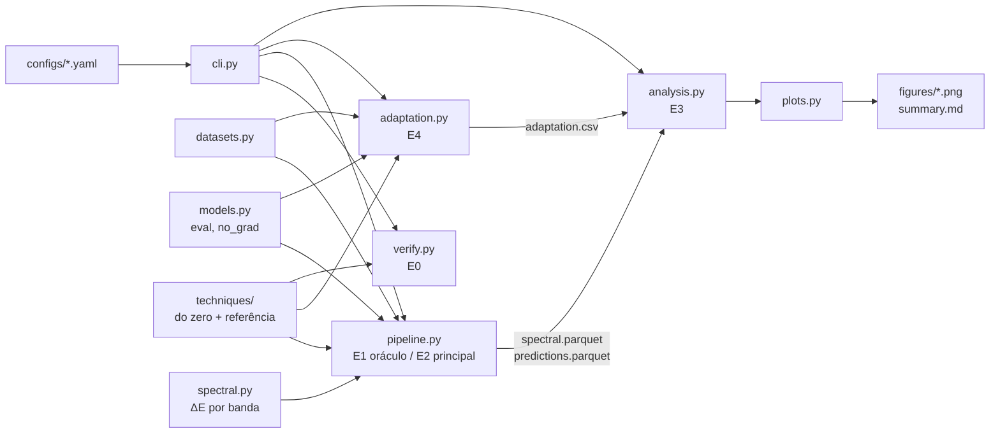

# Quando melhorar piora — pré-processamento perceptual, energia espectral e acurácia de CNNs

Aplicação experimental que acompanha a revisão sistemática em [revisao_literatura/main.tex](revisao_literatura/main.tex).
Ela mede, para cada técnica clássica de pré-processamento e cada nível de intensidade, **quanta energia espectral foi removida ou adicionada em cada banda de frequência** e **quanto a decisão de classificadores pré-treinados muda**, e testa se a primeira prevê a segunda.

> **Pergunta de pesquisa.** Técnicas clássicas de pré-processamento aplicadas para melhorar a qualidade perceptual (denoising, suavização, equalização de histograma, aguçamento, super-resolução) degradam sistematicamente a acurácia de classificadores CNN pré-treinados? Essa degradação se explica pela remoção seletiva de componentes de alta frequência que o classificador usa como sinal discriminativo, e é possível prever a magnitude do dano a partir da energia espectral removida em cada banda?

---

## Sumário

1. [Hipóteses](#1-hipóteses)
2. [Análise das duas propostas do `prompt.txt`](#2-análise-das-duas-propostas-do-prompttxt)
3. [Das lacunas às decisões de desenho](#3-das-lacunas-às-decisões-de-desenho)
4. [Variáveis](#4-variáveis)
5. [Quantificador espectral](#5-quantificador-espectral)
6. [Datasets e classificadores](#6-datasets-e-classificadores)
7. [Experimentos E0–E5](#7-experimentos-e0e5)
8. [Análise estatística](#8-análise-estatística)
9. [Arquitetura do código](#9-arquitetura-do-código)
10. [Como rodar](#10-como-rodar)
11. [Saídas](#11-saídas)
12. [Custo computacional](#12-custo-computacional)
13. [Ameaças à validade](#13-ameaças-à-validade)

---

## 1. Hipóteses

As quatro questões da revisão (QP1–QP4) viram hipóteses testáveis. Cada uma tem um experimento e um critério de decisão.

| # | Hipótese | QP / lacuna | Experimento | Critério |
|---|---|---|---|---|
| **H1** | Técnicas que **removem** energia (suavização, Wiener, JPEG de baixa qualidade, bicúbica) degradam a acurácia de forma monotônica com a dose. As que **redistribuem** (CLAHE, equalização) têm efeito pequeno ou positivo. As que **adicionam** alta frequência (aguçamento, SR aprendida) também degradam em doses altas, porque empurram a entrada para fora da distribuição de treino. | QP1, lacuna 1 | E2 | Sinal e monotonicidade de Δacc por nível; McNemar pareado com correção de Holm |
| **H2** | O **ΔE medido por banda** prevê Δacc melhor do que o parâmetro nominal (σ, k, clip…) e do que métricas de pixel (PSNR/SSIM), **inclusive para técnicas que o modelo nunca viu**. | QP3, lacuna 2 | E3 | R² *leave-one-technique-out* (LOTO): `spec_*` > `dose_rank`, `psnr`, `ssim` |
| **H3** | A banda crítica **não é universal**: depende do dataset (32 px × 224 px) e da arquitetura (CNN × ViT). Um perfil de sensibilidade medido com filtros ideais transfere apenas **parcialmente** para as técnicas reais. | QP3, lacuna 4 | E1 + E3 | Perfis S(banda) diferentes entre datasets/arquiteturas; R² de transferência oráculo → técnicas < R² LOTO |
| **H4** | Para técnicas **invertíveis** ou redistributivas (CLAHE, aguçamento), a maior parte da queda é **domain shift** (recuperável com adaptação). Para técnicas **destrutivas** (mediana, JPEG Q10, blur forte), sobra **perda de informação**. | QP2, lacuna 3 | E4 | Fração recuperável R ≈ 1 × R ≈ 0 |
| **H5** | A **coerência de fase** por banda (estrutura preservada) acrescenta poder explicativo à magnitude da energia. | QP2, lacuna 4 | E3 | `spec_bands+coh` > `spec_bands` no LOTO e na AUC por imagem |

---

## 2. Análise das duas propostas do `prompt.txt`

O prompt traz duas propostas. A primeira é enxuta: só as técnicas com lacuna de evidência, ΔE por banda e inferência estrita. A segunda é mais ampla: a ementa toda, 4–5 níveis, vários datasets, regressão e fine-tuning. Confrontei as duas com a revisão. Ficou o que a literatura sustenta e entrou o que faltava para responder à pergunta.

| Ponto | Proposta 1 | Proposta 2 | Decisão | Por quê (revisão) |
|---|---|---|---|---|
| Técnicas | Só CLAHE, *unsharp*, SR (bicúbica × rede) | Ementa inteira (gauss, mediana, bilateral, USM, laplaciano, HE, CLAHE, Wiener, JPEG, SR) | **Grupo primário** = HE, CLAHE, USM, laplaciano, SR bicúbica/ESPCN/FSRCNN. **Grupo de controle** = gauss, mediana, bilateral, Wiener, JPEG | A Tab. de cobertura mostra 0 estudos para aguçamento e SR e 1 para equalização: são o alvo (lacuna 1). Abandonar blur por completo, porém, enfraquece o estudo. (a) O controle **replica números conhecidos** (Vasiljevic [b4], Wu [b28], Hendrycks [b6]) e valida o pipeline. (b) A regressão precisa de ΔE **negativo e positivo** em todas as bandas: suavização remove, aguçamento adiciona. Sem o controle, o preditor só veria metade do eixo. |
| Dose | Medir ΔE em vez do parâmetro | 4–5 níveis por técnica | **5 níveis** (3 para SR) **e** ΔE medido; o parâmetro nominal entra só como *baseline* a ser vencido | Lacuna 2: a literatura mede a dose pelo parâmetro (raio, σ). Os níveis geram a variação; o ΔE é o eixo comum que permite juntar técnicas diferentes numa mesma curva. |
| Bandas | Baixa/média/alta | Baixa/média/alta | **16 anéis finos + 3 bandas agregadas**, em ciclos/pixel, com janela de Hann | Maiya [b22] e Tsuzuku & Sato [b19] mostram que a banda crítica pode ser baixa ou média e muda com o dataset (lacuna 4). Três bandas fixas escondem isso. A janela evita a falsa alta frequência criada pela borda da DFT. |
| Fase | — | — | **Nova:** coerência espectral por banda | Shao et al. [b24]: filtros tradicionais não produzem o deslocamento espectral limpo que se atribui a eles. A magnitude sozinha pode não bastar (H5). |
| Calibração | — | — | **Novo E1:** oráculo com filtros ideais (remove/dobra **uma** banda) | Mede a sensibilidade S(banda) de cada modelo diretamente, à la Jo & Bengio [b14] e Yin et al. [b18]. Permite o teste mais forte de "prever o dano": ajustar só no oráculo e prever as técnicas reais. |
| Protocolo | Estritamente `model.eval()`, zero fine-tuning | Repetir com re-treino/fine-tuning | **Principal = inferência congelada** (responde à pergunta). **E4 complementar** = BN-adapt, sondas lineares e fine-tuning opcional | Só a inferência congelada **não separa** domain shift de perda de informação: mede a soma dos dois. Ortiz-Jiménez [b23] mostram que a assimetria treino/teste domina o efeito (93 % → 27 % só no teste, −3 p.p. com treino simétrico). Para atacar a lacuna 3 é preciso comparar com um modelo que **pode se adaptar**. As sondas fazem isso sem tocar no extrator, então o "zero fine-tuning" do protocolo principal é preservado. |
| Métrica de decisão | *Decision flip* | Queda de acurácia | **Ambas** + KL(p_orig‖p_proc) + Δp(classe correta) por imagem | O *flip* capta mudanças que a acurácia agregada esconde (acertos e erros que se compensam). As medidas contínuas dão poder estatístico por imagem. |
| Datasets | ImageNet | CIFAR-10/100 + Tiny-ImageNet ou subconjunto do ImageNet; ImageNet-C opcional | **CIFAR-10** (32 px) + **Imagenette** (224 px, 10 classes do ImageNet) + `imagenet_val` local opcional | Tiny-ImageNet não tem pesos pré-treinados padrão (exigiria treinar, o que contraria o protocolo). O Imagenette usa índices do ImageNet-1k, então os pesos oficiais funcionam sem adaptar a cabeça. ImageNet-C mede corrupções, não aprimoramento; fica como E5 opcional (QP4). |
| Modelos | ResNet-50, VGG-16, EfficientNet | ResNet-18, ResNet-50, ViT pequeno | ImageNet: **ResNet-18, ResNet-50, VGG-16-BN, EfficientNet-B0, ViT-B/16** (+ ConvNeXt-T, Swin-T disponíveis). CIFAR: **ResNet-20, ResNet-56, VGG-16-BN, MobileNetV2** | Une as duas listas. A comparação CNN × Transformer testa o viés espectral arquitetural (Tsuzuku & Sato [b19]: a sensibilidade de Fourier vem da convolução). |
| Implementação | — | "Do zero, cobrindo a ementa" | Todas as técnicas **do zero em NumPy**, validadas contra OpenCV/PIL/SciPy (E0). *Backend* `reference` para execuções grandes | Atende à ementa. A validação garante que o resultado não é artefato da implementação. A única exceção é a rede de SR, que usa pesos públicos via `cv2.dnn_superres`. |

---

## 3. Das lacunas às decisões de desenho

| Lacuna (revisão, §II.G) | O que a literatura faz | O que este estudo faz | Onde no código |
|---|---|---|---|
| **1. Escopo de técnica**: equalização, aguçamento e SR quase sem evidência | Concentra-se em blur, ruído e denoising | Grupo primário com 7 técnicas sem evidência + grupo de controle que replica a literatura | [techniques/](src/pdi_spectral/techniques/) |
| **2. Variável independente**: dose medida pelo parâmetro | σ, raio, qualidade JPEG | ΔE medido por banda e por imagem; o parâmetro é *baseline* | [spectral.py](src/pdi_spectral/spectral.py), [analysis.py](src/pdi_spectral/analysis.py) (`dose_rank` × `spec_*`) |
| **3. Confundimento** entre perda de informação e domain shift | Inferência congelada **ou** re-treino, raramente os dois no mesmo estudo | Mesmas condições sob 5 níveis de adaptação; fração recuperável R | [adaptation.py](src/pdi_spectral/adaptation.py) |
| **4. Fragilidade da hipótese espectral**: banda crítica depende do dataset; magnitude ≠ estrutura | 3 bandas fixas ou uma métrica escalar (Yin [b18]) | Anéis finos, dois datasets de resoluções diferentes, CNN × ViT, coerência de fase, oráculo calibrado e teste de transferência | [oracle.py](src/pdi_spectral/techniques/oracle.py), E1, E3 |

---

## 4. Variáveis

### 4.1 Independentes: técnica × nível

Todas operam em RGB uint8 na **resolução exata de entrada do modelo**. A equalização e o CLAHE operam no canal Y (YCbCr) para preservar a cor.

| Técnica | Grupo | Família (ementa) | Parâmetro de dose | Níveis | Efeito espectral esperado |
|---|---|---|---|---|---|
| `hist_eq` | primário | equalização | α (mistura com a equalizada) | 0.2, 0.4, 0.6, 0.8, 1.0 | redistribui (ganho global + mudança de forma) |
| `clahe` | primário | equalização | *clip limit* (grade 2×2 em 32 px, 8×8 em 224 px) | 1, 2, 3, 4, 6 | redistribui, realça média frequência local |
| `unsharp` | primário | aguçamento | *amount* (σ = 1) | 0.5, 1, 1.5, 2, 3 | adiciona média/alta |
| `laplacian` | primário | aguçamento | c em x − c∇²x | 0.25, 0.5, 0.75, 1, 1.5 | adiciona alta |
| `sr_bicubic` | primário | super-resolução | fator s (reduz por s e reconstrói) | 2, 3, 4 | remove alta (anti-aliasing) |
| `sr_espcn` | primário | super-resolução | fator s | 2, 3, 4 | remove e **sintetiza** alta |
| `sr_fsrcnn` | primário | super-resolução | fator s | 2, 3, 4 | idem |
| `gaussian` | controle | suavização | σ | 0.5, 1, 1.5, 2, 3 | remove alta (passa-baixa suave) |
| `median` | controle | suavização | k | 3, 5, 7, 9, 11 | remove alta, não linear (preserva bordas) |
| `bilateral` | controle | suavização | (σ_s, σ_r) | (1,.05) … (5,.3) | remove textura, preserva bordas |
| `wiener` | controle | restauração | janela k (ruído estimado) | 3, 5, 7, 9, 11 | remove alta adaptativamente |
| `jpeg` | controle | compressão | qualidade Q | 90, 70, 50, 30, 10 | remove alta em blocos 8×8 + artefatos |
| `oracle_*` | oráculo | calibração | banda, ganho, corte | 9 anéis × {0, 2}, 5 passa-baixa, 4 passa-alta | controlado |

**Protocolo de SR.** A imagem limpa é reduzida por s (aquisição em baixa resolução) e reconstruída ao tamanho original. A comparação de interesse é **ESPCN/FSRCNN × bicúbica**: as duas partem da mesma entrada reduzida, então a diferença isola o efeito do aprimoramento aprendido. A comparação com o original mede o efeito total.

### 4.2 Mediadora / preditora: ΔE por banda
Ver [§5](#5-quantificador-espectral). Também são registradas PSNR e SSIM como preditores concorrentes de "fidelidade em pixel".

### 4.3 Dependentes (por imagem × condição × modelo)

| Variável | Definição |
|---|---|
| `correct`, `correct_top5` | acerto top-1/top-5 |
| `correct_sub` | acerto top-1 restrito às 10 classes (Imagenette) |
| `flip` | predição mudou em relação à predição na imagem original (*decision flip*) |
| `kl` | KL(p_orig ‖ p_proc): quanto a distribuição de saída mudou |
| `dp_true` | variação da probabilidade da classe correta |
| `conf`, `entropy` | confiança e entropia da saída |
| (E4) `acc_frozen`, `acc_bn`, `acc_probe_{oo,op,pp}`, `acc_ft_{oo,pp}` | acurácia sob cada nível de adaptação |

### 4.4 Controles
- **Desenho pareado:** as mesmas imagens passam por todas as condições, e cada condição é aplicada **uma vez** e avaliada por **todos** os modelos.
- **Recorte fixo** (lado menor 256 → centro 224) aplicado **antes** da técnica, para que técnica e espectro atuem sobre exatamente o que a rede vê.
- `model.eval()` + `torch.no_grad()`; pesos oficiais V1; *seed* fixa para subconjuntos.
- Validação das implementações (E0).

---

## 5. Quantificador espectral

Implementado em [spectral.py](src/pdi_spectral/spectral.py). Para cada par (original x, processada y), na luminância:

1. Remove-se a média; o termo DC é medido à parte (`d_dc`, mudança de brilho).
2. Janela de Hann 2D, para reduzir o vazamento espectral da periodicidade implícita da DFT.
3. FFT 2D; potência P = |F|², normalizada para que Σ P ≈ variância dos pixels.
4. Frequência radial normalizada r = √(fx² + fy²) em **ciclos/pixel** (comparável entre 32 e 224 px). A potência é somada em **16 anéis** em (0, 0.5], mais um anel de cantos (0.5, 0.707], e em **3 bandas**: baixa (0, 0.10], média (0.10, 0.25], alta (0.25, 0.707].

Medidas por banda b:

| Medida | Fórmula | Interpretação |
|---|---|---|
| `dErel_b` | (E_b(y) − E_b(x)) / E_tot(x) | variação de energia; **aditiva** entre bandas (soma = variação total). Principal preditor |
| `dB_b` | 10 log₁₀(E_b(y)/E_b(x)) | variação relativa dentro da banda |
| `dshape_b` | E_b(y)/E_tot(y) − E_b(x)/E_tot(x) | mudança da **forma** do espectro, descontado o ganho global (importante para HE/CLAHE) |
| `D_b` | E_b(y − x) / E_tot(x) | energia da **perturbação** na banda (métrica de Yin et al. [b18]) |
| `coh_b` | Re⟨F_x, F_y⟩_b / √(E_b(x) E_b(y)) | coerência: 1 = estrutura/fase preservada (H5) |

`dErel` tem sinal: remover energia dá valor negativo, adicionar dá positivo. Os preditores separam as partes positiva e negativa (`dErel_b+`, `dErel_b−`), porque o efeito de adicionar e o de remover podem ser assimétricos.

Os testes em [tests/test_spectral.py](tests/test_spectral.py) verificam que: a identidade dá ΔE = 0 e coerência 1; as bandas particionam a energia total; sem janela, a energia total é igual à variância (Parseval); senoides caem na banda certa; o gaussiano remove e o *unsharp* adiciona alta frequência; o oráculo remove a banda pedida.

---

## 6. Datasets e classificadores

| Dataset | Resolução | Imagens (padrão) | Modelos | Pesos |
|---|---|---|---|---|
| `cifar10` | 32×32 | 2 000 do teste (+5 000 de treino para E4) | ResNet-20, ResNet-56, VGG-16-BN, MobileNetV2 | `chenyaofo/pytorch-cifar-models` (torch.hub) |
| `imagenette` | 224×224 | 3 925 (val inteiro) (+2 000 de treino para E4) | ResNet-18, ResNet-50, VGG-16-BN, EfficientNet-B0, ViT-B/16 | torchvision `IMAGENET1K_V1` |
| `imagenet_val` (opcional) | 224×224 | configurável | idem | idem |

- No Imagenette a acurácia é medida **sobre as 1000 classes** (`correct`, rigoroso) e também restrita às 10 (`correct_sub`).
- Para o artigo, recomenda-se habilitar `imagenet_val` (pasta `<wnid>/*.JPEG`) se houver acesso ao ImageNet. Veja [§13](#13-ameaças-à-validade) sobre a origem das imagens do Imagenette.
- Não há ViT padrão para CIFAR-10. A comparação CNN × Transformer é feita no Imagenette/ImageNet.

---

## 7. Experimentos E0–E5

| Exp. | Nome | Pergunta | Comando |
|---|---|---|---|
| **E0** | Validação | As implementações do zero reproduzem OpenCV/PIL/SciPy? O quantificador mede o que diz? | `make verify` |
| **E1** | Oráculo espectral | Quanto custa remover ou dobrar **cada** banda, por modelo e dataset? → perfil S(banda) | `make oracle` |
| **E2** | Dose-resposta (principal) | Cada técnica × nível degrada a acurácia? Quanto ΔE ela produz? (inferência congelada) | `make main` |
| **E3** | Previsibilidade | ΔE prevê Δacc em técnicas não vistas? Melhor que dose nominal, PSNR e SSIM? O oráculo transfere? | `make analyze` |
| **E4** | Domain shift × informação | Quanto da queda é recuperável sem mudar o extrator (BN-adapt, sonda linear) ou com fine-tuning? | `make adapt` |
| **E5** | (opcional) Entradas degradadas | Na QP4, pré-processar imagens **realmente degradadas** (CIFAR-10-C) ajuda? | `bash scripts/download_data.sh cifar10c` + dataset extra |

### E4 em detalhe

O extrator pré-treinado é sempre o mesmo; muda apenas o quanto o modelo pode se ajustar ao domínio processado.

```
frozen     modelo original na imagem processada           (= E2)
bn_adapt   só re-estima as médias/variâncias do BatchNorm  (sem gradiente)
bn_oo      controle: o mesmo nas originais (desconta o ruído da estimativa)
probe_op   sonda linear treinada no ORIGINAL, testada no PROCESSADO
probe_pp   sonda linear treinada e testada no PROCESSADO
probe_oo   sonda linear treinada e testada no ORIGINAL     (teto)
ft_pp/oo   fine-tuning completo (opcional, finetune_epochs > 0)

R = (probe_pp − probe_op) / (probe_oo − probe_op)
    R ≈ 1 → domain shift (a informação continua lá)
    R ≈ 0 → perda irreversível de informação
info_loss = probe_oo − probe_pp
```

---

## 8. Análise estatística

Implementada em [analysis.py](src/pdi_spectral/analysis.py).

1. **Por condição** (dataset × modelo × técnica × nível): acurácia, Δacc com IC 95 % pareado, taxa de *flip*, KL e médias espectrais. Significância por **teste exato de McNemar** (acertos perdidos × ganhos, pareado por imagem), com **correção de Holm** por modelo.
2. **H2: validação cruzada *leave-one-technique-out*.** Para cada modelo, uma regressão *ridge* (padronizada, α por CV interna) prevê Δacc de uma técnica inteira usando só as outras. Conjuntos de preditores comparados:
   - `dose_rank`: parâmetro nominal ordinal (o que a literatura usa);
   - `psnr`, `ssim`: fidelidade em pixel;
   - `delta_bands`: energia da perturbação por banda (Yin [b18]);
   - `spec_bands`, `spec_bands_dB`, `spec_fine`: ΔE por banda (proposta);
   - `spec_bands+coh`, `spec_fine+coh`: + coerência de fase (H5).
   Métricas: R², Spearman, MAE.
3. **H3: transferência do oráculo.** A regressão é ajustada **só** nas condições de E1 e aplicada às técnicas reais de E2.
4. **Nível de imagem.** Regressão logística prevê `flip` por imagem a partir do ΔE daquela imagem; AUC com validação agrupada por técnica.
5. **H4:** resumo das frações recuperáveis por técnica/nível (E4).

O relatório consolidado sai em `results/<run>/analysis/summary.md`, com as figuras em `analysis/figures/`.

---

## 9. Arquitetura do código



```
repo/
├── Makefile                  alvos: setup, download, verify, oracle, main, adapt, analyze, all, smoke…
├── configs/
│   ├── default.yaml          estudo completo
│   ├── smoke.yaml            miniatura para testar o pipeline (herda do default)
│   └── offline.yaml          pipeline sem internet: imagens sintéticas + CNN minúscula
├── scripts/
│   ├── _common.sh            detecção do Python/venv, PYTHONPATH, logs, download
│   ├── setup_env.sh          cria .venv e instala dependências (CPU ou GPU)
│   ├── download_data.sh      pesos SR, CIFAR-10, Imagenette, pesos dos modelos, CIFAR-10-C
│   ├── verify.sh             E0: pytest + tabela de concordância
│   ├── run_experiments.sh    executa etapas em ordem, com log em results/logs/
│   └── run_smoke.sh          teste de ponta a ponta
├── src/pdi_spectral/
│   ├── techniques/
│   │   ├── _core.py          convolução, gaussiana, YCbCr, PSNR, SSIM (do zero)
│   │   ├── smoothing.py      gaussiano, mediana, bilateral
│   │   ├── sharpening.py     unsharp masking, laplaciano
│   │   ├── contrast.py       equalização global, CLAHE
│   │   ├── restoration.py    Wiener adaptativo
│   │   ├── compression.py    JPEG (DCT 8×8 + quantização IJG + 4:2:0)
│   │   ├── superres.py       bicúbica (Keys) do zero + ESPCN/FSRCNN
│   │   ├── oracle.py         filtros espectrais ideais
│   │   ├── reference.py      OpenCV / PIL / SciPy (validação e backend rápido)
│   │   └── __init__.py       registro das técnicas
│   ├── spectral.py           quantificador ΔE por banda
│   ├── datasets.py           CIFAR, Imagenette, ImageNet local
│   ├── models.py             zoológico de modelos, features, BN-adapt
│   ├── pipeline.py           E1/E2
│   ├── adaptation.py         E4
│   ├── analysis.py           E3 + relatório
│   ├── plots.py              figuras
│   ├── verify.py             E0
│   └── cli.py                linha de comando
├── tests/                    pytest: técnicas × referência, propriedades do quantificador
└── revisao_literatura/       artigo (LaTeX)
```

**Adicionar uma técnica:** escreva a função em `techniques/` (recebe e devolve RGB uint8), registre em `techniques/__init__.py` e coloque os níveis em `configs/default.yaml`. O pipeline, o quantificador e a análise passam a tratá-la automaticamente.

---

## 10. Como rodar

### Requisitos
- Python ≥ 3.10 (testado com 3.12), bash e GNU make.
- **Windows:** use o Git Bash. O `make` não vem instalado: `choco install make` ou `conda install -c conda-forge make`. Sem `make`, rode os scripts diretamente (`bash scripts/...`).
- GPU é opcional, mas recomendada para o Imagenette com 5 modelos.

### Passo a passo

```bash
make setup                         # cria .venv e instala requirements
#   GPU NVIDIA: make setup TORCH_INDEX_URL=https://download.pytorch.org/whl/cu121
make download                      # SR + CIFAR-10 + Imagenette (~330 MB) + pesos
make verify                        # E0
make smoke                         # pipeline completo em miniatura (minutos)
make offline                       # idem, sem internet (imagens sintéticas; só checa que roda)
make all                           # E1 + E2 + E4 + E3 com a config padrão
make fast                          # idem, com backend OpenCV (muito mais rápido)
make examples                      # figuras qualitativas e assinatura espectral
```

Etapas isoladas e variações:

```bash
make main DATASETS=cifar10
make main EXTRA="--set backend=reference --set device=cuda --set batch_size=128"
make analyze CONFIG=configs/smoke.yaml
PY=/caminho/python bash scripts/run_experiments.sh oracle main   # sem venv
python -m pdi_spectral show-config --config configs/smoke.yaml   # config final, já mesclada
```

Para criar uma variante do estudo, crie um YAML com `extends: default.yaml` e mude só o necessário. Use `_replace: true` num bloco para substituí-lo inteiro em vez de mesclar.

---

## 11. Saídas

```
results/
├── verification.csv                    E0
├── logs/                               log de cada execução
└── <run_name>/
    ├── oracle/<dataset>/               E1 (mesmo formato do main)
    ├── main/<dataset>/
    │   ├── spectral.parquet            1 linha por (imagem, condição)
    │   ├── predictions.parquet         1 linha por (imagem, condição, modelo)
    │   ├── conditions.csv              catálogo das condições
    │   ├── dataset_spectrum.csv        espectro radial médio das originais
    │   └── meta.json
    ├── adaptation/adaptation.csv       E4
    └── analysis/
        ├── summary.md                  relatório
        ├── conditions_main.csv         tabela por condição (Δacc, IC, McNemar, ΔE médio…)
        ├── loto.csv, loto_predictions.csv, oracle_transfer.csv, image_level.csv
        ├── band_sensitivity.csv, adaptation_summary.csv
        └── figures/
            ├── dose_response_<ds>.png          Δacc × parâmetro nominal
            ├── delta_vs_dErel_high_<ds>.png    Δacc × ΔE alta (todas as técnicas no mesmo eixo)
            ├── delta_vs_D_high_<ds>.png
            ├── band_sensitivity_<ds>.png       perfil do oráculo + espectro do dataset
            ├── loto_r2_<ds>.png                comparação dos preditores (H2)
            ├── pred_vs_obs_<ds>.png
            ├── adaptation_<ds>.png             H4
            ├── examples_<ds>.png
            └── spectral_signature_<ds>.png     ΔE (dB) por anel de cada técnica
```

`predictions.parquet` e `spectral.parquet` se cruzam por `(dataset, image_id, cond_id)`.

---

## 12. Custo computacional

Ordem de grandeza: 54 condições em E2, 27 em E1 e 16 em E4.

| Etapa | CIFAR-10 (2 000 img, 4 modelos) | Imagenette (3 925 img, 5 modelos) |
|---|---|---|
| Inferências E1+E2 | ~0,6 M imagens-modelo | ~1,6 M imagens-modelo (GPU recomendada; ViT-B/16 domina) |
| Processamento, backend `scratch` | minutos | **horas** (o bilateral do zero leva ~0,5 s por imagem de 224 px) |
| Processamento, backend `reference` | segundos | minutos |

Use `backend: scratch` para as figuras do relatório da disciplina e para a validação. Use `backend: reference` (`make fast`) para a varredura completa; o E0 documenta a concordância entre os dois.

---

## 13. Ameaças à validade

| Ameaça | Mitigação |
|---|---|
| Diferença entre implementação do zero e bibliotecas | E0 + testes; *backend* de referência disponível. Diferenças conhecidas: o bilateral do OpenCV usa distância L1 entre cores (o do zero usa L2, como Tomasi & Manduchi); o `scipy.signal.wiener` estima o ruído com borda de zeros; o JPEG do zero usa DCT em ponto flutuante (o libjpeg usa inteira). Em todos os casos, PSNR entre as versões > 30 dB. |
| Janela de Hann altera a medida | É configurável (`spectral.window: none`); os testes conferem Parseval sem janela. Reportar a sensibilidade da conclusão à janela. |
| Imagenette pode conter imagens vistas no treino do ImageNet | Verificar a origem do split antes de publicar. Preferir `imagenet_val` local para os números finais; usar o Imagenette para iteração. |
| Pesos de CIFAR são da comunidade, não "oficiais" | São os mais usados e reprodutíveis (torch.hub); relatar a acurácia de base. |
| SR aprendida treinada em outro domínio (DIV2K/T91) | É exatamente o cenário de uso prático; relatar. |
| Recorte/redimensionamento antes da técnica | É fixo e idêntico para todos; o espectro é medido sobre a entrada efetiva da rede. |
| Múltiplas comparações | Holm por modelo; o foco inferencial está nas curvas e no LOTO, não em p-valores isolados. |
| Poucas condições por modelo para a regressão (~50) | Ridge com regularização por CV; agregados de 3 bandas como modelo principal, anéis finos como exploratório; análise por imagem (centenas de milhares de pontos) como confirmação. |
| ViT sem BatchNorm | O BN-adapt é pulado (célula vazia); as sondas lineares valem para todos. |
| Pré-processamento em imagens já limpas | É a pergunta (QP1). A QP4 sobre entradas degradadas fica como E5 opcional. |
