<div align="center">

# Quando melhorar piora

**Pré-processamento perceptual, energia espectral e acurácia de classificadores de imagem**

Técnicas clássicas que deixam uma imagem *melhor para pessoas* também a deixam melhor para uma rede neural?
Medimos, dose a dose, 14 técnicas em 12 classificadores pré-treinados e 3 datasets (incluindo as 50 mil imagens do ImageNet-val),
achamos o limiar a partir do qual cada uma prejudica a rede e propomos uma fórmula que prevê esse dano a partir do espectro de
Fourier.

[**Site interativo**](https://beatrizalmeidaf.github.io/pdi/) ·
[Resultados completos](results.md) ·
[Modelagem detalhada](MODELAGEM.md) ·
[Revisão sistemática](revisao_literatura/main.tex)


</div>

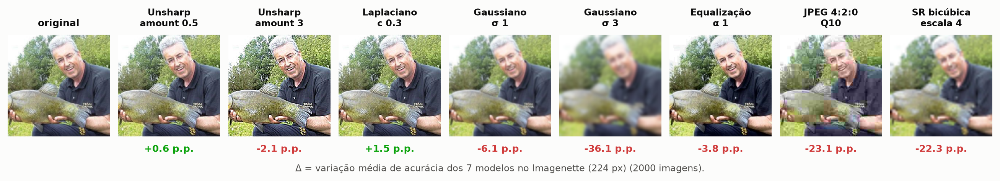

---

## Em poucas palavras

Antes de uma imagem ir para uma rede neural, é comum "melhorá-la": tirar ruído, realçar bordas, ajustar contraste, comprimir. A
pergunta deste trabalho é simples: **isso ajuda a rede a acertar?**

**O que ajuda.** Quase nada.
- Em imagens pequenas (32 px), **nenhuma** técnica, em nenhuma intensidade, fez a rede acertar mais.
- Em imagens grandes, só **realçar bordas de leve** (laplaciano ou *unsharp*) ajuda. Num problema de 10 classes, o ganho é de
  +1 a +3 p.p.
- No ImageNet completo (1000 classes), esse ganho praticamente **some**: sobra +0,3 p.p. em um único modelo (Swin).
- Todo o resto piora a partir de alguma intensidade, e o ponto de virada costuma ser cedo. Um desfoque gaussiano com σ
  entre 0,4 e 0,7 pixel já custa 1 p.p. em todos os 12 modelos.
- O JPEG "qualidade 100" padrão já custa até 1,4 p.p., e o culpado é a compressão da cor: sem ela, o custo é ~0.

**Quem ajuda, ou quem aguenta mais.**
- Em 224 px, **ViT-B/16 e ConvNeXt-T** são os mais robustos: perdem em média 2,4 a 4,2 p.p.
- **VGG-16 e as ResNets** são os que mais sofrem: 4,6 a 6,3 p.p.
- O Swin fica no meio.
- Re-treinar a rede com as imagens processadas recupera quase tudo no realce e no desfoque leve. No JPEG forte e na mediana a
  informação se perdeu de verdade: mesmo re-treinando, a rede fica até 13 p.p. abaixo do original.

**O que é novo.**
1. Medimos a "dose" pelo que a técnica faz **ao sinal** (espectro de Fourier), não pelo botão do algoritmo (σ, qualidade…). Isso
   põe técnicas diferentes na mesma régua.
2. Uma fórmula própria, o **Índice de Risco Espectral (IRE)**, prevê o dano de técnicas que ela nunca viu (R² 0,86–0,91). Ela
   olha só a imagem, sem rodar a rede.
   - É melhor que LPIPS, SSIM, PSNR e a métrica espectral de Yin et al. em dois dos três datasets; só perde para o LPIPS no
     CIFAR-10.
   - Só é superada por medidas que precisam rodar a própria rede.
3. A fórmula traz uma **dose segura** com garantia: se IRE ≤ −ln(1 − τ), a acurácia cai no máximo τ.
4. Limiares com intervalo de confiança (**BMD**, vocabulário da toxicologia) para 14 técnicas × 12 modelos. Inclui equalização,
   realce e super-resolução, que a literatura quase não testava.

---

## Resumo

Pipelines de visão computacional costumam "melhorar" a imagem antes de classificá-la: suavizam ruído, aguçam bordas, equalizam
contraste, comprimem, super-resolvem. A suposição implícita é que o que é melhor para o olho humano também é melhor para a rede. Uma
revisão sistemática de 29 estudos mostrou que essa suposição quase nunca é testada para equalização, aguçamento e super-resolução, e
que a literatura mede a "dose" de uma técnica pelo seu parâmetro (σ, raio, qualidade), não pelo que ela faz ao sinal.

Este trabalho:
- aplica **14 técnicas** em **8 a 14 intensidades** cada a três conjuntos de imagens:
  - CIFAR-10 (32 px, 5 CNNs, 2000 imagens × 3 sementes);
  - Imagenette (224 px, 7 modelos, 2000 imagens × 3 sementes);
  - **ImageNet-val completo** (50 mil imagens, os mesmos 7 modelos: ResNet-18/50, VGG-16-BN, EfficientNet-B0, ConvNeXt-T, ViT-B/16
    e Swin-T);
- mede quanto a acurácia muda **com modelos congelados**, como seriam usados na prática;
- compara a fórmula proposta com os preditores existentes: PSNR, SSIM, LPIPS, energia por banda de Yin et al. e distância entre
  features da própria rede.

**Em uma frase:** em 32 px, *nenhuma* dose de *nenhuma* técnica melhora o classificador; em 224 px, só o aguçamento leve melhora, e
quase nada no ImageNet completo; e o dano de qualquer técnica é previsível a partir do espectro da perturbação (IRE, R² 0,86–0,91),
mas não a partir do parâmetro nominal (R² 0,2–0,5) nem do PSNR (0,1).

---

## Principais achados

### 1. "Melhorar" a imagem quase sempre piora a rede

Todas as 14 técnicas degradam a acurácia de forma monotônica a partir de alguma dose. No CIFAR-10 (5 modelos, 3 sementes), nenhum
ganho é significativo. Em 224 px a degradação é mais lenta: os modelos maiores toleram doses bem maiores de aguçamento, equalização
e JPEG.

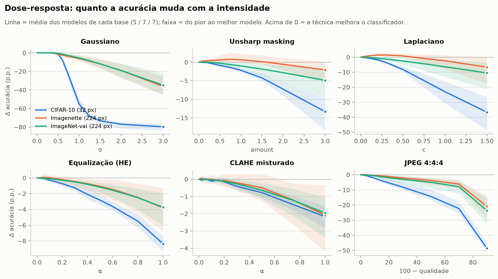

### 2. Cada técnica tem um limiar, e às vezes uma janela operacional

O **BMD** (*benchmark dose*) é a intensidade em que a acurácia cai 1 p.p., estimada com IC 90 % por bootstrap pareado. Existe
**janela operacional** quando o objetivo visual da técnica é atingido *antes* do limite seguro: +10 % de nitidez, −10 % de ruído ou
+10 % de contraste.

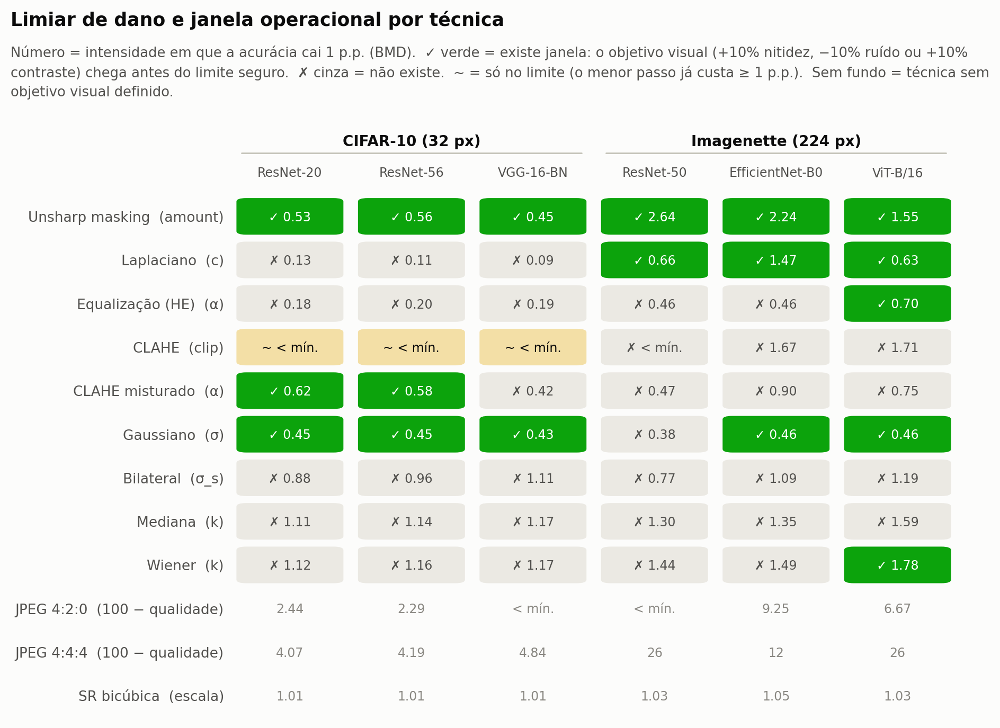

| Técnica (parâmetro) | BMD 1 p.p. — CIFAR-10 | BMD — Imagenette | BMD — ImageNet-val | Janela no ImageNet-val |
|---|---|---|---|---|
| Unsharp masking (amount) | 0,49–0,73 | 1,54–2,72 | 0,68–2,10 | ✅ 7/7 |
| Laplaciano (c) | 0,11–0,14 | 0,50–1,45 | 0,16–0,66 | ✅ 7/7 |
| Equalização global (α) | 0,26–0,38 | 0,30–0,90 | 0,34–0,66 | ✅ 7/7 |
| CLAHE misturado (α) | 0,52–0,79 | 0,42–0,95 | 0,46–0,97 | 2/7 |
| Gaussiano (σ) | **0,46–0,50** | **0,38–0,69** | **0,51–0,64** | ✅ 7/7 |
| Bilateral (σ_s) | 1,02–1,24 | 0,83–2,12 | 0,73–1,49 | 5/7 |
| Mediana / Wiener (k) | k = 3 já passa de 1 p.p. | k = 3 já passa | k = 3 já passa | mediana 1/7 · Wiener 7/7 |
| JPEG 4:2:0 (qualidade) | ≈ 97,5–99,7 | ≈ 85–100 | ≈ 88–97 | — |
| JPEG 4:4:4 (qualidade) | ≈ 93–95 | ≈ 68–86 | ≈ 67–92 | — |
| SR bicúbica (escala) | ≈ 1,01–1,02 | ≈ 1,02–1,31 | ≈ 1,05–1,19 | — |

*Faixa = entre os modelos de cada dataset (CIFAR-10 e Imagenette: média de 3 sementes). O limiar do gaussiano é quase o mesmo, em
pixels, nas três bases e nos 12 modelos. Tabelas completas: [docs/resultados/pub/](docs/resultados/pub/).*

### 3. Hormese: só em 224 px, só no aguçamento, e pequena no ImageNet completo

O laplaciano **leve** melhora a acurácia com IC acima de zero nos 7 modelos do Imagenette, em pelo menos 2 das 3 sementes; o unsharp
leve, em 3 deles:
- até +2,7 p.p. na ResNet-50 e +1,8 p.p. no ConvNeXt;
- doses maiores voltam a piorar.

No **ImageNet-val completo** (1000 classes), o mesmo efeito quase desaparece:
- só o Swin-T melhora com significância, e só +0,3 p.p.;
- na ResNet-50, a dose que dava +2,7 p.p. no Imagenette custa −1,4 p.p.

O ganho do Imagenette vem, em boa parte, de o problema ter só 10 classes fáceis.

O CLAHE, que a literatura sugeria como candidato a melhorar (Hendrycks & Dietterich, 2019), só piorou.

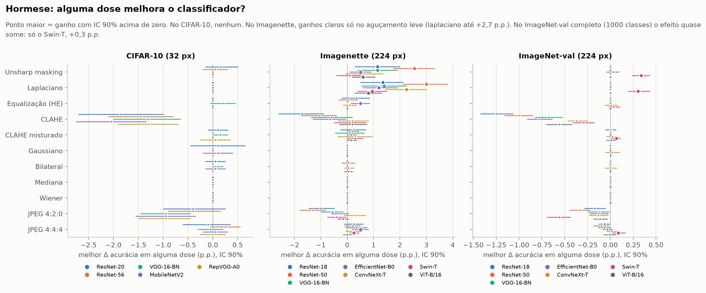

### 4. A banda que importa e quem aguenta mais

Com filtros ideais que removem um anel de frequência por vez:
- em 32 px, o que mais dói é a **média-alta frequência** (0,28–0,41 ciclo/pixel);
- em 224 px, a **mais baixa**: no ImageNet-val, removê-la custa 30 p.p. (ConvNeXt) a 64 p.p. (ViT);
- o **ViT** depende quase só dela, e por isso perde menos que as CNNs com técnicas que removem frequência.

Na média de todas as técnicas, **ViT-B/16 e ConvNeXt-T são os mais robustos** e **VGG-16 e ResNets os mais frágeis**. No
ImageNet-val a queda média vai de 3,0 p.p. (ViT) a 6,3 p.p. (VGG).

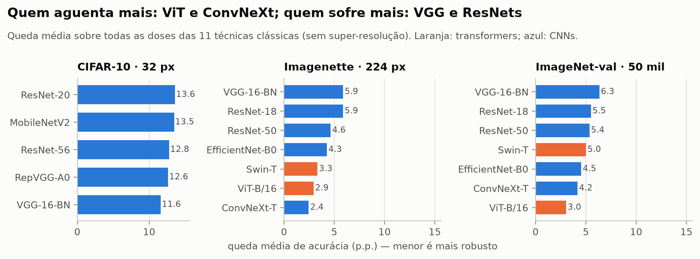
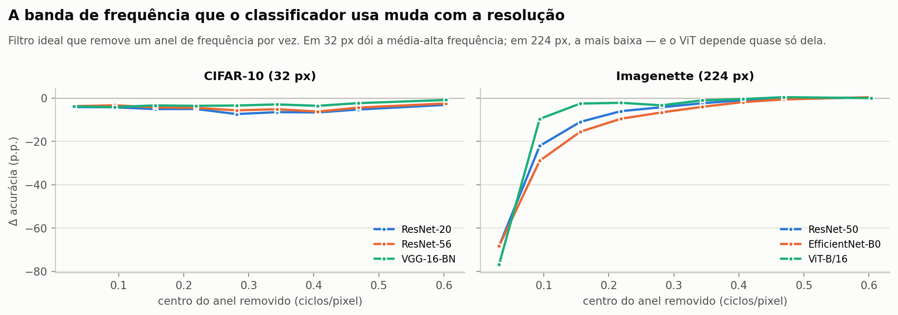

### 5. Medir o espectro prevê o dano; o parâmetro nominal não

Cada preditor tenta prever a probabilidade de a decisão da rede mudar em cada condição. Ele é avaliado **em técnicas que não viu**
(*leave-one-technique-out*), na média dos modelos (± desvio entre sementes):

| Preditor | CIFAR-10 | Imagenette | ImageNet-val |
|---|---|---|---|
| Distância entre features da rede (**precisa rodar a rede**) | 0,99 | 0,95 | 0,98 |
| **IRE (este trabalho, só a imagem)** | **0,86 ± 0,00** | **0,86 ± 0,01** | **0,91** |
| ΔE por banda + coerência + cor (ridge) | 0,82 | 0,74 | 0,79 |
| LPIPS (Zhang et al., 2018) | **0,90** | 0,73 | 0,67 |
| SSIM | 0,59 | 0,54 | 0,47 |
| Energia por banda (Yin et al., 2019) | 0,49 | 0,61 | 0,42 |
| Parâmetro nominal (σ, k, clip…) — o que a literatura usa | 0,23 | 0,42 | 0,47 |
| PSNR | 0,08 | 0,14 | 0,12 |

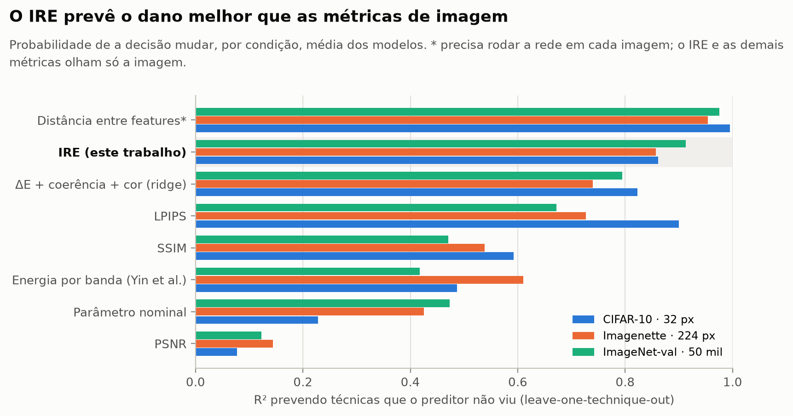

Entre os preditores que olham só a imagem, o IRE é o melhor em 224 px e fica perto do LPIPS em 32 px. O LPIPS é ele próprio uma
rede neural; o IRE é uma soma de termos espectrais com 3 grupos de pesos. A distância entre features acerta mais, mas é a resposta
da própria rede: exige rodar o modelo em cada imagem, e o IRE existe justamente para evitar isso.

### 6. Uma fórmula para o risco: o Índice de Risco Espectral (IRE)

$$
\mathrm{IRE}=\sum_b w_b\,D_b^{\gamma}+\sum_b c_b\,\big(D^{\mathrm{cor}}_b\big)^{\gamma}+\sum_{B} u_B\,(1-\rho_B)^{\gamma},
\qquad
\widehat{P}(\text{decisão mudar})=1-e^{-\mathrm{IRE}}
$$

- **D_b** é a energia da perturbação no anel de frequência *b*, e **D^cor_b** o mesmo nos canais de cor.
- **1 − ρ_B** é a perda de coerência espectral, isto é, de estrutura e fase.
- Os pesos **w, c, u ≥ 0** e o expoente **γ** são ajustados uma vez por modelo.

Como só uma decisão que muda pode virar erro, **IRE ≤ −ln(1 − τ) garante queda de acurácia ≤ τ**. Daí sai a dose segura de uma
técnica nova **sem rodar a rede** (`make safe-dose`).

Desempenho prevendo técnicas que a fórmula não viu:
- R² **0,78–0,95** por modelo (média 0,86 / 0,86 / 0,91) e Spearman 0,92–0,98;
- calibrada só com filtros ideais, R² 0,75–0,81 em 32 px; em 224 px precisa de técnicas reais.

A coerência de fase foi o que fez a fórmula funcionar: com ela o R² sobe de 0,23 para 0,85.

**O IRE calibrado num modelo serve para outro?** Em parte.
- Em 32 px, sim: calibrado nos outros 4 modelos, prevê o quinto tão bem quanto os próprios pesos (R² 0,85–0,89).
- Em 224 px a **ordem** das condições transfere (Spearman 0,89–0,97), mas a **escala** não. Os modelos medianos ficam em R² 0,8–0,9.
  O ViT, o mais robusto, é superestimado (~6 p.p. de flip), e a ResNet-18 e a VGG, as mais frágeis, subestimadas (~5 p.p.).
- Ou seja, as bandas que importam são parecidas entre modelos, mas a sensibilidade total é de cada um. A dose segura com garantia
  exige calibrar no próprio modelo. Detalhes em [results.md](results.md) §0.6.

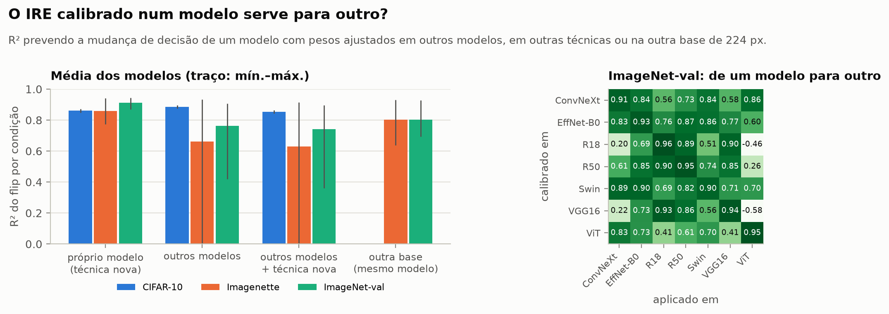

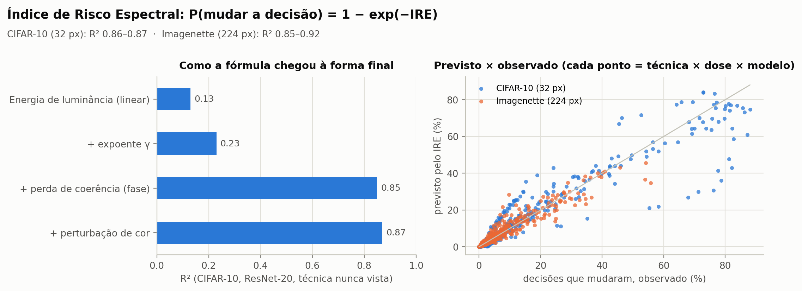

### 7. Domain shift ou informação perdida?

Re-treinar o modelo nas imagens processadas separa o que ele poderia recuperar do que a imagem perdeu de fato. Média de 5 CNNs ×
3 sementes no CIFAR-10 e de 7 modelos × 3 sementes no Imagenette.

- **Aguçamento e blur leve são *domain shift*.**
  - Só re-estimar as estatísticas do BatchNorm, sem tocar em nenhum peso, leva o blur σ = 1 de 39 % para 85 % no CIFAR-10.
  - O fine-tuning chega a 90 %.
  - Unsharp e laplaciano voltam a ~1 p.p. do original (93,8 %).
- **JPEG forte, mediana e Wiener destroem informação:** mesmo re-treinando, ficam 6–13 p.p. abaixo no CIFAR-10. No Imagenette ficam
  2–4 p.p. abaixo (JPEG q = 10: 2,2; mediana k = 9: 3,0; blur σ = 3: 3,8), contra < 1 p.p. no aguçamento e
  na equalização.

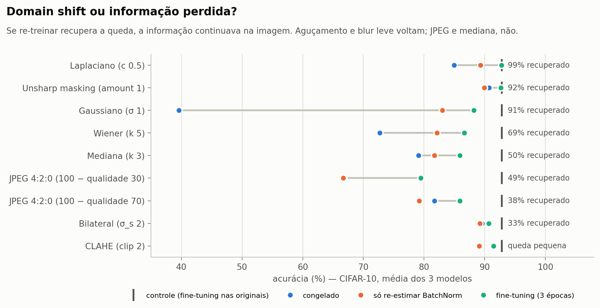

### 8. No JPEG de alta qualidade, quem muda a decisão é a cor

Na qualidade **100**, o JPEG padrão, que subamostra a cor (4:2:0), já custa 0,1–0,6 p.p. nos 7 modelos do ImageNet-val; sem
subamostrar (4:4:4), ~0. Na qualidade 98, o erro de cor é ~10× o de luminância.

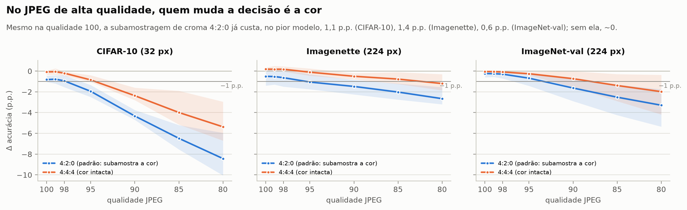

### 9. O que é bom para pessoas e o que é bom para a rede

Cruzando uma métrica perceptual independente (BRISQUE) com a acurácia:
- **em 32 px**, a qualidade percebida só sobe às custas do classificador;
- **em 224 px**, o aguçamento leve melhora as duas coisas ao mesmo tempo, e o BRISQUE melhora muito antes do limiar da rede.

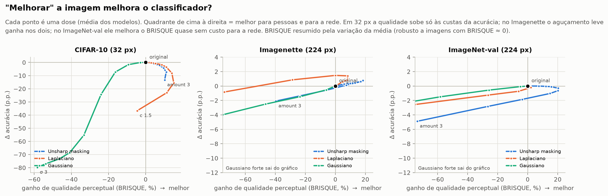

---

## O que é inovação aqui

| Lacuna da literatura (revisão, 29 estudos) | O que este trabalho faz |
|---|---|
| Equalização, aguçamento e super-resolução quase sem evidência | 14 técnicas, com essas três como grupo principal e suavização/JPEG como controle que reproduz a literatura |
| "Dose" medida pelo parâmetro do algoritmo | **Dose medida no sinal:** ΔE por banda, coerência de fase e perturbação de cor, imagem a imagem. É isso que permite comparar e prever técnicas diferentes num mesmo eixo |
| Sem limiares, só tabelas de pontos | **Modelagem dose-resposta** com vocabulário da toxicologia (BMD, BMDL, NOAEL, LOAEL, hormese), IC por bootstrap pareado e **janela operacional** (objetivo visual × limite seguro) |
| Perda de informação confundida com *domain shift* | Mesma bateria com modelo congelado, BatchNorm re-estimado, sonda linear e fine-tuning |
| Hipótese espectral frágil e qualitativa | **Índice de Risco Espectral:** fórmula de risco com garantia formal de acurácia, validada em técnicas que não viu e comparada com PSNR, SSIM, LPIPS e Yin et al. Dá a dose segura sem rodar a rede |
| Resultados em subconjuntos pequenos | ImageNet-val completo (50 mil imagens), 12 modelos (10 CNNs + ViT + Swin), 3 sementes nas bases menores |

Também saíram do trabalho quatro achados de implementação que afetam qualquer estudo do tipo:
- a **subamostragem de cor domina o JPEG** de alta qualidade;
- o **clip do CLAHE é quantizado** em blocos pequenos: em 32 px, todo clip < 2 gera a mesma imagem;
- o **BRISQUE precisa ser resumido pela variação da média**, porque pode valer ≈ 0 ou ser negativo e a média de razões explode;
- **imagens quase constantes quebram medidas espectrais relativas.** No ImageNet-val, uma única imagem praticamente branca chegava a
  uma perturbação relativa ~1000× maior que a de qualquer outra e derrubava o R² de Yin et al. de 0,42 para 0,10. A análise exclui
  imagens com desvio de luminância < 1/255; só essa foi excluída.

Todas as técnicas foram **implementadas do zero** em NumPy e validadas contra OpenCV, PIL e SciPy: diferença média ≤ 1,7 nível de
cinza, PSNR ≥ 37 dB.

## Hipóteses

| # | Hipótese | Resultado |
|---|---|---|
| H1 | Técnicas perceptuais degradam classificadores, de forma monotônica com a dose | ✅ Confirmada. Exceção: o aguçamento leve em 224 px melhora (hormese): +1 a +3 p.p. no Imagenette, só +0,3 p.p. (Swin) no ImageNet completo |
| H2 | O ΔE medido prevê o dano melhor que o parâmetro nominal e o PSNR | ✅ R² 0,2–0,5 (nominal) e 0,1 (PSNR) → 0,74–0,82 (ridge espectral) e 0,86–0,91 (IRE) |
| H3 | A banda crítica depende da resolução e da arquitetura | ✅ 32 px: média-alta; 224 px: a mais baixa; ViT: quase só ela |
| H4 | Técnicas invertíveis causam *domain shift*; destrutivas, perda de informação | ✅ Aguçamento/blur leve voltam a ~1 p.p.; JPEG forte, mediana e Wiener ficam 6–13 p.p. abaixo (CIFAR-10) |
| H5 | A coerência de fase acrescenta poder explicativo à energia | ✅ +0,09 a +0,32 de R² nos três datasets |
| H6 | Existe janela operacional para técnicas redistributivas | 🟡 Parcial: blur leve, unsharp, laplaciano e equalização global sim em 224 px; CLAHE misturado só em 2/7 modelos; mediana quase nunca |
| H7 | O IRE prevê o dano de técnicas que não viu | ✅ R² 0,86–0,91 e melhor que LPIPS, SSIM e Yin et al. em 224 px. Entre modelos, transfere em 32 px; em 224 px só a ordem. Calibrado só em filtros ideais, só funciona em 32 px |

## Como funciona

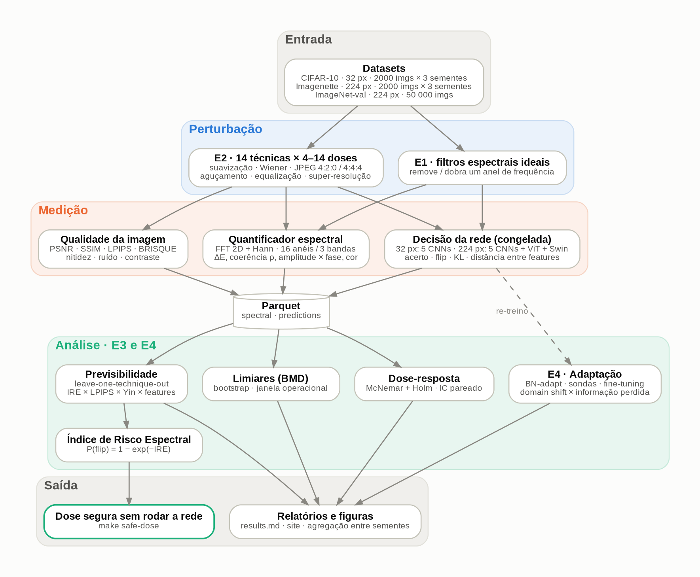

*Cada imagem passa por cada técnica em cada dose; o resultado é medido em três frentes (espectro, qualidade e decisão da rede) e guardado por (imagem, condição). Fonte do diagrama: [docs/figures/pipeline.dot](docs/figures/pipeline.dot).*

1. **Técnicas.** Suavização (gaussiano, mediana, bilateral), restauração (Wiener), compressão (JPEG 4:2:0 e 4:4:4), aguçamento
   (unsharp, laplaciano), equalização (global, CLAHE, CLAHE misturado) e super-resolução (bicúbica, ESPCN, FSRCNN).
2. **Espectro.** FFT 2D com janela de Hann sobre a luminância e a cor; energia, coerência e decomposição amplitude/fase em 16 anéis
   e 3 bandas.
3. **Decisão.** Acurácia, *flip*, KL, confiança e distância entre features. Teste de McNemar com Holm; bootstrap pareado para os
   limiares.
4. **Validação.** Previsão *leave-one-technique-out*, comparação com PSNR/SSIM/LPIPS/Yin, transferência dos filtros ideais,
   adaptação e BRISQUE. Há também um kit pronto para um estudo com pessoas (escolha entre 2 imagens).

Detalhes, equações e decisões de desenho: [MODELAGEM.md](MODELAGEM.md). Todas as tabelas, inclusive por modelo: [results.md](results.md).

## Reproduzir

```bash
make setup                         # cria .venv e instala dependências (TORCH_INDEX_URL=... para GPU)
make download                      # pesos de SR, CIFAR-10, Imagenette e pesos dos classificadores
make test && make verify           # testes + técnicas do zero × OpenCV/PIL/SciPy
make sweep                         # varredura completa no CIFAR-10 (~1h40 em CPU)
make sweep DATASETS=imagenette     # 224 px com ViT (GPU recomendada)
make report                        # regera as figuras deste README e os dados do site
make safe-dose T=gaussian M=cifar10_resnet20 TAU=0.01   # dose segura pela fórmula, sem rodar a rede
make human-export                  # kit do estudo com pessoas (index.html local)

# rodada final: ImageNet-val completo + 12 modelos + 3 sementes + LPIPS (≈ 8–9 h em 2 GPUs)
setsid nohup bash scripts/run_publicacao.sh &   # retomável; progresso: bash scripts/status_publicacao.sh
python scripts/figuras_publicacao.py            # figuras *_pub.png e tabelas em docs/resultados/pub/
python scripts/ire_transfer.py                  # IRE entre modelos e bases (~25 min em CPU)
make report                                     # figuras do README e dados do site a partir da rodada final
```

O ImageNet-val deve estar em `data/imagenet/val/<wnid>/*.JPEG` (`paths.imagenet_val` em
[configs/pub_imagenet.yaml](configs/pub_imagenet.yaml)).

No Windows, use o Git Bash; o `make` pode ser instalado com `choco install make`. Sem ele, os scripts em `scripts/` funcionam
direto.

## Estrutura

```
├── src/pdi_spectral/        código: técnicas (do zero + referência), espectro, pipeline, limiares, IRE, adaptação, relatório
├── configs/                 default · sweep · smoke · offline · finetune_cifar · e4_imagenette · pub_* (rodada final)
├── scripts/                 setup, download, execução, rodada final, agregação entre sementes e verificação
├── tests/                   técnicas × referência, propriedades do espectro, limiares, IRE, adaptação, pipeline
├── docs/                    site (GitHub Pages): index.html, assets/, samples/, figures/ e tabelas em resultados/
├── results.md               todos os resultados, com tabelas por modelo
├── MODELAGEM.md             hipóteses, variáveis, quantificador espectral e protocolo em detalhe
└── revisao_literatura/      artigo da revisão sistemática (LaTeX)
```

## Limitações

- **Sem sementes no ImageNet-val.** Ele usa todas as 50 mil imagens; as sementes (3) ficaram para CIFAR-10 e Imagenette, onde o
  desvio entre elas é pequeno: ≤ 0,04 de R² e ≤ 1 p.p. de acurácia.
- **Os pesos do IRE são por modelo.** Em 224 px, pesos emprestados de outros modelos acertam a ordem do dano, mas não o nível, e
  subestimam o dano nos modelos frágeis. Recalibrar só um fator de escala por modelo é o próximo passo.
- **A fórmula superestima o dano da equalização** (~2×), ou seja, erra para o lado seguro. Calibrada só em filtros ideais, ela não
  transfere para 224 px.
- **O "objetivo visual" usa métricas sem referência** (nitidez, ruído, contraste, BRISQUE). O estudo com pessoas está pronto, mas
  ainda sem respostas.
- **Só imagens naturais.** Domínios como imagens médicas, onde o pré-processamento é rotina, ficam para trabalho futuro, assim como
  entradas já degradadas (CIFAR-10-C).
- **O ImageNet-val veio de um espelho público** (`clip-benchmark/wds_imagenet1k`), com as 50 mil imagens e os rótulos oficiais.
  As acurácias originais batem com as publicadas para os pesos do torchvision: ResNet-50 76,1 %, ViT-B/16 81,1 %.

## Autoria

Beatriz Almeida Felicio · Júlio Cesar Alves Pereira · Kamilla Jordana R. de Moura — Instituto de Informática, Universidade Federal de
Goiás. Trabalho da disciplina de Processamento Digital de Imagens.
