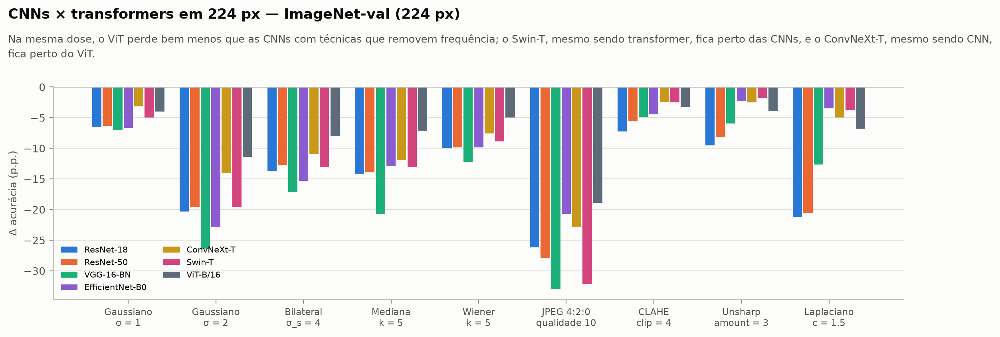
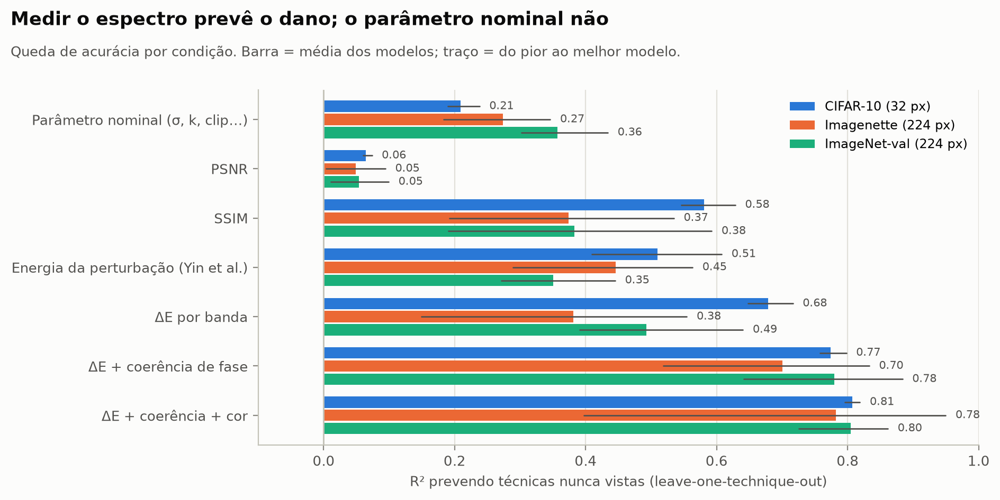

<div align="center">

# Quando melhorar piora

**Pré-processamento perceptual, energia espectral e acurácia de classificadores de imagem**

Técnicas clássicas que deixam uma imagem *melhor para pessoas* também a deixam melhor para uma rede neural?
Medimos, dose a dose, 14 técnicas em 6 classificadores pré-treinados e 2 resoluções, achamos o limiar a partir do qual cada uma
prejudica a rede e propomos uma fórmula que prevê esse dano a partir do espectro de Fourier.

[**Site interativo**](https://beatrizalmeidaf.github.io/pdi/) ·
[Resultados completos](results.md) ·
[Modelagem detalhada](MODELAGEM.md) ·
[Revisão sistemática](revisao_literatura/main.tex)


</div>


---

## Resumo

Pipelines de visão computacional costumam "melhorar" a imagem antes de classificá-la: suavizam ruído, aguçam bordas, equalizam
contraste, comprimem, super-resolvem. A suposição implícita é que o que é melhor para o olho humano também é melhor para a rede. Uma
revisão sistemática de 29 estudos mostrou que essa suposição quase nunca é testada para equalização, aguçamento e super-resolução, e
que a literatura mede a "dose" de uma técnica pelo seu parâmetro (σ, raio, qualidade), não pelo que ela faz ao sinal.

Este trabalho:
- aplica **14 técnicas** em **8 a 12 intensidades** cada a **2000 imagens** de dois datasets: CIFAR-10 (32 px, 3 CNNs) e Imagenette
  (224 px, 2 CNNs e 1 Vision Transformer);
- mede quanto a acurácia muda, **com modelos congelados**, como seriam usados na prática.

**Em uma frase:** em 32 px, *nenhuma* dose de *nenhuma* técnica melhora o classificador; em 224 px, só o aguçamento leve melhora; e
o dano de qualquer técnica é previsível a partir do espectro da perturbação (R² 0,85–0,92), mas não a partir do parâmetro nominal
(R² ≈ 0,2) nem do PSNR (0,06).

---

## Principais achados

### 1. "Melhorar" a imagem quase sempre piora a rede

Todas as 14 técnicas degradam a acurácia de forma monotônica a partir de alguma dose. No CIFAR-10, nenhum ganho é significativo. Em
224 px a degradação é mais lenta: os modelos maiores toleram doses bem maiores de aguçamento, equalização e JPEG.


### 2. Cada técnica tem um limiar, e às vezes uma janela operacional

O **BMD** (*benchmark dose*) é a intensidade em que a acurácia cai 1 p.p., estimada com IC 90 % por bootstrap pareado. Existe
**janela operacional** quando o objetivo visual da técnica é atingido *antes* do limite seguro: +10 % de nitidez, −10 % de ruído ou
+10 % de contraste.


| Técnica (parâmetro) | BMD 1 p.p. — CIFAR-10 | BMD 1 p.p. — Imagenette | Janela (CIFAR / Imagenette) | Melhor ganho em 224 px |
|---|---|---|---|---|
| Unsharp masking (amount) | 0,45–0,56 | 1,55–2,64 | ✅ 3/3 · ✅ 3/3 | **+2,0 p.p.** (ResNet-50) |
| Laplaciano (c) | 0,09–0,13 | 0,63–1,47 | ❌ · ✅ 3/3 | **+2,8 p.p.** (ResNet-50) |
| Equalização global (α) | 0,18–0,20 | 0,46–0,70 | ❌ · ✅ só ViT | — |
| CLAHE misturado (α) | 0,42–0,62 | 0,47–0,90 | ✅ 2/3 · ❌ | +0,3 p.p. (no limite) |
| Gaussiano (σ) | **0,43–0,45** | **0,38–0,46** | ✅ 3/3 · ✅ 2/3 | — |
| Bilateral (σ_s) | 0,88–1,11 | 0,77–1,19 | ❌ · ❌ | — |
| Mediana / Wiener (k) | k = 3 já custa 12–18 p.p. | k = 3 já custa 2,6–6,8 p.p. | ❌ · ❌ | — |
| JPEG 4:2:0 (qualidade) | ≈ 98 (VGG: já na 100) | ≈ 91–93 (R50: já na 100) | — | — |
| JPEG 4:4:4 (qualidade) | ≈ 95–96 | ≈ 74–88 | — | +0,4 p.p. (no limite) |
| SR bicúbica (escala) | < 1,05 | ≈ 1,03–1,05 | — | — |

*Faixa = entre os 3 modelos de cada dataset. O limiar do gaussiano é quase o mesmo em pixels nas duas resoluções. "No limite": ganho
pequeno com IC raspando o zero. Com 42 testes a IC 90 %, ~4 falsos positivos são esperados ao acaso.*

### 3. Hormese: só em 224 px, e só no aguçamento

O laplaciano e o unsharp **leves** melhoram a acurácia com IC acima de zero nos modelos de 224 px; doses maiores voltam a piorar.
O CLAHE, que a literatura sugeria como candidato a melhorar (Hendrycks & Dietterich, 2019), só piorou.


### 4. A banda de frequência que importa muda com a resolução e a arquitetura

Com filtros ideais que removem um anel de frequência por vez:
- em 32 px, o que mais dói é a **média-alta frequência** (0,28–0,41 ciclo/pixel);
- em 224 px, a **mais baixa**: removê-la custa 68–77 p.p.;
- o **ViT** depende quase só dela, e por isso perde até **2× menos** que as CNNs com técnicas que removem frequência. No aguçamento
  forte, porém, ele não é o mais robusto.




### 5. Medir o espectro prevê o dano; o parâmetro nominal não

Uma regressão prevê a queda de acurácia de cada técnica **usando só as outras** (*leave-one-technique-out*):

| Preditor | R² CIFAR-10 | R² Imagenette |
|---|---|---|
| Parâmetro nominal (σ, k, clip…) — o que a literatura usa | 0,21 | 0,28 |
| PSNR | 0,06 | 0,06 |
| SSIM | 0,56 | 0,43 |
| Energia da perturbação por banda (Yin et al., 2019) | 0,49 | 0,48 |
| ΔE por banda | 0,69 | 0,48 |
| ΔE por banda + coerência de fase | 0,78 | 0,77 |
| **ΔE por banda + coerência de fase + cor** | **0,81** | **0,89** |



### 6. Uma fórmula para o risco: o Índice de Risco Espectral (IRE)

$$
\mathrm{IRE}=\sum_b w_b\,D_b^{\gamma}+\sum_b c_b\,\big(D^{\mathrm{cor}}_b\big)^{\gamma}+\sum_{B} u_B\,(1-\rho_B)^{\gamma},
\qquad
\widehat{P}(\text{decisão mudar})=1-e^{-\mathrm{IRE}}
$$

- **D_b** é a energia da perturbação no anel de frequência *b*, e **D^cor_b** o mesmo nos canais de cor.
- **1 − ρ_B** é a perda de coerência espectral, isto é, de estrutura e fase.
- Os pesos **w, c, u ≥ 0** e o expoente **γ** são ajustados uma vez por modelo.

Como só uma decisão que muda pode virar erro, **IRE ≤ −ln(1 − τ) garante queda de acurácia ≤ τ**. Daí sai a dose segura de uma
técnica nova **sem rodar a rede** (`make safe-dose`).

Desempenho prevendo técnicas que a fórmula não viu:
- R² **0,85–0,92** e Spearman 0,94–0,97;
- calibrada só com filtros ideais, R² 0,76–0,81 em 32 px; em 224 px precisa de técnicas reais.

A coerência de fase foi o que fez a fórmula funcionar: com ela o R² sobe de 0,23 para 0,85.


### 7. Domain shift ou informação perdida?

Re-treinar o modelo nas imagens processadas separa o que ele poderia recuperar do que a imagem perdeu de fato.

- **Aguçamento e blur leve são *domain shift*.** Só re-estimar as estatísticas do BatchNorm, sem tocar em nenhum peso, leva o blur
  σ = 1 de 39,6 % para 83 % no CIFAR-10. O fine-tuning recupera 91–99 %.
- **JPEG forte e mediana destroem informação:** mesmo re-treinando, ficam 7–13 p.p. abaixo do controle.


### 8. No JPEG de alta qualidade, quem muda a decisão é a cor

Na qualidade **100**, o JPEG padrão, que subamostra a cor (4:2:0), já custa até 1,4 p.p.; sem subamostrar (4:4:4), ~0. Na qualidade
98, o erro de cor é ~10× o de luminância.


### 9. O que é bom para pessoas e o que é bom para a rede

Cruzando uma métrica perceptual independente (BRISQUE) com a acurácia:
- **em 32 px**, a qualidade percebida só sobe às custas do classificador;
- **em 224 px**, o aguçamento leve melhora as duas coisas ao mesmo tempo, e o BRISQUE melhora muito antes do limiar da rede.


---

## O que é inovação aqui

| Lacuna da literatura (revisão, 29 estudos) | O que este trabalho faz |
|---|---|
| Equalização, aguçamento e super-resolução quase sem evidência | 14 técnicas, com essas três como grupo principal e suavização/JPEG como controle que reproduz a literatura |
| "Dose" medida pelo parâmetro do algoritmo | **Dose medida no sinal:** ΔE por banda, coerência de fase e perturbação de cor, imagem a imagem. É isso que permite comparar e prever técnicas diferentes num mesmo eixo |
| Sem limiares, só tabelas de pontos | **Modelagem dose-resposta** com vocabulário da toxicologia (BMD, BMDL, NOAEL, LOAEL, hormese), IC por bootstrap pareado e **janela operacional** (objetivo visual × limite seguro) |
| Perda de informação confundida com *domain shift* | Mesma bateria com modelo congelado, BatchNorm re-estimado, sonda linear e fine-tuning |
| Hipótese espectral frágil e qualitativa | **Índice de Risco Espectral:** fórmula de risco com garantia formal de acurácia, validada em técnicas que não viu, e dose segura sem rodar a rede |

Também saíram do trabalho três achados de implementação que afetam qualquer estudo do tipo:
- a **subamostragem de cor domina o JPEG** de alta qualidade;
- o **clip do CLAHE é quantizado** em blocos pequenos: em 32 px, todo clip < 2 gera a mesma imagem;
- o **BRISQUE precisa ser resumido pela variação da média**, porque pode valer ≈ 0 ou ser negativo e a média de razões explode.

Todas as técnicas foram **implementadas do zero** em NumPy e validadas contra OpenCV, PIL e SciPy: diferença média ≤ 1,7 nível de
cinza, PSNR ≥ 37 dB.

## Hipóteses

| # | Hipótese | Resultado |
|---|---|---|
| H1 | Técnicas perceptuais degradam classificadores, de forma monotônica com a dose | ✅ Confirmada. Exceção: o aguçamento leve em 224 px melhora (hormese) |
| H2 | O ΔE medido prevê o dano melhor que o parâmetro nominal e o PSNR | ✅ R² 0,2 / 0,06 → 0,81–0,89 |
| H3 | A banda crítica depende da resolução e da arquitetura | ✅ 32 px: média-alta; 224 px: a mais baixa; ViT: quase só ela |
| H4 | Técnicas invertíveis causam *domain shift*; destrutivas, perda de informação | ✅ Nas pontas: aguçamento/blur leve recuperam 91–99 %; JPEG/mediana deixam 7–13 p.p. |
| H5 | A coerência de fase acrescenta poder explicativo à energia | ✅ +0,06 a +0,49 de R² |
| H6 | Existe janela operacional para técnicas redistributivas | 🟡 Parcial: blur leve, unsharp e CLAHE fraco sim; equalização global, laplaciano (32 px), bilateral e mediana não |
| H7 | O IRE prevê o dano de técnicas que não viu | ✅ R² 0,85–0,92. Calibrado só em filtros ideais, só funciona em 32 px |

## Como funciona


*Cada imagem passa por cada técnica em cada dose; o resultado é medido em três frentes (espectro, qualidade e decisão da rede) e guardado por (imagem, condição). Fonte do diagrama: [docs/figures/pipeline.dot](docs/figures/pipeline.dot).*

1. **Técnicas.** Suavização (gaussiano, mediana, bilateral), restauração (Wiener), compressão (JPEG 4:2:0 e 4:4:4), aguçamento
   (unsharp, laplaciano), equalização (global, CLAHE, CLAHE misturado) e super-resolução (bicúbica, ESPCN, FSRCNN).
2. **Espectro.** FFT 2D com janela de Hann sobre a luminância e a cor; energia, coerência e decomposição amplitude/fase em 16 anéis
   e 3 bandas.
3. **Decisão.** Acurácia, *flip*, KL e confiança. Teste de McNemar com Holm; bootstrap pareado (1000 reamostragens) para os limiares.
4. **Validação.** Previsão *leave-one-technique-out*, transferência dos filtros ideais, adaptação e BRISQUE. Há também um kit pronto
   para um estudo com pessoas (escolha entre 2 imagens).

Detalhes, equações e decisões de desenho: [MODELAGEM.md](MODELAGEM.md). Todas as tabelas, inclusive por modelo: [results.md](results.md).

## Reproduzir

```bash
make setup                         # cria .venv e instala dependências (TORCH_INDEX_URL=... para GPU)
make download                      # pesos de SR, CIFAR-10, Imagenette e pesos dos classificadores
make test && make verify           # testes + técnicas do zero × OpenCV/PIL/SciPy
make sweep                         # varredura completa no CIFAR-10 (~1h40 em CPU)
make sweep DATASETS=imagenette     # 224 px com ViT (GPU recomendada)
make report                        # regera as figuras deste README e os dados do site
make safe-dose T=gaussian M=cifar10_resnet20 TAU=0.01   # dose segura pela fórmula, sem rodar a rede
make human-export                  # kit do estudo com pessoas (index.html local)
```

No Windows, use o Git Bash; o `make` pode ser instalado com `choco install make`. Sem ele, os scripts em `scripts/` funcionam
direto.

## Estrutura

```
├── src/pdi_spectral/        código: técnicas (do zero + referência), espectro, pipeline, limiares, IRE, adaptação, relatório
├── configs/                 default · sweep (varredura densa) · smoke · offline · finetune_cifar · e4_imagenette
├── scripts/                 setup, download, execução e verificação
├── tests/                   técnicas × referência, propriedades do espectro, limiares, IRE, adaptação, pipeline
├── docs/                    site (GitHub Pages): index.html, assets/, samples/, figures/ e tabelas em resultados/
├── results.md               todos os resultados, com tabelas por modelo
├── MODELAGEM.md             hipóteses, variáveis, quantificador espectral e protocolo em detalhe
└── revisao_literatura/      artigo da revisão sistemática (LaTeX)
```

## Limitações

- **Dois datasets, 10 classes no de 224 px.** O Imagenette é um subconjunto do ImageNet. Os números finais deveriam vir do
  ImageNet-val completo.
- **Uma semente e 3 épocas no fine-tuning.** No Imagenette, o problema de 10 classes satura nas doses moderadas.
- **A fórmula superestima o dano da equalização** (~2×), ou seja, erra para o lado seguro. Calibrada só em filtros ideais, ela não
  transfere para 224 px.
- **O "objetivo visual" usa métricas sem referência** (nitidez, ruído, contraste, BRISQUE). O estudo com pessoas está pronto, mas
  ainda sem respostas.

## Autoria

Beatriz Almeida Felicio · Júlio Cesar Alves Pereira · Kamilla Jordana R. de Moura — Instituto de Informática, Universidade Federal de
Goiás. Trabalho da disciplina de Processamento Digital de Imagens.
