# Resultados

Esse arquivo reúne o que foi executado e os resultados obtidos até agora. A modelagem, as hipóteses e os métodos estão no [README.md](README.md). As figuras e tabelas citadas aqui ficam em [docs/resultados/](docs/resultados/), e os dados brutos em `results/` (não versionado).

> **Escopo.** As seções 2 a 9 usam **CIFAR-10** (32×32 px) com **3 CNNs** pré-treinadas, rodando em CPU. A [§10](#10-imagenette-224-px-e-vit-o-que-muda) repete a varredura no **Imagenette** (224 px) com **ResNet-50, EfficientNet-B0 e ViT-B/16** (Colab, A100) e mostra o que muda. Várias conclusões do CIFAR **não valem em 224 px**; quando é o caso, a seção do CIFAR aponta para a §10.
>
> **Rodada final.** A [§0](#0-rodada-final-imagenet-val-completo-12-modelos-3-sementes) resume a rodada que responde às limitações de escala: **ImageNet-val completo** (50 mil imagens), **12 modelos** (10 CNNs + ViT-B/16 + Swin-T), **3 sementes** no CIFAR-10 e no Imagenette, e a comparação do IRE com LPIPS, Yin et al. e a distância entre features. Onde ela e as seções antigas discordam, vale a §0.

---

## Sumário

0. [Rodada final: ImageNet-val completo, 12 modelos, 3 sementes](#0-rodada-final-imagenet-val-completo-12-modelos-3-sementes)
1. [O que rodou](#1-o-que-rodou)
2. [Validação das implementações (E0)](#2-validação-das-implementações-e0)
3. [Limiares por técnica e janela operacional (H1, H6)](#3-limiares-por-técnica-e-janela-operacional-h1-h6)
4. [Achados específicos](#4-achados-específicos)
5. [Previsibilidade espectral (H2, H5)](#5-previsibilidade-espectral-h2-h5)
6. [Fórmula IRE (H7)](#6-fórmula-ire-h7)
7. [Sensibilidade por banda — oráculo (E1, H3)](#7-sensibilidade-por-banda--oráculo-e1-h3)
8. [Domain shift × perda de informação (E4, H4)](#8-domain-shift--perda-de-informação-e4-h4)
9. [Validação perceptual: BRISQUE e estudo com pessoas](#9-validação-perceptual-brisque-e-estudo-com-pessoas)
10. [Imagenette (224 px) e ViT: o que muda](#10-imagenette-224-px-e-vit-o-que-muda)
11. [O que ainda não foi feito](#11-o-que-ainda-não-foi-feito)
12. [Como reproduzir](#12-como-reproduzir)

---

## 0. Rodada final: ImageNet-val completo, 12 modelos, 3 sementes

| Base | Imagens | Modelos | Sementes | Config |
|---|---|---|---|---|
| CIFAR-10 (32 px) | 2000 por semente | ResNet-20, ResNet-56, VGG-16-BN, MobileNetV2, RepVGG-A0 | 3 | [pub_cifar10.yaml](configs/pub_cifar10.yaml) |
| Imagenette (224 px) | 2000 por semente (+ 2000 de treino no E4) | ResNet-18, ResNet-50, VGG-16-BN, EfficientNet-B0, ConvNeXt-T, ViT-B/16, Swin-T | 3 | [pub_imagenette.yaml](configs/pub_imagenette.yaml) |
| ImageNet-val (224 px) | **50 000** (1 excluída, ver abaixo) | os mesmos 7 | — | [pub_imagenet.yaml](configs/pub_imagenet.yaml) |

Cada semente sorteia outro subconjunto de imagens e outro fine-tuning. A rodada levou ~8 h em 2 GPUs: o ImageNet foi dividido em 80
fatias processadas em paralelo e depois unidas (`pdi merge-shards`). Orquestração em
[scripts/run_publicacao.sh](scripts/run_publicacao.sh); agregação em [scripts/aggregate_seeds.py](scripts/aggregate_seeds.py).
Tabelas agregadas (média ± desvio entre sementes) em [docs/resultados/pub/](docs/resultados/pub/).

**Acurácia nas imagens originais.** As do ImageNet-val batem com as publicadas para os pesos do torchvision:

| Modelo | ImageNet-val | Imagenette (1000 classes) |
|---|---|---|
| ResNet-18 | 69,8 % | 77,8 ± 0,2 % |
| ResNet-50 | 76,1 % | 84,4 ± 0,1 % |
| VGG-16-BN | 73,4 % | 80,2 ± 0,5 % |
| EfficientNet-B0 | 77,6 % | 85,0 ± 0,2 % |
| ConvNeXt-T | 82,1 % | 86,7 ± 0,0 % |
| ViT-B/16 | 81,1 % | 91,2 ± 0,2 % |
| Swin-T | 81,0 % | 83,9 ± 0,6 % |

No CIFAR-10, as acurácias vão de 92,3 % (ResNet-20) a 94,4 % (ResNet-56, RepVGG-A0).

### 0.1 IRE × preditores existentes

R² *leave-one-technique-out* da probabilidade de *flip* por condição, na média dos modelos (± desvio entre sementes):

| Preditor | CIFAR-10 | Imagenette | ImageNet-val |
|---|---|---|---|
| Distância cosseno entre features (precisa rodar a rede) | 0,99 ± 0,00 | 0,95 ± 0,00 | 0,98 |
| Distância L2 entre features (precisa rodar a rede) | 0,96 ± 0,00 | 0,92 ± 0,00 | 0,95 |
| **IRE** | **0,86 ± 0,00** | **0,86 ± 0,01** | **0,91** |
| ΔE por banda + coerência + cor (ridge) | 0,82 ± 0,01 | 0,74 ± 0,04 | 0,79 |
| LPIPS (Zhang et al., 2018) | 0,90 ± 0,00 | 0,73 ± 0,01 | 0,67 |
| SSIM | 0,59 ± 0,00 | 0,54 ± 0,01 | 0,47 |
| Energia por banda (Yin et al., 2019) | 0,49 ± 0,02 | 0,61 ± 0,01 | 0,42 |
| Parâmetro nominal | 0,23 ± 0,00 | 0,42 ± 0,00 | 0,47 |
| PSNR | 0,08 ± 0,00 | 0,14 ± 0,00 | 0,12 |

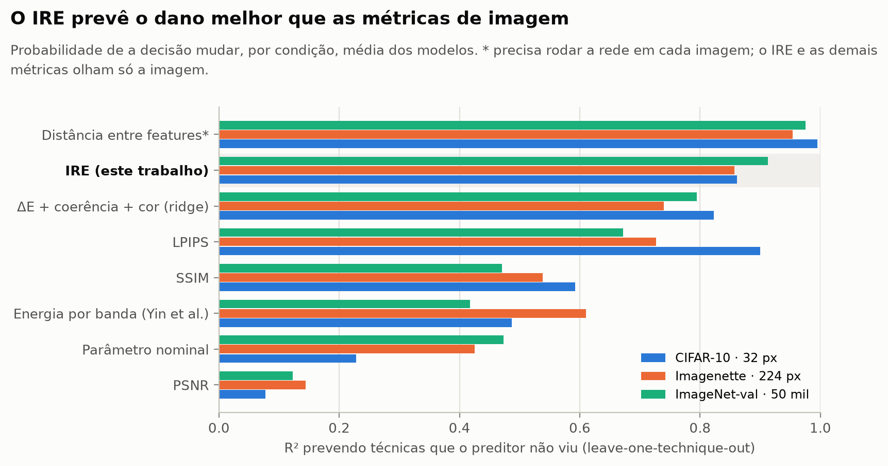

- Entre os preditores que olham só a imagem, o IRE é o melhor nas duas bases de 224 px. No CIFAR-10, o LPIPS fica 0,04 à frente.
- O IRE por modelo vai de R² 0,78 (Swin-T, Imagenette) a 0,95 (ResNet-18, ImageNet-val), com Spearman 0,92–0,98.
- A distância entre features acerta mais porque é a própria rede respondendo: ela serve de teto, não de concorrente, para um
  preditor que dispensa rodar o modelo.
- Calibrado só com filtros ideais, o IRE continua funcionando em 32 px (R² 0,75–0,81) e falhando em 224 px (R² < 0,2), como na §10.6.

**Imagem excluída.** Uma imagem do ImageNet-val é praticamente branca (`n03623198/s0030765.JPEG`, pixels entre 253 e
255).
- A energia original dela é quase zero, então a perturbação espectral relativa chegava a ~4,9 × 10⁴, contra ≤ 45 nas outras imagens.
- Sozinha, ela distorcia a média das condições: Yin et al. caía de 0,42 para 0,10 e o ridge espectral de 0,79 para 0,63. O IRE não
  mudava.
- A análise agora exclui imagens com desvio de luminância original < 1/255 (`analysis.min_image_std`), em que a medida relativa não
  é definida. O critério é fixo e não foi ajustado aos resultados.
- Só essa imagem foi excluída, e nenhuma no CIFAR-10 ou no Imagenette. A lista sai em `excluded_flat_images.csv`.

### 0.2 O que ajuda: hormese só no Imagenette

Ganhos com IC 90 % acima de zero:

| Base | Onde há ganho significativo | Maior ganho |
|---|---|---|
| CIFAR-10 | nenhum (0 de 70 combinações modelo × técnica, nas 3 sementes) | — |
| Imagenette | laplaciano leve nos 7 modelos e unsharp leve em 3 (ResNet-50, VGG-16-BN, EfficientNet-B0), em ≥ 2 das 3 sementes | +2,7 p.p. (ResNet-50, laplaciano c = 0,2) |
| ImageNet-val | só o Swin-T: laplaciano, unsharp e, no limite, CLAHE misturado e JPEG 4:4:4 q = 99 | +0,3 p.p. |

No ImageNet-val, a mesma dose que dá +2,7 p.p. à ResNet-50 no Imagenette custa −1,4 p.p. O ganho do aguçamento depende de o problema
ter poucas classes, bem separadas. **Não é uma recomendação geral.**

### 0.3 Quem aguenta mais

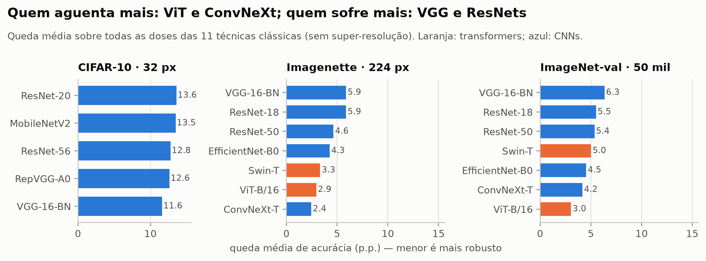

Queda média de acurácia sobre todas as doses das 11 técnicas clássicas:

| Base | Do mais robusto para o mais frágil |
|---|---|
| CIFAR-10 | VGG-16-BN 11,6 · RepVGG-A0 12,6 · ResNet-56 12,8 · MobileNetV2 13,5 · ResNet-20 13,6 p.p. |
| Imagenette | ConvNeXt-T 2,4 · ViT-B/16 2,9 · Swin-T 3,3 · EfficientNet-B0 4,3 · ResNet-50 4,6 · ResNet-18 5,9 · VGG-16-BN 5,9 p.p. |
| ImageNet-val | ViT-B/16 3,0 · ConvNeXt-T 4,2 · EfficientNet-B0 4,5 · Swin-T 5,0 · ResNet-50 5,4 · ResNet-18 5,5 · VGG-16-BN 6,3 p.p. |

- Removendo só a banda mais baixa (filtro ideal), o ViT é o que mais perde no ImageNet-val (−64 p.p.) e o ConvNeXt o que menos perde
  (−30 p.p.).
- Ou seja, o ViT aguenta bem a maioria das técnicas porque quase só usa a faixa baixa, que elas preservam.

### 0.4 Limiares

O desfoque gaussiano cruza 1 p.p. em σ = 0,46–0,50 (CIFAR-10), 0,38–0,69 (Imagenette) e 0,51–0,64 (ImageNet-val): quase o mesmo
valor em pixels nos 12 modelos.

| Técnica | CIFAR-10 | Imagenette | ImageNet-val |
|---|---|---|---|
| Unsharp (amount) | 0,49–0,73 | 1,54–2,72 | 0,68–2,10 |
| Laplaciano (c) | 0,11–0,14 | 0,50–1,45 | 0,16–0,66 |
| Equalização global (α) | 0,26–0,38 | 0,30–0,90 | 0,34–0,66 |
| CLAHE misturado (α) | 0,52–0,79 | 0,42–0,95 | 0,46–0,97 |
| Bilateral (σ_s) | 1,02–1,24 | 0,83–2,12 | 0,73–1,49 |
| JPEG 4:2:0 (qualidade) | 97,5–99,7 | 85–100 | 88–97 |
| JPEG 4:4:4 (qualidade) | 93–95 | 68–86 | 67–92 |

Na qualidade 100, o JPEG 4:2:0 custa 0,3–1,0 p.p. (CIFAR-10) e 0,1–0,6 p.p. (ImageNet-val), e o 4:4:4 custa ~0.

### 0.5 Domain shift × informação perdida, com sementes

| Condição | Original | Congelado | Só BatchNorm | Fine-tuning | Falta para o original |
|---|---|---|---|---|---|
| CIFAR-10 · gaussiano σ = 1 | 93,8 % | 39,3 % | 85,1 % | 89,5 % | 4,4 p.p. |
| CIFAR-10 · unsharp 1,0 | 93,8 % | 91,6 % | 90,3 % | 93,0 % | 0,9 p.p. |
| CIFAR-10 · laplaciano 0,5 | 93,8 % | 85,4 % | 89,5 % | 92,7 % | 1,2 p.p. |
| CIFAR-10 · mediana k = 3 | 93,8 % | 80,8 % | 83,4 % | 87,4 % | 6,5 p.p. |
| CIFAR-10 · Wiener k = 5 | 93,8 % | 73,5 % | 83,1 % | 87,2 % | 6,7 p.p. |
| CIFAR-10 · JPEG q = 30 | 93,8 % | 68,5 % | 67,8 % | 80,9 % | 12,9 p.p. |
| Imagenette · gaussiano σ = 3 | 99,6 % | 89,2 % | 89,4 % | 95,8 % | 3,8 p.p. |
| Imagenette · mediana k = 9 | 99,6 % | 90,4 % | 94,1 % | 96,7 % | 3,0 p.p. |
| Imagenette · JPEG q = 10 | 99,6 % | 95,7 % | 93,3 % | 97,5 % | 2,2 p.p. |
| Imagenette · unsharp 3,0 | 99,6 % | 99,2 % | 98,9 % | 99,3 % | 0,4 p.p. |

Médias dos modelos (5 no CIFAR-10, 7 no Imagenette) e das 3 sementes; o desvio entre sementes é ≤ 1,3 p.p. No Imagenette a acurácia
é medida entre as 10 classes, por isso começa em 99,6 %.

A rodada anterior do E4 no Imagenette tinha um problema: 5 das 10 classes estavam vazias no conjunto de treino, por uma extração
incompleta. Ela foi refeita com o treino completo (9469 imagens), e os números acima já são posteriores à correção.

### 0.6 O IRE calibrado num modelo serve para outro? E a dose segura é segura?

Os pesos do IRE são ajustados por modelo; o LOTO testa técnicas novas, não modelos novos. [scripts/ire_transfer.py](scripts/ire_transfer.py) ajusta os pesos em outros modelos (com o mesmo número de linhas por modelo) e prevê o modelo que ficou de fora:

| Protocolo | CIFAR-10 | Imagenette | ImageNet-val |
|---|---|---|---|
| Próprio modelo, técnica nova (LOTO) | 0,86 (0,85–0,87) | 0,86 (0,77–0,94) | 0,91 (0,87–0,94) |
| Outros modelos | 0,89 (0,88–0,90) | 0,66 (−0,10–0,93) | 0,76 (0,42–0,91) |
| Outros modelos **e** técnica nova | 0,85 (0,84–0,87) | 0,63 (−0,11–0,92) | 0,74 (0,36–0,90) |
| Mesmo modelo, outra base de 224 px | — | 0,80 (0,64–0,93) | 0,80 (0,69–0,93) |

R² do flip por condição, média dos modelos (mín.–máx.). O Spearman fica entre 0,89 e 0,97 em todos os protocolos.

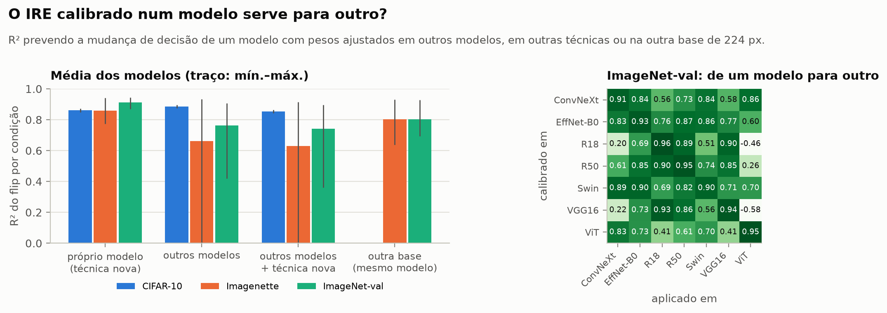

- **Em 32 px o IRE transfere sem perda.** Calibrado nos outros 4 modelos, prevê o quinto tão bem quanto os pesos do próprio
  modelo, inclusive em técnica nova (0,85).
- **Em 224 px a ordem transfere, o nível não.** O Spearman continua em 0,89–0,97: o IRE calibrado em outros modelos ordena
  corretamente as condições, da mais à menos danosa. O que não transfere é a escala.
  - Nos modelos "medianos" (ResNet-50, EfficientNet-B0, Swin-T) o R² fica em 0,77–0,92.
  - Nos extremos ele cai. O ViT-B/16, o mais robusto, é superestimado em ~6 p.p. de flip (R² 0,36–0,42 no ImageNet-val, ~0 no
    Imagenette). A ResNet-18 e a VGG-16-BN, as mais frágeis, são subestimadas em ~5 p.p. (R² 0,68–0,77).
- **Entre bases, o mesmo modelo transfere razoavelmente** (R² 0,64–0,93), com viés de ~3 p.p.: a mesma perturbação muda mais
  decisões no ImageNet-val (1000 classes) que no Imagenette (10).
- **Consequência.** O perfil de vulnerabilidade (quais bandas importam) é parecido entre os modelos, mas a sensibilidade total é
  própria de cada um. Com pesos emprestados, o IRE subestima o dano justamente nos modelos frágeis.

**Pesos compartilhados + 1 fator de escala por modelo** ([scripts/ire_escala.py](scripts/ire_escala.py)). Os pesos de banda vêm
dos outros modelos, sem a técnica prevista; o modelo-alvo ajusta só k em P = 1 − exp(−k · IRE). Duas fontes para k, nenhuma
com a técnica prevista:

| Protocolo (técnica e modelo novos) | CIFAR-10 | Imagenette | ImageNet-val |
|---|---|---|---|
| Pesos do próprio modelo (referência) | 0,86 | 0,86 | 0,91 |
| Pesos de outros modelos, sem escala | 0,85 | 0,63 (−0,15–0,91) | 0,74 (0,35–0,90) |
| … + escala medida só no gaussiano | 0,38 | 0,70 (0,44–0,85) | **0,84 (0,72–0,91)** |
| … + escala medida só nos filtros ideais | 0,85 | < 0 | < 0 |

- **Em 224 px, uma técnica real basta para a escala.** Com k medido só no desfoque gaussiano, o ViT vai de R² 0,35 para 0,91 no
  ImageNet-val, a ResNet-18 de 0,77 para 0,88 e a VGG de 0,75 para 0,85. A pior subestimação do flip cai de 30 para 15 p.p., o
  mesmo nível dos pesos do próprio modelo (12–19 p.p.). O preço: nos modelos medianos (EfficientNet-B0, Swin-T) o R² cai um pouco
  (até 0,72), e o viés fica levemente positivo (+2 a +5 p.p.), do lado seguro.
- **Os filtros ideais não servem para calibrar a escala em 224 px**: k sai 2–3× maior e o IRE superestima o flip em ~15 p.p.
  (R² < 0). Nunca subestima, mas fica inútil. É o mesmo motivo de o IRE calibrado só no oráculo não transferir (§10.6).
- **Em 32 px não é preciso escala.** Os pesos de outros modelos já funcionam; medir a escala no gaussiano piora (R² 0,38), porque
  no CIFAR-10 o gaussiano satura em ~80 % de flip e puxa k para cima.

**A dose segura para técnica nova: margem conformal** (`ire_conformal*.csv`).

A margem fica no **orçamento de flip**, não na dose: a regra passa a ser "aceitar a dose só se o IRE prevê flip ≤ c · τ" (orçamento
−ln(1 − c · τ)). Assim ela vale para qualquer técnica, inclusive o JPEG, cujo limiar pode cair já na qualidade 100. O fator c é
calibrado por **predição conformal** sobre as técnicas: para cada técnica, o escore é o pior modelo de τ / p̂, onde p̂ é o flip
que o IRE (sem aquela técnica) previa na dose em que o flip observado cruza τ; c = 1 / quantil conformal desses escores. Se as
técnicas forem trocáveis, uma técnica nova fica segura em **todos** os modelos com probabilidade ≥ 1 − α
([scripts/ire_conformal.py](scripts/ire_conformal.py), `thresholds.margin_scores` / `conformal_margin`).

| | CIFAR-10 | Imagenette | ImageNet-val |
|---|---|---|---|
| Sem margem (c = 1): técnicas novas seguras em todos os modelos | 38 % | 36 % | 57 % |
| **Fator conformal, α = 0,1**: técnicas novas seguras em todos os modelos | **93 %** | **93 %** | **93 %** |
| … pares modelo × técnica seguros | 98 % | 97 % | 96 % |
| … fator c (orçamento para τ = 1 %) | 0,18 (0,2 %) | 0,37 (0,4 %) | 0,55 (0,55 %) |
| … dose recomendada / dose realmente segura (mediana) | 29 % | 43 % | 54 % |
| Fator conformal, α = 0,2: técnicas seguras em todos os modelos | 86 % | 86 % | 86 % |
| … fator c / dose aproveitada | 0,24 / 44 % | 0,54 / 66 % | 0,82 / 80 % |

- A cobertura foi medida de forma honesta: o fator usado para cada técnica foi calibrado **sem** ela (LOTO) e testado nela. A
  meta era ≥ 90 % (α = 0,1) e ≥ 80 % (α = 0,2); as três bases cumprem as duas.
- A unidade da calibração é a **técnica**, não o par modelo × técnica: os modelos erram juntos numa mesma técnica. Calibrando
  sobre os pares, como se fossem independentes, a cobertura por técnica cai para 71–79 % com α = 0,1.
- O fator pode ser reaproveitado entre bases de mesma resolução, com ressalvas: calibrado no Imagenette (c = 0,40), cobre 100 %
  das técnicas no ImageNet-val; calibrado no ImageNet-val, cobre 86 % no Imagenette. Entre resoluções não: o fator do
  ImageNet-val cobre só 57 % no CIFAR-10.
- O preço é dose. Com α = 0,1, a dose recomendada fica na metade (ImageNet-val) ou em menos de um terço (CIFAR-10) da dose
  realmente segura. Sem margem, ela passa do limite real na mediana em 32 px (razão 1,20).
- A garantia supõe que as técnicas sejam trocáveis entre si e que o flip previsto cresça com a dose (7 de 602 curvas não
  crescem). Com 14 técnicas, o menor α possível é 1/15 ≈ 0,07.

No `make safe-dose`, o fator vem de `ire.safe_margin` (0,18 / 0,37 / 0,55 nas configs `pub_*`) ou de `MARGIN=`.

Tabelas: `ire_transfer.csv` (por modelo e protocolo), `ire_transfer_pares.csv` (matriz calibra em A → aplica em B), `ire_transfer_resumo.csv`, `ire_escala.csv`, `ire_escala_resumo.csv`, `ire_conformal*.csv` e `ire_dose_segura.csv`, em [docs/resultados/pub/](docs/resultados/pub/).

### 0.7 Bugs encontrados nesta rodada

- **Classe *parachute* fora do Imagenette:** o wnid estava errado (`n03888605` → `n03888257`). As rodadas antigas de
  `sweep_imagenette` têm só 9 classes.
- **BRISQUE em imagens degeneradas:** o piq falha com `AssertionError`; agora a imagem recebe NaN e sai da média.
- **Imagem quase constante no ImageNet-val** distorcendo métricas relativas (§0.1).

---

## 1. O que rodou

| Execução | Config | Dados | Etapas | Tempo | Status |
|---|---|---|---|---|---|
| Testes unitários | — | sintéticos | técnicas × referência, quantificador espectral, limiares, IRE, adaptação, qualidade/BRISQUE, análise, kit humano, pipeline offline | ~40 s | ✅ 62 passam* |
| `make verify` | `sweep.yaml` | 50 imagens CIFAR-10 | E0 | ~1 min | ✅ |
| `make offline` | `offline.yaml` | 48 imagens sintéticas + CNN sem pesos | E1, E2, E4, E3 | ~1 min | ✅ (checa que o pipeline roda; números sem significado) |
| `make smoke` | `smoke.yaml` | 64 imagens CIFAR-10, 2 modelos | E1, E2, E4, E3 | ~2 min | ✅ |
| **`make sweep`** | `sweep.yaml` | **2000 imagens CIFAR-10, 3 modelos, 106 doses + 27 filtros-oráculo** | E1 (11 min), E2 (54 min), E4 (14 min), E3 (17 min) | ~1h40 | ✅ **base deste relatório** |
| E4 com fine-tuning | `finetune_cifar.yaml` | 2000 imagens CIFAR-10 (5000 de treino), 3 modelos, 9 condições, 3 épocas | E4 | 2h07 (CPU) | ✅ §8 |
| **Sweep no Imagenette** | `sweep.yaml`, `DATASETS=imagenette` | **2000 imagens Imagenette (224 px), ResNet-50, EfficientNet-B0, ViT-B/16** | E1 (44 min), E2 (2h42), E4 (14 min), E3 | ~3h40 + E3 (Colab, A100) | ✅ §10 (o E4 desta rodada saturou) |
| E4 no Imagenette, refeito | `e4_imagenette.yaml` | mesmas 2000 imagens + 2000 de treino, 13 condições com doses fortes, fine-tuning de 3 épocas | E4, E3 | 19 min + E3 (Colab, A100) | ✅ §10.7 |
| `make human-export` | `sweep.yaml` | 12 imagens × 74 condições | kit do estudo com pessoas | <1 min | ✅ gerado; **sem respostas coletadas ainda** |

\* Os testes que precisam de torch, torchvision ou dos pesos de SR são pulados quando eles não estão instalados.

Classificadores (pesos `chenyaofo/pytorch-cifar-models`, `model.eval()`, sem nenhum ajuste):

| Modelo | Acurácia nas 2000 imagens originais |
|---|---|
| ResNet-20 | 92,85 % |
| ResNet-56 | 94,85 % |
| VGG-16-BN | 93,70 % |

Esses valores batem com os publicados para esses pesos (92,6 %, 94,4 % e 94,2 % no teste completo).

Durante as execuções, foram encontrados e corrigidos dois bugs que afetariam os resultados:
- o *backend* rápido do Wiener (SciPy) gerava bordas escuras e pixels pretos em regiões planas;
- o bilateral do OpenCV usa distância L1 entre cores, o que deixava o filtro ~3,5 dB mais fraco que o do zero.

Os resultados abaixo já são **posteriores** às correções.

---

## 2. Validação das implementações (E0)

Todas as técnicas foram implementadas do zero em NumPy e comparadas com OpenCV/PIL/SciPy em 50 imagens reais do CIFAR-10, em todas as doses da varredura ([verificacao_tecnicas.csv](docs/resultados/verificacao_tecnicas.csv)).

| Técnica | Maior diferença média (níveis de cinza, 0–255) | Menor PSNR do zero × referência |
|---|---|---|
| Gaussiano, *unsharp*, laplaciano, mediana, Wiener | 0,00–0,10 | ≥ 58 dB (idênticos ou quase) |
| CLAHE, CLAHE misturado, equalização | 0,33 | 52,9 dB |
| Bilateral | 0,39 | 47,4 dB |
| SR bicúbica, ESPCN, FSRCNN | 0,73–0,78 | 45,7 dB |
| JPEG 4:2:0 / 4:4:4 | 1,61–1,73 | 37,1 dB (DCT em ponto flutuante × inteira no libjpeg) |

O quantificador espectral também passa nos testes de propriedade:
- a identidade dá ΔE = 0;
- as bandas somam a energia total, e sem janela a energia total é igual à variância dos pixels (Parseval);
- senoides caem na banda certa;
- a decomposição D = A + P é exata.

---

## 3. Limiares por técnica e janela operacional (H1, H6)

Tabela completa: [thresholds.csv](docs/resultados/thresholds.csv). Valores = faixa entre os 3 modelos. **BMD 1 p.p.** = intensidade em que a acurácia cai 1 ponto; o **BMDL** (limite inferior do IC 90 %, bootstrap pareado com 1000 reamostragens) é a dose segura conservadora. **Objetivo visual** = intensidade em que a técnica cumpre o que promete (−10 % de ruído, +10 % de nitidez ou +10 % de contraste). **Janela** = [objetivo visual, BMDL].

| Técnica (parâmetro) | BMD 1 p.p. | BMDL | BMD 5 p.p. | Objetivo visual | Janela operacional |
|---|---|---|---|---|---|
| Gaussiano (σ) | 0,43–0,45 | 0,41–0,43 | 0,54–0,56 | 0,33 | ✅ **σ ∈ [0,33; 0,41–0,43]** nos 3 |
| *Unsharp* (amount, σ = 1) | 0,45–0,56 | 0,28–0,37 | 1,29–1,54 | 0,26 | ✅ **[0,26; 0,28–0,37]** nos 3 |
| CLAHE misturado (α, clip 2) | 0,42–0,62 | 0,27–0,44 | não cruza até α = 1 (−1,9 a −2,5 p.p. em α = 1) | 0,32 | ✅ **[0,32; 0,41–0,44]** em 2 de 3 (no VGG o BMDL = 0,27 fica antes) |
| CLAHE (clip) | já no menor clip (1): −1,4 a −2,1 p.p. | — | 3,4–4,1 | 1 | só no limite: o clip mínimo já custa > 1 p.p. |
| Equalização (α) | 0,19–0,20 | 0,10–0,14 | 0,64–0,70 | 0,16 | ❌ o BMDL vem antes do objetivo |
| Laplaciano (c) | 0,09–0,13 | 0,05–0,08 | 0,31–0,35 | 0,09 | ❌ |
| Bilateral (σ_s) | 0,88–1,11 | 0,73–0,91 | 2,0–2,7 | 1,89 | ❌ |
| Mediana (k) | k = 3 já custa 11,6–18,0 p.p. | — | — | k = 3 | ❌ (parâmetro discreto: o menor passo já passa) |
| Wiener (k) | k = 3 já custa 11,8–16,7 p.p. | — | — | k = 3 | ❌ (idem) |
| JPEG 4:2:0 (qualidade) | 97,6–100 (no VGG, já na qualidade 100) | — | 84–90 | — | — |
| JPEG 4:4:4 (qualidade) | 95,2–95,9 | 94,1–96,8 | 74–86 | — | — |
| SR bicúbica (escala) | < 1,05 (1,05 já custa 3,9–5,7 p.p.) | — | 1,04–1,14 | — | — |
| ESPCN / FSRCNN (escala) | ×2 já custa 33–42 p.p. | — | ×2 | — | — |

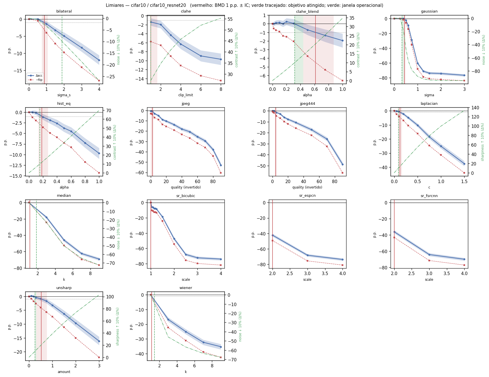
*Um painel por técnica. Azul = Δacc com IC 90 %; vermelho tracejado = −flip; linha vermelha = BMD 1 p.p., com faixa do IC; verde tracejado = dose do objetivo visual; faixa verde = janela operacional. Os outros modelos: [ResNet-56](docs/resultados/thresholds_cifar10_cifar10_resnet56.png), [VGG-16-BN](docs/resultados/thresholds_cifar10_cifar10_vgg16_bn.png).*

**Leituras principais**
- **H1 confirmada no CIFAR-10.** Todas as técnicas degradam a acurácia de forma monotônica com a dose, inclusive as que só *adicionam* alta frequência (aguçamento) ou *redistribuem* (equalização). Nenhuma técnica melhorou a acurácia com significância: **não houve hormese**. O maior ganho pontual foi +0,2 p.p. (*unsharp* 0,1; CLAHE misturado 0,02), com IC cruzando 0. **Em 224 px isso muda**: o aguçamento leve melhora a acurácia nos 3 modelos ([§10.2](#102-hormese-e-janela-operacional-h1-h6)).
- **Os limiares são estreitos e quase iguais entre arquiteturas.** No gaussiano, o BMD fica entre 0,43 e 0,45 nos 3 modelos. Entre perder 1 p.p. (σ = 0,44) e perder 5 p.p. (σ = 0,55) há só 0,11 de σ.
- **H6 parcialmente confirmada.** Existe janela operacional para **suavização gaussiana leve, *unsharp* leve e CLAHE fraco** (misturado ao original). **Não existe** para equalização global, laplaciano, bilateral, mediana e Wiener: nelas, quando o objetivo visual é atingido, o classificador já perdeu ≥ 1 p.p.
- As janelas que existem são **estreitas**: σ ∈ [0,33; 0,42] no gaussiano e amount ∈ [0,26; 0,32] no *unsharp*.

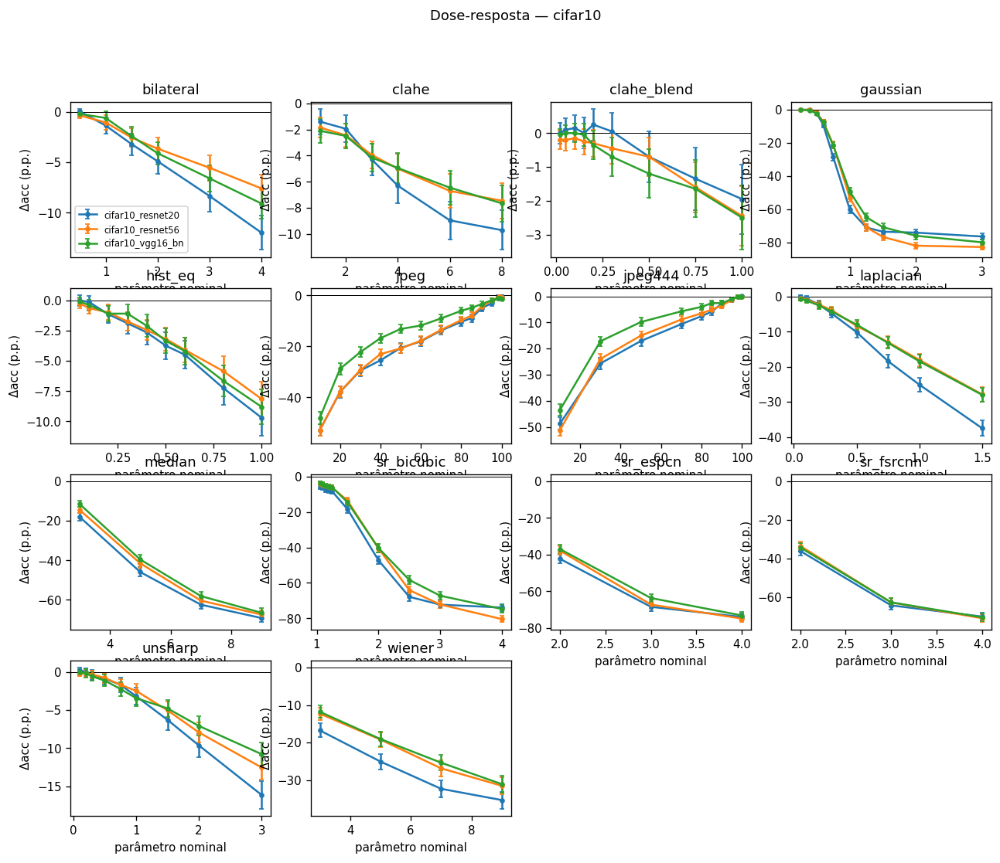

---

## 4. Achados específicos

**JPEG: em alta qualidade, a perda vem da cor, não da compressão.**

| Qualidade | 4:2:0 (padrão PIL/libjpeg) | 4:4:4 (sem subamostragem de cor) |
|---|---|---|
| 100 | −0,55 / −0,75 / −1,35 p.p. | +0,05 / −0,20 / −0,25 p.p. |
| 99 | −0,60 / −0,45 / −1,15 | −0,10 / −0,10 / −0,20 |
| 98 | −0,65 / −0,90 / −1,15 | 0,00 / −0,05 / −0,10 |
| 95 | −3,05 / −1,95 / −1,85 | −1,45 / −1,35 / −1,05 |

*(ResNet-20 / ResNet-56 / VGG-16-BN)*

Na qualidade 98, o erro de **cor** da versão 4:2:0 é ~10× o de luminância. A subamostragem de croma sozinha já muda decisões. Sem ela, o JPEG só passa de 1 p.p. por volta da qualidade 95–96.

**CLAHE: o clip é quantizado em imagens pequenas.** Em blocos de 16×16 px (CIFAR, grade 2×2), o clip efetivo é `max(int(clip × 256 / 256), 1)`. Ou seja, **todo clip < 2 gera exatamente a mesma imagem**, e a versão mais fraca possível já custa 1,4–2,1 p.p. Por isso a dose fraca de CLAHE foi feita misturando a saída com o original (α).

**Redimensionar é muito danoso em 32 px.** Reduzir 32 → 30 px e voltar (escala 1,05) já custa 3,9–5,7 p.p.; o limiar fica abaixo da menor escala possível. Na mesma escala de redução, a **SR aprendida é melhor que a bicúbica** para o classificador (FSRCNN > ESPCN > bicúbica). Isso é coerente com a QP4 da revisão: aprimorar ajuda quando a entrada está de fato degradada. **Em 224 px a vantagem some** ([§10.5](#105-super-resolução)).

| Escala | Bicúbica | ESPCN | FSRCNN |
|---|---|---|---|
| ×2 | −40,3 a −47,2 p.p. | −37,0 a −42,2 | −33,4 a −36,0 |
| ×3 | −67,2 a −72,2 | −63,6 a −68,4 | −62,6 a −64,2 |
| ×4 | −73,9 a −80,4 | −73,1 a −74,8 | −70,0 a −70,9 |

**Parâmetros discretos.** Para mediana e Wiener, k = 3 é o menor passo e já custa 12–18 p.p. Nessas técnicas não existe "dose fraca" em 32 px.

---

## 5. Previsibilidade espectral (H2, H5)

Uma regressão *ridge* prevê Δacc de cada condição usando só as outras técnicas (*leave-one-technique-out*, LOTO). Ela compara a **dose nominal** (o que a literatura usa), métricas de pixel e o **ΔE medido por banda** (proposta). Tabela: [loto.csv](docs/resultados/loto.csv).

| Preditor | R² LOTO (ResNet-20 / ResNet-56 / VGG) |
|---|---|
| parâmetro nominal (`dose_rank`) | 0,22 / 0,21 / 0,19 |
| PSNR | 0,06 / 0,06 / 0,06 |
| SSIM | 0,57 / 0,54 / 0,58 |
| energia da perturbação por banda (Yin et al.) | 0,41 / 0,50 / 0,56 |
| ΔE por banda | 0,71 / 0,65 / 0,71 |
| ΔE por banda + coerência de fase | 0,77 / 0,76 / 0,81 |
| ΔE por banda + coerência + cor | **0,82 / 0,78 / 0,81** |

**Por imagem** (prever se a decisão daquela imagem muda; AUC, validação agrupada por técnica):

| Preditor | AUC (ResNet-20 / ResNet-56 / VGG) |
|---|---|
| PSNR | 0,70 / 0,70 / 0,70 |
| ΔE por banda | 0,77 / 0,77 / 0,79 |
| ΔE por banda + coerência | **0,84 / 0,86 / 0,86** |

- **H2 confirmada.** O ΔE medido prevê o dano em técnicas não vistas muito melhor que o parâmetro nominal (R² 0,2 → 0,8) e que PSNR/SSIM.
- **H5 confirmada.** A coerência de fase (estrutura) acrescenta poder explicativo: +0,06 a +0,10 de R² e +0,07 de AUC.

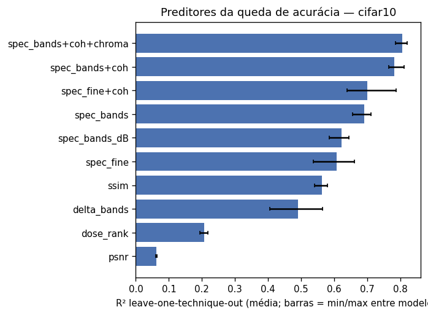

---

## 6. Fórmula IRE (H7)

**IRE = Σ w_b D_b^γ + Σ c_b D^cor_b^γ + Σ u_B (1 − ρ_B)^γ** e **P(decisão mudar) = 1 − e^(−IRE)**.

- D_b = energia da perturbação de luminância no anel b; D^cor_b = idem na cor; 1 − ρ_B = perda de coerência (estrutura); pesos ≥ 0 por modelo.
- Como só uma predição que muda pode virar erro, **IRE ≤ −ln(1 − τ) limita a queda de acurácia a τ**, desde que o IRE não subestime o flip. Para técnica nova ele subestima em ~40–60 % dos casos perto do limiar; a margem conformal da §0.6 corrige isso.

**Desempenho prevendo cada técnica sem tê-la visto** ([ire_summary.csv](docs/resultados/ire_summary.csv)):

| Modelo | R² (flip por condição) | Spearman | R² calibrando **só nos filtros ideais** | γ estimado |
|---|---|---|---|---|
| ResNet-20 | **0,872** | 0,953 | 0,799 | ≈ 0,75–0,85 |
| ResNet-56 | **0,860** | 0,953 | 0,808 | |
| VGG-16-BN | **0,865** | 0,948 | 0,763 | |

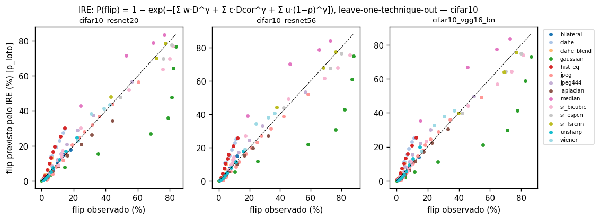

**Como a fórmula chegou aqui** (R² LOTO, ResNet-20):

| Versão | R² | O que mudou |
|---|---|---|
| Σ w·D (só energia de luminância, linear) | 0,13 | — |
| + expoente γ | 0,23 | resposta não linear |
| + perda de coerência (1 − ρ) | 0,85 | **o salto**: estrutura/fase importa mais que energia |
| + cor (D^cor) | 0,87 | corrige o JPEG (previsto/observado foi de 0,15 para ≈ 1,0) |
| + separar amplitude e estrutura (D = A + P) e brilho médio | 0,88 | ganho marginal; **não** corrigiu a equalização |

**Onde ela erra** (previsto/observado do flip médio, os 3 modelos):
- ≈ 1 (0,9–1,2) em bilateral, JPEG, JPEG 4:4:4, SR, *unsharp*, Wiener e laplaciano;
- **superestima a equalização**: HE ≈ 2,1×, CLAHE ≈ 2,1–2,3×, CLAHE misturado ≈ 1,7×;
- **subestima o blur forte**: gaussiano ≈ 0,6×, por saturação perto de 80 % de flip.

**Limiar previsto × medido** (flip de 1 %, LOTO; [ire_threshold_predictions.csv](docs/resultados/ire_threshold_predictions.csv)):
- dentro do IC do medido em **40 %** dos casos;
- erro relativo mediano de ≈ 0–20 % em mediana, Wiener, SR bicúbica, bilateral, HE, CLAHE misturado e gaussiano;
- erro de ~2× no laplaciano e no *unsharp*.

**Uso sem rede (`make safe-dose`).**
- Gaussiano, ResNet-20: a fórmula marca σ ≤ 0,40 como seguro (P(flip) previsto < 1 %). O medido foi BMD-flip 0,34 e BMD-acurácia 0,45.
- *Unsharp*: marca amount ≤ 0,2; o medido foi BMD-flip 0,11 e BMD-acurácia 0,53.
- A garantia de acurácia se manteve nos dois casos; a de flip ficou ligeiramente otimista.

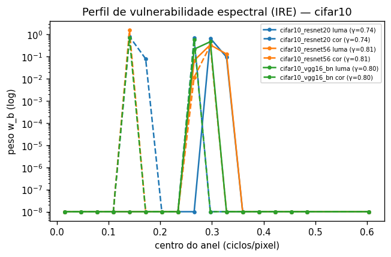

### Ajuste da fórmula para as técnicas de equalização

A fórmula superestima o dano da equalização em ~2×. Foram testadas duas correções, sempre com validação LOTO e sem rodar as redes de novo (reaproveitando as decisões salvas). Os números abaixo usam 500 imagens; a tabela completa está em [ire_tonal_experiment.csv](docs/resultados/ire_tonal_experiment.csv).

| Variante | R² (R20 / R56 / VGG) | HE | CLAHE | CLAHE mist. | *Unsharp* | Laplaciano |
|---|---|---|---|---|---|---|
| **atual** (D + cor + coerência) | **0,88 / 0,86 / 0,87** | 2,06 / 1,89 / 1,85 | 1,98 / 1,99 / 2,35 | 1,55 / 1,61 / 1,75 | 0,98 / 0,98 / 1,16 | 0,81 / 0,92 / 0,98 |
| separar amplitude × estrutura por banda (D = A + P) | 0,88 / 0,86 / 0,87 | ≈ igual | ≈ igual | ≈ igual | ≈ igual | ≈ igual |
| tirar a **curva tonal global** (y ≈ f(x)) e usar só o resíduo | 0,70 / 0,66 / 0,63 | **0,55 / 0,50 / 0,50** | 2,60 / 2,83 / 3,14 | 2,4–3,0 | 2,5–3,1 | 1,7–2,2 |
| atual + termo tonal separado | 0,88 / 0,86 / 0,87 | igual à atual (o ajuste dá peso ≈ 0 ao termo) | | | | |

*(colunas de técnica = previsto/observado do flip; 1 = perfeito)*

O que se conclui:
- **A superestimação da equalização global é explicada pela curva tonal.** Quando a mudança que uma tabela de cinza explica é descontada, o HE deixa de ser superestimado (até passa a ser subestimado). Os modelos são mais tolerantes a remapeamentos globais de intensidade do que a energia espectral sugere.
- **Mas a correção global piora o resto.** O CLAHE é uma curva **local** (por bloco), que a curva global não captura. No aguçamento, parte do efeito é absorvida pela curva e o dano restante fica superestimado.
- **Decisão: manter a fórmula atual.** Ela é a melhor no conjunto. O viés na equalização fica documentado como limitação.

Próximos candidatos:
1. Curva tonal **por bloco**, compatível com o CLAHE.
2. Usar o resíduo tonal **junto** com as features atuais, e não no lugar delas.

Na prática, enquanto o viés existir, a fórmula erra **para o lado seguro** nas técnicas de equalização: diz que a dose segura é menor do que realmente é.

---

## 7. Sensibilidade por banda — oráculo (E1, H3)

Filtros ideais: removem (ganho 0) ou dobram (ganho 2) **um** anel de frequência por vez.

| Centro do anel (ciclos/pixel) | Remover: Δacc (R20 / R56 / VGG) | Dobrar: Δacc |
|---|---|---|
| 0,03 | −4,1 / −3,7 / −3,8 | −4,5 / −3,9 / −4,1 |
| 0,16 | −5,1 / −4,3 / −3,4 | −6,2 / −5,4 / −5,1 |
| 0,28 | **−7,4 / −5,7** / −3,4 | −5,8 / −5,3 / −3,4 |
| 0,41 | −6,6 / **−6,2** / −3,6 | −6,0 / −5,0 / −3,0 |
| 0,60 (cantos) | −3,1 / −2,5 / −0,9 | −2,2 / −2,1 / −0,8 |

- As **ResNets** dependem mais da **média-alta frequência** (0,28–0,41 ciclos/pixel), embora quase não haja energia ali.
- A **VGG** é mais plana e bem menos sensível nos cantos.
- Mexer em qualquer banda isolada custa 3–7 p.p. em ambos os sentidos, removendo ou amplificando.
- Esse perfil, aprendido só com filtros sintéticos, já prevê as técnicas reais com R² 0,76–0,81 (§6).
- A comparação com 224 px e ViT está na [§10.1](#101-banda-crítica-h3): a banda crítica muda com a resolução e com a arquitetura, e a transferência oráculo → técnicas não se sustenta em 224 px.

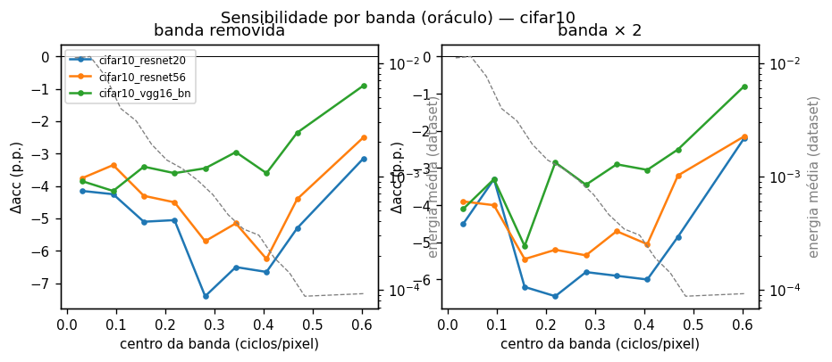

---

## 8. Domain shift × perda de informação (E4, H4)

Mesmo extrator pré-treinado; muda só o quanto o modelo pode se adaptar às imagens processadas. Média dos 3 modelos, 5000 imagens de treino ([adaptation_summary.csv](docs/resultados/adaptation_summary.csv)).

| Condição | Congelado | Re-estimar BatchNorm | BN nas originais (controle) | Sonda orig → proc | Sonda proc → proc | Sonda orig → orig (teto) |
|---|---|---|---|---|---|---|
| Gaussiano σ = 1 | 39,6 % | **83,0 %** | 91,1 % | 40,2 % | 64,3 % | 93,7 % |
| Wiener k = 5 | 72,7 % | 82,2 % | 91,1 % | 73,0 % | 79,2 % | 93,7 % |
| Mediana k = 3 | 79,1 % | 81,7 % | 91,1 % | 79,3 % | 83,0 % | 93,7 % |
| Laplaciano c = 0,5 | 84,9 % | 89,3 % | 91,1 % | 84,9 % | 87,0 % | 93,7 % |
| JPEG qualidade 70 | 81,7 % | 79,2 % | 91,1 % | 81,6 % | 83,1 % | 93,7 % |
| JPEG qualidade 30 | 66,8 % | 66,7 % | 91,1 % | 67,2 % | 71,9 % | 93,7 % |
| Bilateral σ_s = 2 | 89,6 % | 89,2 % | 91,1 % | 89,6 % | 90,2 % | 93,7 % |
| *Unsharp* amount = 1 | 90,8 % | 89,9 % | 91,1 % | 90,5 % | 91,2 % | 93,7 % |
| CLAHE clip = 2 | 91,5 % | 89,1 % | 91,1 % | 91,3 % | 91,3 % | 93,7 % |

**H4 confirmada em parte.**
- **Suavização é sobretudo domain shift.** Só re-estimar as estatísticas do BatchNorm, sem mexer em nenhum peso, leva o blur σ = 1 de 39,6 % para 83,0 %, perto do controle de 91,1 %. A informação discriminativa continua na imagem; o modelo é que não estava calibrado para ela.
- **JPEG forte é perda estrutural.** O BN não recupera nada (66,8 % → 66,7 %) e a sonda re-treinada pouco.
- **Aguçamento e CLAHE em doses moderadas** custam pouco e já estão perto do controle. O espaço para recuperar é pequeno.

As sondas lineares (64–512 features) recuperam menos que o ajuste do BN nas CNNs de CIFAR.

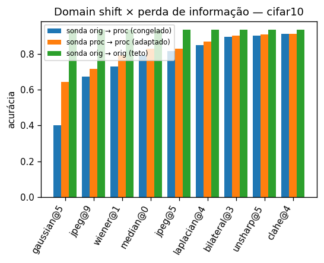

### Fine-tuning completo

Mesmas 9 condições, modelo inteiro re-treinado por 3 épocas (SGD, lr 0,001) nas 5000 imagens de treino processadas. Controle: o mesmo fine-tuning nas originais (92,8 %; a acurácia original é 93,8 %). Média dos 3 modelos ([adaptation_finetune_cifar10.csv](docs/resultados/adaptation_finetune_cifar10.csv)).

| Condição | Congelado | BN-adapt | Fine-tuning | Perda que sobra | Recuperado pelo fine-tuning |
|---|---|---|---|---|---|
| Laplaciano c = 0,5 | 84,9 % | 89,3 % | **92,8 %** | 0,1 p.p. | 99 % |
| *Unsharp* amount = 1 | 90,8 % | 89,9 % | **92,6 %** | 0,2 p.p. | 92 % |
| Gaussiano σ = 1 | 39,6 % | 83,0 % | **88,2 %** | 4,6 p.p. | 91 % |
| Wiener k = 5 | 72,7 % | 82,2 % | 86,6 % | 6,2 p.p. | 69 % |
| Mediana k = 3 | 79,1 % | 81,7 % | 85,9 % | 6,9 p.p. | 50 % |
| JPEG qualidade 30 | 66,8 % | 66,7 % | 79,5 % | **13,3 p.p.** | 49 % |
| JPEG qualidade 70 | 81,7 % | 79,2 % | 85,9 % | 6,9 p.p. | 38 % |
| Bilateral σ_s = 2 | 89,6 % | 89,2 % | 90,6 % | 2,2 p.p. | 33 % |
| CLAHE clip = 2 | 91,5 % | 89,1 % | 91,5 % | 1,3 p.p. | (queda pequena demais) |

*Recuperado = (fine-tuning − congelado) / (controle − congelado). Instável quando a queda é pequena (CLAHE, bilateral).*

- **No aguçamento, a queda é quase toda domain shift**: re-treinado, o modelo volta ao nível do controle.
- **No gaussiano σ = 1, também** (39,6 % → 88,2 %), o que confirma e reforça o resultado do BN-adapt.
- **No JPEG e na mediana sobra perda real**: mesmo re-treinando, ficam 7–13 p.p. abaixo. No JPEG, onde o BN não recuperava nada, o fine-tuning recupera cerca de metade: há também um componente de shift que a re-estimação do BN não alcança.
- **A sonda linear subestima o quanto é recuperável.** O `recoverable_frac` fica entre 0,1 e 0,44 mesmo onde o fine-tuning recupera > 90 %. A sonda mede a informação que sobra nas *features congeladas*, não na imagem.
- O padrão se repete nos 3 modelos. Limitações: um único seed e 3 épocas.

---

## 9. Validação perceptual: BRISQUE e estudo com pessoas

### BRISQUE

O BRISQUE (via `piq`, CPU, menor = melhor) foi calculado para todas as 2000 imagens em todas as 106 condições, com as imagens ampliadas para 128 px.

Checagem de sanidade antes do uso (300 imagens):
- **em 32 px nativo é instável**: σ = 2 não sai pior que σ = 1;
- **ampliado para 128 px**, piora em 100 % das imagens com blur σ = 1 ou σ = 2 (e piora mais com σ = 2) e em 97 % com JPEG qualidade 10. Melhora com *unsharp* e CLAHE.
- Limitação: ampliado, não detecta ruído aditivo, que não é uma das técnicas do estudo.

| Técnica | BRISQUE melhora ≥ 5 % em | BMD do classificador (1 p.p.) | Janela pelo BRISQUE? |
|---|---|---|---|
| *Unsharp* | amount ≈ 0,58 | 0,45–0,56 | ❌ (melhora só depois do limiar) |
| Laplaciano | c ≈ 0,095 | 0,09–0,13 (BMDL 0,05–0,08) | ❌ (no limite) |
| Equalização | α ≈ 0,67 | 0,19–0,20 | ❌ |
| CLAHE (clip) | clip ≈ 3,6 | < 1 | ❌ |
| CLAHE misturado | nunca chega a 5 % (melhor: −3,7 % em α = 1) | 0,42–0,62 | ❌ |
| Gaussiano | nunca melhora; **piora 5 % em σ ≈ 0,44** | 0,43–0,45 | ❌ |

*(BRISQUE resumido pela variação da média; ver a correção na §10.3. No CIFAR os números mudam na segunda casa decimal.)*
| Mediana, Wiener, bilateral, JPEG, SR | nunca melhora | — | ❌ |

**Resultado central.** Medida por uma métrica perceptual independente, **a melhora visual só chega depois que o classificador já perdeu ≥ 1 p.p., ou exatamente no limite**. Em nenhuma técnica o BRISQUE melhora antes do BMDL. Na suavização, o BRISQUE e o classificador "quebram" quase no mesmo ponto (σ ≈ 0,43–0,44).

Há duas leituras complementares:
- as janelas do §3 dependem do critério de "objetivo visual" (proxies como nitidez e ruído);
- por um critério perceptual geral, **não há dose de aprimoramento que seja grátis para o classificador** em imagens limpas de 32 px. Isso confirma a pergunta de pesquisa.

**Em 224 px esse resultado se inverte para o aguçamento** ([§10.3](#103-brisque-em-224-px)): o BRISQUE melhora logo na primeira dose, muito antes do limiar do classificador.

### Estudo com pessoas

O kit está pronto em `results/sweep/human_study/` (gerado por `make human-export`):
- 12 imagens × 74 condições + pares de atenção = **900 pares**;
- `index.html` roda localmente (4 MB), cada participante responde ~120 pares e o navegador baixa um CSV.

**Ainda não há respostas.** Para ±10 p.p. de precisão por dose, são necessários ~35 participantes; com `--technique` dá para focar numa técnica e precisar de menos gente. Depois de coletar os CSVs em `human_study/respostas/`, rode `make human-analyze`. O código da análise foi testado com participantes simulados, incluindo a exclusão de quem falha nos pares de atenção.

---

## 10. Imagenette (224 px) e ViT: o que muda

Mesma varredura do `sweep.yaml` (106 doses + 25 filtros-oráculo), em 2000 imagens de validação do Imagenette, com ResNet-50, EfficientNet-B0 e ViT-B/16 (pesos oficiais do torchvision, `model.eval()`). A acurácia é top-1 entre as **1000 classes** do ImageNet: 83,9 % (ResNet-50), 84,3 % (EfficientNet-B0) e **90,9 %** (ViT-B/16). Tabelas em `docs/resultados/*_imagenette.csv`; relatório completo em `results/sweep_imagenette/analysis/summary.md`.

Nas tabelas abaixo, a ordem dos modelos é **EffNet / R50 / ViT**.

### 10.1 Banda crítica (H3)

Oráculo: remover (ganho 0) ou dobrar (ganho 2) um anel por vez ([band_sensitivity_imagenette.csv](docs/resultados/band_sensitivity_imagenette.csv)).

| Centro do anel (ciclos/pixel) | Remover: Imagenette | Remover: CIFAR (R20 / R56 / VGG) | Dobrar: Imagenette |
|---|---|---|---|
| 0,03 | **−68,3 / −68,3 / −76,8** | −4,1 / −3,7 / −3,8 | −8,8 / −12,3 / −5,3 |
| 0,09 | −28,9 / −22,1 / **−9,7** | — | −11,9 / −9,9 / −5,3 |
| 0,16 | −15,5 / −11,0 / **−2,6** | −5,1 / −4,3 / −3,4 | −13,7 / −4,9 / −6,7 |
| 0,28 | −6,7 / −4,2 / −3,4 | **−7,4 / −5,7** / −3,4 | −3,7 / −1,2 / −1,2 |
| 0,41 | −1,9 / −1,0 / −0,5 | −6,6 / **−6,2** / −3,6 | 0,0 / +1,2 / +0,8 |
| 0,60 (cantos) | +0,4 / +0,2 / −0,1 | −3,1 / −2,5 / −0,9 | +0,8 / +1,1 / 0,0 |

- **H3 confirmada: a banda crítica depende da resolução e da arquitetura.** Em 224 px quase toda a informação útil está abaixo de 0,1 ciclo/pixel. A faixa de 0,375–0,44 ciclo/pixel, crítica para as ResNets no CIFAR (−6 a −7 p.p.), custa no máximo 1,9 p.p.
- **O ViT depende quase só da banda mais baixa.** Removendo 0,06–0,19 ciclo/pixel, ele perde 3–10 p.p.; as CNNs perdem 11–29 p.p.
- *Hipótese a testar:* em **ciclos por imagem**, o pico do CIFAR (0,28–0,41 ciclo/pixel ≈ 9–14 ciclos/imagem) cai dentro da banda mais crítica do Imagenette (0–0,06 ciclo/pixel ≈ 0–14 ciclos/imagem). A escala crítica pode ser relativa ao objeto, não ao pixel. Para testar, é preciso um oráculo com anéis mais finos na faixa baixa.
- **A transferência oráculo → técnicas reais não se sustenta em 224 px** ([oracle_transfer_imagenette.csv](docs/resultados/oracle_transfer_imagenette.csv)). Com ΔE por banda + coerência, o R² é 0,20 / 0,69 / −2,19 (no CIFAR, 0,76–0,81). A ordem das técnicas se mantém em parte (Spearman 0,80 / 0,80 / 0,63), mas a escala não. Leitura provável: o oráculo em 224 px é dominado pela remoção catastrófica da banda mais baixa (−70 p.p.), longe do regime de dano pequeno das técnicas reais.

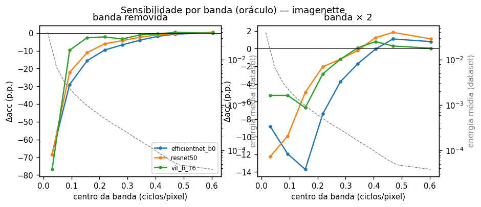

### 10.2 Hormese e janela operacional (H1, H6)

Tabela completa: [thresholds_imagenette.csv](docs/resultados/thresholds_imagenette.csv). Mesmas definições da §3.

| Técnica (parâmetro) | BMD 1 p.p. | BMDL | Objetivo visual | Janela operacional | Melhor ganho (dose) | CIFAR (BMD 1 p.p.) |
|---|---|---|---|---|---|---|
| Laplaciano (c) | 0,63–1,47 | 0,43–1,16 | 0,10 | ✅ **[0,10; 0,43–1,16]** nos 3 | **+1,2 / +2,8 / +0,7 p.p.** (c 0,2–0,3), significativo nos 3 | 0,09–0,13, sem janela |
| *Unsharp* (amount) | 1,55–2,64 | 1,11–2,26 | 0,28 | ✅ **[0,28; 1,1–2,3]** nos 3 | +0,1 / **+2,0** / +0,5 p.p. (0,2–0,75), significativo em R50 e ViT | 0,45–0,56, janela [0,26; 0,28–0,37] |
| Gaussiano (σ) | 0,38–0,47 | 0,34–0,43 | 0,35 | ✅ em EffNet e ViT ([0,35; 0,42–0,43]); ❌ R50 | — | 0,43–0,45: **quase igual em pixels** |
| Equalização (α) | 0,46–0,70 | 0,20–0,40 | 0,34 | só no ViT ([0,34; 0,40]) | — | 0,19–0,20 |
| CLAHE (clip) | 1,0–1,7 (a R50 já perde no clip 1) | 1,0–1,2 | 2,25 | ❌ | nenhum (o CLAHE só piora) | < 1 |
| CLAHE misturado (α, clip 2) | 0,48–0,90 | 0,33–0,61 | não atinge +10 % de contraste | ❌ | — | 0,42–0,62 |
| Bilateral (σ_s) | 0,77–1,19 | 0,68–0,91 | 1,0 | ❌ | — | 0,88–1,11 |
| Mediana / Wiener (k) | k = 3 já passa: −5,8 / −6,8 / −3,4 e −4,1 / −4,5 / −2,6 p.p. | — | k = 3 | ❌ | — | k = 3 já custa 12–18 p.p. |
| JPEG 4:2:0 (qualidade) | ≈ 91 / **já na 100** (−1,5 p.p.) / ≈ 93 | — | — | — | — | 97,6–100 |
| JPEG 4:4:4 (qualidade) | ≈ 88 / 74 / 74 | — | — | — | — | 95,2–95,9 |
| SR bicúbica (escala) | ≈ 1,03–1,05 (1,05 já custa 1,0 / 1,7 / 1,8 p.p.) | — | — | — | — | < 1,05 |

- **Há hormese em 224 px, no aguçamento.** O laplaciano leve melhora a acurácia com significância nos 3 modelos (até +2,8 p.p. na ResNet-50), e o *unsharp* em 2 de 3. No CIFAR, nenhuma técnica melhorou.
- **O CLAHE não mostrou hormese**, ao contrário do que a literatura sugeria (Hendrycks & Dietterich [b6]). Ele só piora, e a ResNet-50 já perde 1,3 p.p. no clip 1.
- **H6 em 224 px:** a janela operacional é **larga** para o aguçamento (o objetivo visual chega com amount 0,28 e o dano só depois de 1,1–2,3) e estreita ou ausente para o resto. Gaussiano, CLAHE, bilateral, mediana e Wiener se comportam como no CIFAR.
- **O efeito da cor no JPEG se repete só na ResNet-50**: 4:2:0 em qualidade 100 custa 1,5 p.p.; 4:4:4, +0,1. EfficientNet e ViT não reagem à subamostragem de croma.
- No geral, os modelos de 224 px toleram doses bem maiores de aguçamento, equalização e JPEG. Na suavização gaussiana, o limiar em σ (pixels) é quase o mesmo nas duas resoluções.

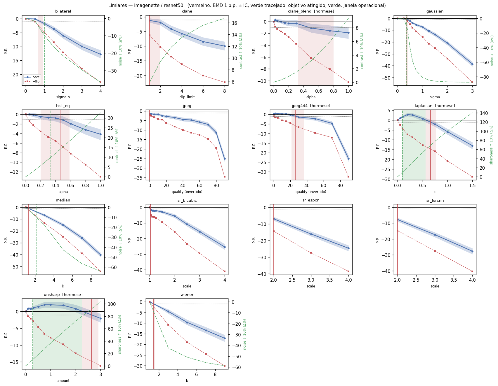
*Os outros modelos: [EfficientNet-B0](docs/resultados/thresholds_imagenette_efficientnet_b0.png), [ViT-B/16](docs/resultados/thresholds_imagenette_vit_b_16.png). Dose-resposta: [dose_response_imagenette.png](docs/resultados/dose_response_imagenette.png).*

### 10.3 BRISQUE em 224 px

Em 224 px o BRISQUE roda na resolução nativa (sem ampliar).

> **Correção (nov/2026).** A primeira versão desta tabela resumia o BRISQUE pela *média das variações relativas por imagem*, (q − q₀)/|q₀|. No Imagenette, ~10 % das imagens originais têm BRISQUE < 5 e ~3 % < 0. Nelas essa razão explode e domina a média: no laplaciano leve, a média das razões dizia "+43 % (pior)" e a mediana, "−18 % (melhor)". O resumo correto é a **variação da média**, mean(q)/mean(q₀) − 1, calculada com o BRISQUE das 2000 imagens originais. Ele já é usado pelo código ([brisque_fix.py](src/pdi_spectral/brisque_fix.py)), e a tabela abaixo foi refeita com ele. Nada mudou nos limiares de acurácia, e o CIFAR praticamente não mudou (BRISQUE médio ≈ 60, longe de zero). A versão antiga fica em `thresholds_brisque_media_das_razoes.csv`.

| Técnica | BRISQUE melhora ≥ 5 % em | BRISQUE piora ≥ 5 % em | Melhor variação | Classificador (BMD 1 p.p.) | Janela pelo BRISQUE? |
|---|---|---|---|---|---|
| *Unsharp* | amount ≈ 0,08 | amount ≈ 1,7 | −17 % | 1,55–2,64 | ✅ nos 3 |
| Laplaciano | c ≈ 0,05 | c ≈ 0,30 | −8 % | 0,63–1,47 | ✅ nos 3 |
| CLAHE | clip 1 (a menor dose) | clip ≈ 3,8 | −5 % | 1,0–1,7 (a R50 já perde no clip 1) | no limite |
| CLAHE misturado | nunca chega a 5 % | nunca | −4,6 % | 0,48–0,90 | ❌ |
| Equalização | nunca | nunca | −1,9 % | 0,46–0,70 | ❌ (neutra) |
| Gaussiano | nunca | **σ ≈ 0,37** | 0 | 0,38–0,47 | ❌ |
| Bilateral, mediana, Wiener, SR | nunca | já nas primeiras doses | 0 | — | ❌ |
| JPEG 4:2:0 / 4:4:4 | nunca | qualidade ≈ 76 | −4 % | — | — |

- **O "resultado central" da §9 não vale em 224 px para o aguçamento.** Pela métrica perceptual independente, a imagem melhora logo nas primeiras doses (amount ≈ 0,08, c ≈ 0,05), muito antes do limiar do classificador. Em imagens limpas de 224 px, **há dose de aguçamento que é grátis**, e até benéfica (§10.2). O ganho perceptual tem teto: o BRISQUE volta a piorar a partir de amount ≈ 1,7 e c ≈ 0,30.
- Na suavização, em 224 px o BRISQUE "percebe" o blur **um pouco antes** do classificador (σ ≈ 0,37 × 0,38–0,47). No CIFAR, os dois quebravam juntos (0,44).
- Em 224 px o BRISQUE é **neutro para a equalização global** e melhora um pouco com o CLAHE fraco (−5 % no clip 1). A versão anterior desta seção dizia que ele "piorava" com HE e CLAHE; isso era efeito da média das razões.

### 10.4 CNN × ViT

Δacc (p.p.) em doses iguais:

| Condição | EffNet | R50 | ViT |
|---|---|---|---|
| Gaussiano σ = 1 | −7,3 | −7,4 | **−5,6** |
| Gaussiano σ = 2 | −24,1 | −21,1 | **−13,6** |
| Bilateral σ_s = 4 | −13,5 | −12,8 | **−6,6** |
| Mediana k = 5 | −13,7 | −15,0 | **−9,1** |
| Wiener k = 5 | −8,0 | −9,7 | **−4,5** |
| JPEG qualidade 10 | −19,6 | −25,1 | **−17,5** |
| CLAHE clip 4 | −6,1 | −5,7 | **−4,0** |
| *Unsharp* amount 3 | **−1,6** | −2,1 | −3,4 |
| Laplaciano c = 1,5 | **−1,1** | −13,0 | −6,0 |

- **O ViT é bem mais robusto a técnicas que removem frequência** (até 2× menos dano), coerente com o perfil do oráculo (§10.1): ele depende pouco das bandas médias.
- **No aguçamento forte não é o mais robusto**: perde para a EfficientNet. Somar alta frequência afeta o ViT mais que removê-la.
- O dano entre as duas CNNs é parecido na suavização, mas muito diferente no laplaciano forte (−1,1 × −13,0 p.p.).

### 10.5 Super-resolução

| Escala | Bicúbica | ESPCN | FSRCNN |
|---|---|---|---|
| ×2 | −7,4 / −5,6 / −5,9 | −7,3 / −7,0 / −5,4 | −7,0 / −7,8 / −4,8 |
| ×3 | −15,7 / −15,5 / −10,8 | −15,3 / −16,1 / −10,6 | −14,3 / −17,3 / −9,8 |
| ×4 | −25,7 / −25,3 / −17,8 | −23,9 / −24,7 / −18,1 | −23,1 / −27,7 / −19,1 |

**A vantagem da SR aprendida sobre a bicúbica não se repete em 224 px.** Na mesma escala, ESPCN e FSRCNN ficam a ±2 p.p. da bicúbica, com sinal misto (no CIFAR recuperavam 3–11 p.p.). A partir de ×3, o ViT é o mais robusto à redução de resolução.

### 10.6 Previsibilidade (H2, H5, H7)

| Preditor | R² LOTO Imagenette (EffNet / R50 / ViT) | Média CIFAR |
|---|---|---|
| parâmetro nominal (`dose_rank`) | 0,26 / 0,28 / 0,29 | 0,21 |
| PSNR | 0,05 / 0,06 / 0,06 | 0,06 |
| SSIM | 0,40 / 0,46 / 0,44 | 0,56 |
| energia da perturbação por banda | 0,55 / 0,30 / 0,58 | 0,49 |
| ΔE por banda | 0,61 / 0,31 / 0,54 | 0,69 |
| ΔE por banda + coerência | 0,74 / 0,80 / 0,76 | 0,78 |
| ΔE por banda + coerência + cor | **0,87 / 0,86 / 0,94** | 0,81 |
| ΔE em 16 anéis finos | −2,6 / −10,8 / −6,3 | 0,61 |

- **H2 e H5 se repetem.** O ΔE medido supera o parâmetro nominal e as métricas de pixel. Em 224 px, a coerência e a cor pesam ainda mais: só com ΔE por banda o R² é menor que no CIFAR, mas com coerência e cor ele é maior.
- Os 16 anéis finos sofrem *overfitting* em 224 px (34 features para 106 condições). As 3 bandas agregadas são o nível certo de detalhe.
- **Por imagem**, a AUC do *flip* sobe de 0,70 (ΔE por banda) para 0,76–0,77 com a coerência (no CIFAR, 0,77 → 0,84–0,86).
- **H7: o IRE se repete** em validação LOTO: R² 0,85 / 0,92 / 0,85 e Spearman 0,94–0,97 (no CIFAR, 0,86–0,87). **Calibrado só no oráculo, falha** em 224 px: R² −1,7 / −0,5 / −1,0, embora o Spearman fique em 0,87–0,93 (no CIFAR, 0,76–0,81). Em 224 px a fórmula precisa ser calibrada com técnicas reais.

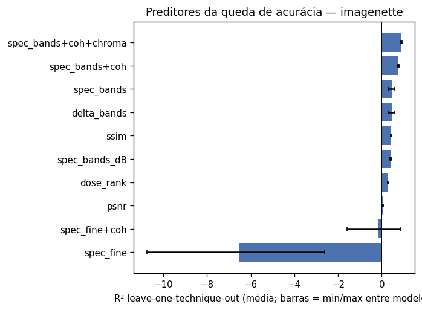

### 10.7 Domain shift × perda de informação (H4)

**Primeira rodada: saturou.** Com as condições do `sweep.yaml`, toda a adaptação foi medida entre as 10 classes do Imagenette, o único problema em que sondas e fine-tuning podem ser treinados. Ele é fácil demais: 99,8 % nas originais e 98,8–99,7 % em todas as condições, sem espaço para medir recuperação ([adaptation_summary_imagenette_saturado.csv](docs/resultados/adaptation_summary_imagenette_saturado.csv)).

**Segunda rodada** ([configs/e4_imagenette.yaml](configs/e4_imagenette.yaml), [adaptation_summary_imagenette.csv](docs/resultados/adaptation_summary_imagenette.csv)): 13 condições com doses fortes, fine-tuning de 3 épocas em 2000 imagens de treino e, para o congelado e o BN-adapt, acurácia também nas **1000 classes**.

**Sondas e fine-tuning (10 classes).** Média dos 3 modelos. Só entram as condições em que a queda congelada é ≥ 3 p.p. Nas outras, o problema de 10 classes continua saturado (gaussiano σ = 1, bilateral, CLAHE, HE e *unsharp* caem < 1,1 p.p.).

| Condição | Congelado | Fine-tuning | Controle (fine-tuning nas originais) | Perda que sobra | Recuperado pelo fine-tuning (EffNet / R50 / ViT) |
|---|---|---|---|---|---|
| Gaussiano σ = 3 | 90,7 % | 96,6 % | 99,5 % | 2,9 p.p. | 0,66 / 0,71 / 0,60 |
| Mediana k = 9 | 92,7 % | 97,3 % | 99,5 % | 2,2 p.p. | 0,53 / 0,75 / — |
| Mediana k = 7 | 95,8 % | 98,2 % | 99,5 % | 1,3 p.p. | 0,49 / 0,73 / — |
| SR bicúbica ×4 | 95,7 % | 97,5 % | 99,5 % | 2,0 p.p. | 0,32 / 0,50 / — |
| ESPCN ×4 | 96,0 % | 97,3 % | 99,5 % | 2,3 p.p. | 0,08 / 0,54 / — |
| JPEG qualidade 10 | 96,7 % | 98,1 % | 99,5 % | 1,5 p.p. | 0,28 / 0,64 / — |
| Laplaciano c = 1,5 (só R50 cai ≥ 3 p.p.) | 95,2 % (R50) | 99,2 % (R50) | 99,4 % (R50) | 0,2 p.p. | — / **0,98** / — |

*"—" = queda < 3 p.p. naquele modelo (o ViT só cai ≥ 3 p.p. no σ = 3).*

**BN-adapt (1000 classes, só CNNs; o ViT não tem BatchNorm).** Aqui o controle importa: re-estimar o BN nas *originais* já derruba a acurácia de 84,3 → 74,8 % (EffNet) e 83,9 → 78,0 % (R50), porque as estatísticas vêm de só 10 classes. A fração recuperada compara a queda congelada com a queda depois do BN, medida em relação a esse controle.

| Condição | Queda congelada (EffNet / R50) | Recuperado pelo BN (EffNet / R50) |
|---|---|---|
| Gaussiano σ = 1 | 7,3 / 7,4 p.p. | 0,22 / 0,41 |
| Gaussiano σ = 3 | 42,1 / 38,6 | −0,05 / 0,04 |
| Mediana k = 9 | 32,3 / 40,2 | 0,12 / 0,31 |
| Bilateral σ_s = 4 | 13,5 / 12,8 | 0,27 / 0,32 |
| CLAHE clip 8 | 10,7 / 10,0 | 0,06 / 0,25 |
| JPEG qualidade 10 | 19,6 / 25,1 | −0,52 / −0,05 (piora) |
| SR bicúbica ×4 / ESPCN ×4 | 25,7 / 25,3 e 24,0 / 24,7 | ≤ 0,02 (nada ou piora) |
| Laplaciano c = 1,5 | 1,1 / **13,0** | — / **0,83** |

O que se conclui:
- **H4 se mantém em 224 px nas pontas.** O aguçamento é domain shift: na ResNet-50, onde o laplaciano forte custa 13 p.p., o BN recupera 83 % e o fine-tuning 98 %. JPEG forte, SR ×4, mediana e blur forte deixam **perda real**: mesmo re-treinando, sobram 1,5–2,9 p.p. num problema de 10 classes em que o controle está em 99,5 %.
- **Em 224 px, o BN-adapt deixa de ser a alavanca principal.** No CIFAR, só re-estimar o BN recuperava ~84 % da queda do blur σ = 1. No Imagenette recupera 22–41 % (σ = 1) e nada no blur forte, no JPEG e na SR. Parte disso pode vir de as estatísticas serem estimadas com só 10 classes (o controle já perde 6–10 p.p.).
- **No JPEG, de novo, o BN não ajuda e o fine-tuning ajuda em parte** (28–64 %), como no CIFAR: há um componente de shift que a re-estimação de primeira e segunda ordem não alcança.
- **O ViT quase não cai entre as 10 classes** (só σ = 3 passa de 3 p.p.), coerente com a robustez maior da §10.4. Nas 1000 classes, ele perde de 2 p.p. (HE) a 26 p.p. (σ = 3) nessas condições.
- **Ao contrário do CIFAR, a sonda linear e o fine-tuning ficam na mesma faixa** (0,3–0,7) na maioria das condições. As exceções são o JPEG na R50 (sonda 0,03 × fine-tuning 0,64) e a ESPCN na EffNet (0,49 × 0,08).
- Limitações: um seed; o problema de 10 classes ainda satura nas doses moderadas; o controle do BN é afetado pelas 10 classes.

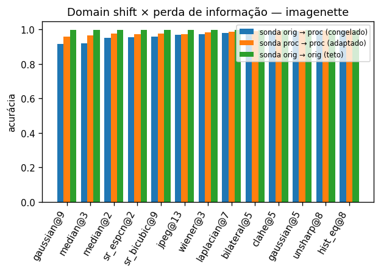

---

## 11. O que ainda não foi feito

| Item | Por quê | Como fazer |
|---|---|---|
| E4 no ImageNet com 1000 classes | no Imagenette as doses moderadas ainda saturam perto de 99 % (§0.5) | fine-tuning com um subconjunto de treino do ImageNet |
| Coleta do estudo com pessoas | depende de participantes | `make human-export` → enviar → `make human-analyze` |
| Oráculo com anéis finos na faixa baixa | testar se a banda crítica é fixa em ciclos/imagem (§10.1) | aumentar `oracle.n_bins` ou usar bandas em escala log |
| Fórmula IRE nas técnicas de equalização (superestima ~2×; a correção global testada não serviu) | ver §6 | curva tonal por bloco; resíduo tonal junto às features atuais |
| Sementes no ImageNet-val | a rodada final usa as 50 mil imagens uma vez | dividir em subconjuntos e repetir o E4 |
| Domínio médico | o pré-processamento é rotina em imagens médicas | dataset com rótulo clínico + mesma bateria |
| E5: entradas realmente degradadas (CIFAR-10-C) | QP4; o download existe, mas falta o código que usa os dados | implementar o loader e o experimento |
| Métodos e Resultados no artigo LaTeX | — | a partir deste arquivo |

---

## 12. Como reproduzir

```bash
make setup && make download-sr && make download-cifar   # ambiente e dados
make test && make verify                               # E0
make sweep                                             # E1 + E2 + E4 + E3 no CIFAR-10 (~1h40 em CPU)
CONFIG=configs/finetune_cifar.yaml bash scripts/run_experiments.sh adapt   # E4 com fine-tuning (~2h em CPU)
make safe-dose T=gaussian M=cifar10_resnet20           # dose segura pela fórmula, sem rede
make human-export                                      # kit do estudo com pessoas

# Imagenette (GPU)
make download-imagenette
CONFIG=configs/sweep.yaml DATASETS=imagenette \
  EXTRA="--set run_name=sweep_imagenette --set device=cuda --set batch_size=128" \
  bash scripts/run_experiments.sh oracle main adapt analyze examples
```

Rodada final: `setsid nohup bash scripts/run_publicacao.sh &` (retomável; progresso com `bash scripts/status_publicacao.sh`), depois `python scripts/figuras_publicacao.py`, `python scripts/ire_transfer.py` (~25 min em CPU) e `make report` (figuras do README e dados do site).

Relatórios automáticos completos, com todas as tabelas: `results/sweep/analysis/summary.md` (CIFAR-10) e `results/sweep_imagenette/analysis/summary.md` (Imagenette).
